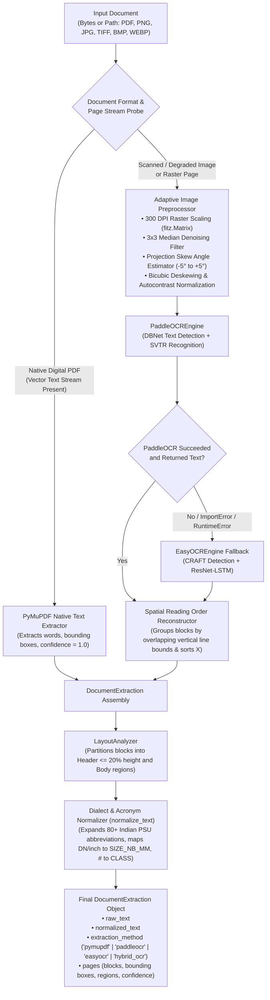

# OCR Subsystem: Dual-Path Document Extraction & Normalization

The `OCR` module provides end-to-end document text extraction, raster image preprocessing, spatial layout analysis, and procurement shorthand normalization. It is engineered specifically for non-standardized Material Test Certificates (MTCs), supplier inspection release notes, purchase orders, and technical datasheets in both native digital vector format and degraded scanned physical sheets.

---

## Architecture Overview



---

## File Breakdown & Responsibilities

### 1. `pipeline.py` (Orchestration & Dual-Path Routing)
- **`extract_document(source: bytes | str | Path, filename: str | None = None) -> DocumentExtraction`**: Primary public API. Accepts raw file bytes or filesystem paths for `.pdf`, `.png`, `.jpg`, `.jpeg`, `.tiff`, `.bmp`, and `.webp`.
- **`DocumentExtraction` Dataclass**:
  - `raw_text`: Complete raw text stitched across all pages.
  - `normalized_text`: Preprocessed text with standard engineering aliases expanded.
  - `extraction_method`: Method used across pages (`pymupdf`, `paddleocr`, `easyocr`, or `hybrid_ocr`).
  - `source_type`: Either `pdf` or `image`.
  - `pages`: List of per-page dictionaries containing text, bounding box coordinates, image dimensions, extraction engine, and layout regions.
  - `confidence`: Calculated aggregate mean confidence across all detected text blocks.
- **`_image_from_page(page)`**: Converts PDF pages into 300 DPI RGB NumPy arrays (`RASTER_DPI = 300`).
- **`_estimate_skew(image)`**: Estimates document rotation angle between $-5.0^\circ$ and $+5.0^\circ$ by rotating thumbnail grayscale slices and maximizing ink row variance.
- **`_preprocess_image(image)`**: Applies a 3-pixel median filter, rotates by the estimated skew angle with white fill, and performs contrast maximization via `ImageOps.autocontrast`.

### 2. `engine.py` (OCR Adapters & Reading Order Reconstruction)
- **`_reading_order(blocks)`**: Reconstructs human reading order from 2D coordinates. Groups bounding boxes into horizontal lines when vertical overlap $\ge 50\%$, sorts rows top-to-bottom by median Y, and orders words within each row left-to-right by X coordinate.
- **`PaddleOCREngine`**: Adapter wrapping PaddleOCR (v2/v3). Disables MKLDNN threading hazards (`FLAGS_use_mkldnn=0`), enables textline orientation classification, and filters low-confidence detections ($< 0.40$).
- **`EasyOCREngine`**: Fallback reader using EasyOCR on CPU with English language models.
- **`FallbackOCREngine`**: Resilient fault-tolerant coordinator. Attempts `PaddleOCREngine` first; if unreadable, missing weights, or crashed, seamlessly cascades to `EasyOCREngine`.

### 3. `normalization.py` (Dialect Canonicalization & Thesaurus)
- **`DIALECT_THESAURUS`**: 80+ procurement and engineering mappings:
  - Component types: `FLG` $\rightarrow$ `FLANGE`, `BL FLG` $\rightarrow$ `BLIND FLANGE`, `WNRF` $\rightarrow$ `WELD NECK RAISED FACE`, `GV`/`GT VLV` $\rightarrow$ `GATE VALVE`, `BV` $\rightarrow$ `BALL VALVE`.
  - Metallurgy: `CS` $\rightarrow$ `CARBON STEEL`, `MS` $\rightarrow$ `MILD STEEL`, `SS` $\rightarrow$ `STAINLESS STEEL`.
  - Organizations & Standards: `IOCL`, `ONGC`, `BPCL`, `HPCL`, `EIL`, `OISD`, `BIS`, `MESC`, `NACE`.
- **`normalize_text(text: str) -> str`**:
  - Replaces mathematical unicode multiplication signs (`×` $\rightarrow$ `x`, double quotes `″` $\rightarrow$ `"`).
  - Normalizes metric sizes: `DN 100` and `100 mm` $\rightarrow$ `SIZE_NB_MM=100`.
  - Normalizes imperial sizes: `4 in` / `4 inch` $\rightarrow$ `SIZE_IN=4`.
  - Normalizes pressure classes: `300#`, `#300`, `CLASS 300` $\rightarrow$ `CLASS=300`.
  - Replaces all known acronyms in descending length order to avoid substring corruption.

### 4. `layout.py` (Spatial Layout Segmentation)
- **`LayoutRegion`**: Immutable dataclass pairing region names (`header`, `body`) with block indices.
- **`LayoutAnalyzer`**: Heuristic spatial partitioner grouping blocks into `header` (top $20\%$ of page height containing certificate numbers, supplier logo, PO reference) and `body` (lower $80\%$ containing heat numbers, chemical composition tables, and mechanical properties).
- **`LayoutLMv3Analyzer`**: Extensible transformer hook for token-level visual layout models.

### 5. `__init__.py` (Package Interface)
- Re-exports `extract_document` and `DocumentExtraction` for consumption by `backend.app.ingestion`.

---

## Usage Example

```python
from OCR import extract_document

# Ingest an MTC document directly from a path or file bytes
result = extract_document("data/raw/sample_mtc_valve_02.pdf")

print(f"Extraction Method: {result.extraction_method}")
print(f"Confidence Score:  {result.confidence:.2%}")
print(f"Normalized Text:\n{result.normalized_text[:200]}...")
```
