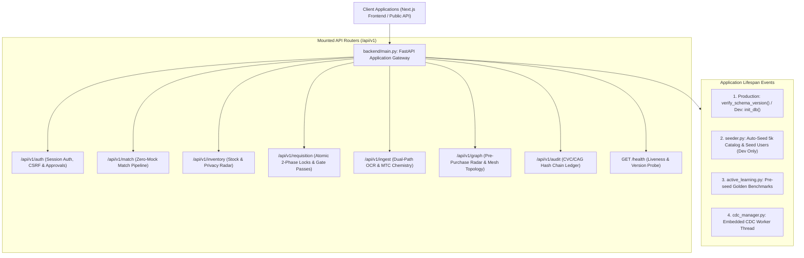

# Backend Application Layer (`backend/`)

## 1. Architectural Role & Overview

The `backend/` directory serves as the root gateway and orchestrator of the **Samanvay-AI** application server.

Built with **FastAPI**, **SQLAlchemy 2.0**, **Alembic**, and **Pydantic v2**, it exposes high-throughput, asynchronous REST endpoints for cross-CPSE spare parts discovery, material test certificate processing, automated safety rule compliance, sovereign cryptographic auditing, zero-trust session authentication, and real-time graph synchronization.



---

## 2. Directory Structure

```
backend/
├── alembic/              # Alembic database migration environment and version revisions
│   ├── versions/         # Baseline schema migration (0001_baseline.py)
│   ├── env.py            # Migration runtime environment connecting to SQLAlchemy metadata
│   └── baseline_schema.py # Canonical baseline table catalog and expected revision head
├── alembic.ini           # Alembic migration configuration file
├── app/                  # Application core, persistence, schemas, and routers
│   ├── api/              # Dependencies, domain routers, and v1 endpoints
│   ├── contracts/        # Decoupled Data Transfer Objects (DTOs)
│   ├── core/             # Configuration, RBAC permissions, CSRF, and security
│   ├── graph/            # Neo4j Bolt driver and Cypher query templates
│   ├── ingestion/        # Document extraction, MTC parsing, and ASTM checks
│   ├── matching/         # ASME tolerance rules and alloy upgrade DAGs
│   ├── models/           # SQLAlchemy ORM declarative table entities, sessions & events
│   ├── schemas/          # Pydantic v2 validation contracts and privacy firewalls
│   ├── services/         # Business logic and domain service implementations
│   ├── config.py         # Application settings provider
│   └── main.py           # Backward-compatible proxy to backend.main:app
├── main.py               # Master FastAPI application entrypoint & lifespan
└── __init__.py           # Package namespace anchor
```

---

## 3. Application Lifecycle Management (`backend/main.py`)

The application utilizes FastAPI's `@asynccontextmanager lifespan` hook to perform critical system initializations on startup and graceful teardown on exit:

1. **Relational Schema Verification**:
   - In production (`APP_ENV=production`): Runs `verify_schema_version()`, validating that the database is migration-managed and matches `0001_baseline`. Fails closed if any baseline tables or versions are missing.
   - In development: Runs `init_db()` for rapid local bootstrapping.
2. **Deterministic Auto-Seeding**:
   - `seed_database_if_empty()`: Populates PostgreSQL with 5,000 authentic CPSE catalog items from `datasets/inventory_catalog.csv` if the table is uninitialized.
   - `seed_users_if_empty()`: In development, ensures that default persona users across OIL, IOCL, ONGC, GAIL, BPCL, HPCL, NRL, and MoPNG exist. Existing accounts are never overwritten, and seeding is skipped entirely in production.
3. **Active Learning Cold-Start**:
   - `seed_from_golden_benchmarks()`: Loads the 150 golden benchmark cases into memory, establishing initial high-confidence decision boundaries before user interaction.
4. **Embedded Change Data Capture**:
   - Starts a background daemon thread running `start_cdc_worker()`, which listens to PostgreSQL transactional triggers on `inventory_items` and `requisitions` and immediately mirrors events to Neo4j.
   - Cleans up and stops the worker thread when the server receives a shutdown signal.

---

## 4. Middleware & Cross-Origin Resource Sharing (CORS)

Configured to support local development and multi-container Docker environments:
- **Configured Allowlist**: Sourced strictly from `settings.allowed_origins_list` (`AUTH_ALLOWED_ORIGINS` environment variable, defaulting to `http://localhost:3000,http://localhost:3001`). Never derived from untrusted `Host` headers.
- **Credentials Support**: `allow_credentials=True` enabled to allow cookie-based session headers (`__Host-samanvay_session`).
- **Surface Gating**: In production deployments, `/docs`, `/redoc`, and `/openapi.json` are automatically disabled.
