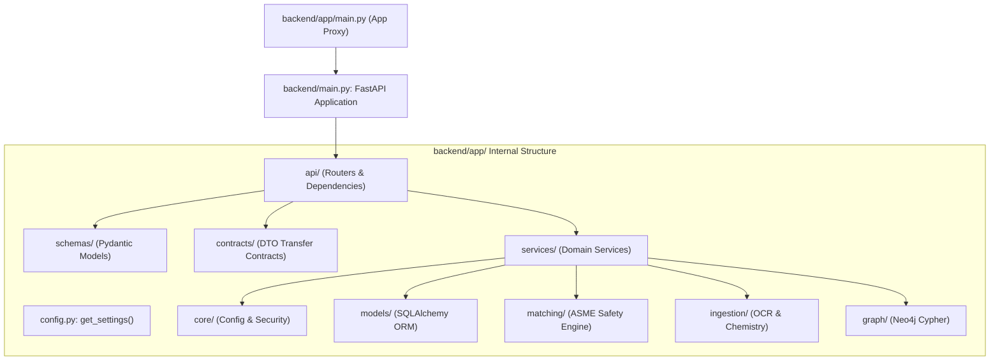

# Application Core Package (`backend/app/`)

## 1. Architectural Role & Overview

The `backend/app/` package contains the internal application framework for **Samanvay-AI**.

It organizes the domain logic into modular subpackages:
- **`core/`**: Platform configuration, cryptographic primitives, and custom exception definitions.
- **`models/`**: SQLAlchemy 2.0 ORM schemas for all 10 relational persistence tables.
- **`schemas/`**: Pydantic v2 data models, validation contracts, and attribute privacy firewalls.
- **`contracts/`**: Decoupled Data Transfer Objects (DTOs) for OCR, MTC parsing, and matching.
- **`services/`**: Business logic engines (matching pipeline, requisition lifecycle, audit hash chaining, CDC manager).
- **`matching/`**: Deterministic ASME and metallurgical tolerance classification.
- **`ingestion/`**: Document intake, OCR routing, and chemical ASTM validation.
- **`graph/`**: Neo4j Bolt client and Cypher query execution.
- **`api/`**: Dependency injection providers and REST API controllers (`/routers` and `/v1`).



---

## 2. Directory Structure & Subsystem Inventory

```
backend/app/
├── api/            # Dependency injection, middleware & REST controllers
│   ├── routers/    # Domain-specific REST routers (/match, /inventory, etc.)
│   └── v1/         # Contract-driven v1 routes & dashboard probes
├── contracts/      # Strongly-typed Data Transfer Objects (DTOs)
├── core/           # Runtime settings, cryptographic hashing, and HTTP exceptions
├── graph/          # Neo4j Bolt connection driver and Cypher queries
├── ingestion/      # Multi-modal OCR routing, MTC parsing, and chemistry checks
├── matching/       # ASME dimensional, pressure, and alloy upgrade rules
├── models/         # SQLAlchemy 2.0 declarative ORM table entities
├── schemas/        # Pydantic v2 request/response validation schemas
├── services/       # Domain business logic (matching, requisitions, CDC, audit)
├── config.py       # LRU-cached environment configuration provider
└── main.py         # App proxy forwarding backend.app.main:app -> backend.main:app
```

---

## 3. Core Files

- [`config.py`](file:///C:/Users/mayank/Development/Hackathons/Samanvay-AI/backend/app/config.py):
  Provides `get_settings()` decorated with `@lru_cache`, returning environment configuration for Qdrant (host, port, local path), Neo4j (URI, credentials), PostgreSQL DSN, and model weights path.
- [`main.py`](file:///C:/Users/mayank/Development/Hackathons/Samanvay-AI/backend/app/main.py):
  Provides backward-compatible entrypoint proxy importing and re-exporting `app` from `backend.main`, enabling both `uvicorn backend.main:app` and `uvicorn backend.app.main:app` execution.
