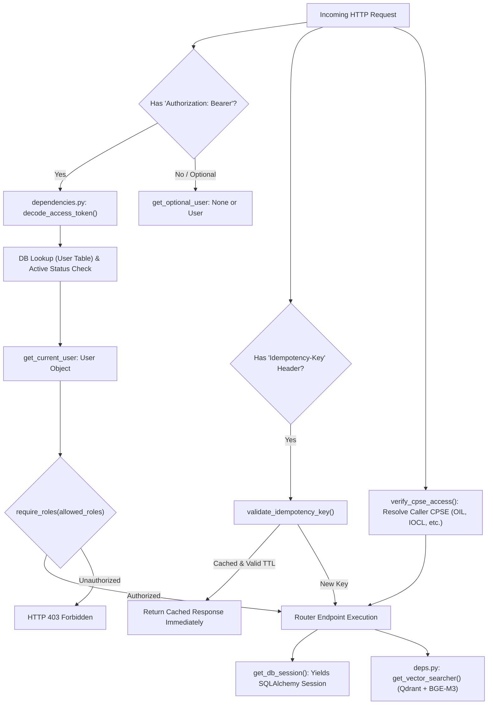

# Dependency Injection & Controller Middleware (`backend/app/api/`)

## 1. Architectural Role & Overview

The `backend/app/api/` package provides reusable **FastAPI dependency injectors**, security middleware, authentication checkers, database session providers, and request validators used across all REST routers.

It guarantees that every incoming HTTP request satisfies prerequisite contracts: valid bearer JWT credentials, role-based authorizations, enterprise tenancy identification, idempotency guarantees, and connection pooling to PostgreSQL and Qdrant.

---

## 2. Module Inventory

| File | Primary Functions & Classes | Responsibility |
| :--- | :--- | :--- |
| [`dependencies.py`](file:///C:/Users/mayank/Development/Hackathons/Samanvay-AI/backend/app/api/dependencies.py) | `get_db_session()`, `get_current_user()`, `get_optional_user()`, `require_roles()`, `validate_idempotency_key()`, `verify_cpse_access()`, `PaginationParams`, `InventoryFilterParams` | Provides core dependency injection: JWT authentication, role-based access control, idempotency cache lookups, CPSE tenant resolution, and query parameters. |
| [`deps.py`](file:///C:/Users/mayank/Development/Hackathons/Samanvay-AI/backend/app/api/deps.py) | `get_vector_searcher()`, `audit_context()` | LRU-cached dependency for the vector search engine (`VectorSearcher`), verifying on-disk model weights and falling back to embedded local Qdrant if the server is offline. |
| [`routers/`](file:///C:/Users/mayank/Development/Hackathons/Samanvay-AI/backend/app/api/routers/README.md) | Subpackage | REST endpoint routers (`match`, `inventory`, `requisition`, `ingest`, `graph`, `audit`, `auth`). |
| [`v1/`](file:///C:/Users/mayank/Development/Hackathons/Samanvay-AI/backend/app/api/v1/README.md) | Subpackage | Contract-driven endpoints, system readiness dashboard (`/summary`), and active learning queues. |
| [`__init__.py`](file:///C:/Users/mayank/Development/Hackathons/Samanvay-AI/backend/app/api/__init__.py) | Package initialization | Namespace anchor. |

---

## 3. Dependency Specifications

### 3.1. Authentication & RBAC (`dependencies.py`)

- **`get_current_user`**:
  - Intercepts `Authorization: Bearer <token>`.
  - Decodes token using `settings.jwt_secret_key` and `HS256`.
  - Confirms the user exists in the database and `is_active == True`.
  - Returns the strongly-typed `User` ORM instance.
- **`require_roles(allowed_roles: List[str])`**:
  - Higher-order dependency function factory.
  - Verifies that `current_user.role in allowed_roles` or `current_user.role == "SUPER_ADMIN"`.
  - Raises `HTTPException(status_code=403)` with descriptive role mismatch information if access is denied.

### 3.2. Financial Idempotency Protection (`validate_idempotency_key`)
- Reads the `Idempotency-Key` header on mutating POST/PUT endpoints.
- Queries `idempotency_keys` table.
- If an unexpired matching record is found, returns `{"status": "CACHED", "data": ...}` to immediately short-circuit redundant double-debits or duplicate consignments.

### 3.3. Multi-Tenant Enterprise Resolution (`verify_cpse_access`)
- Determines the caller's enterprise identity for attribute-level privacy firewalls.
- Priority order:
  1. Authenticated `current_user.cpse`.
  2. `X-CPSE-ID` HTTP request header.
  3. Defaults safely to flagship entity `"OIL"`.

### 3.4. Cached Vector Search Engine (`deps.py`)
- **`get_vector_searcher()`**:
  - Decorated with `@lru_cache(maxsize=1)` to avoid re-instantiating heavy ML transformers on every search request.
  - Verifies that `settings.model_weights_path` contains an ONNX or Hugging Face directory.
  - Attempts network connection to `qdrant_host:qdrant_port`. If unreachable (e.g. offline field laptop), automatically falls back to an embedded SQLite-backed local client (`QdrantClient(path=settings.qdrant_local_path)`).
