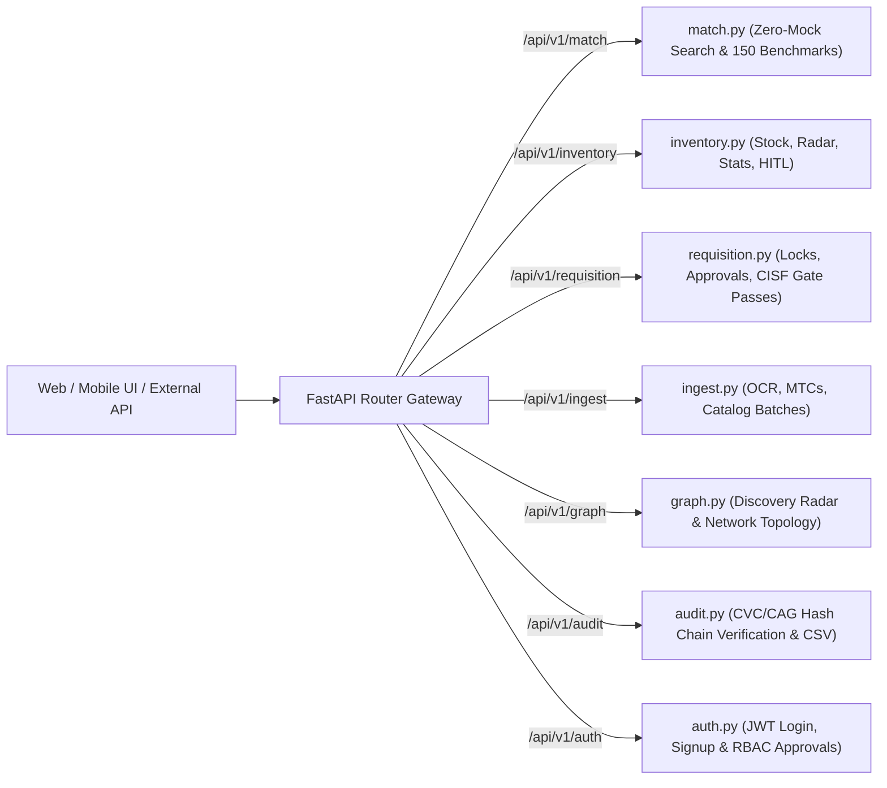

# HTTP Presentation & REST API Routers (`backend/app/api/routers/`)

## 1. Architectural Role & Overview

The `backend/app/api/routers/` package constitutes the primary HTTP controller layer for **Samanvay-AI**.

It exposes standard REST endpoints under the `/api/v1` namespace, mediating user requests, validating request bodies via Pydantic schemas, enforcing Role-Based Access Control (RBAC) and CPSE multi-tenancy, managing idempotency caches, and delegating execution to the underlying domain services in `backend/app/services/`.

---

## 2. Router Catalog & Endpoint Mappings

| Router File | URL Prefix | Primary Endpoints | Key Security & Middleware |
| :--- | :--- | :--- | :--- |
| [`match.py`](file:///C:/Users/mayank/Development/Hackathons/Samanvay-AI/backend/app/api/routers/match.py) | `/match` | `POST /search` `GET /benchmark` | `verify_cpse_access`, attribute-level privacy cost filtering. |
| [`inventory.py`](file:///C:/Users/mayank/Development/Hackathons/Samanvay-AI/backend/app/api/routers/inventory.py) | `/inventory` | `GET /` `GET /stats` `GET /surplus` `GET /hitl-queue` `GET /{sku}` `POST /` `PUT /{sku}/status` | Multi-tenant CPSE headers, `require_roles(["MATERIALS_MANAGER", "SUPER_ADMIN"])`, `validate_idempotency_key`. |
| [`requisition.py`](file:///C:/Users/mayank/Development/Hackathons/Samanvay-AI/backend/app/api/routers/requisition.py) | `/requisition` | `POST /` `GET /` `GET /{id}` `PUT /{id}/approve` `PUT /{id}/reject` `POST /{id}/gatepass` `PUT /{id}/dispatch` `PUT /{id}/deliver` | Segregation of duties validation, multi-tenant user scoping, `validate_idempotency_key`. |
| [`ingest.py`](file:///C:/Users/mayank/Development/Hackathons/Samanvay-AI/backend/app/api/routers/ingest.py) | `/ingest` | `POST /document` `POST /text` `POST /catalog` `GET /documents` `GET /documents/{id}` | Multipart file validation (15 MB limit), dual-path OCR execution, ASTM conformance checks. |
| [`graph.py`](file:///C:/Users/mayank/Development/Hackathons/Samanvay-AI/backend/app/api/routers/graph.py) | `/graph` | `GET /discover` `GET /item/{sku}/properties` `GET /depot/{depot}/surplus` `GET /logistics/{src}/{tgt}` `GET /topology` | GIS logistics calculation, road tortuosity routing ($T=1.28$), SVG map coordinate projection. |
| [`audit.py`](file:///C:/Users/mayank/Development/Hackathons/Samanvay-AI/backend/app/api/routers/audit.py) | `/audit` | `GET /` `GET|POST /verify` `GET /export` `GET /{log_id}` `POST /feedback` | On-the-fly cryptographic SHA-256 chain verification, RFC 4180 CSV export with UTF-8 BOM. |
| [`auth.py`](file:///C:/Users/mayank/Development/Hackathons/Samanvay-AI/backend/app/api/routers/auth.py) | `/auth` | `POST /login` `POST /signup` `GET /me` `GET /seed-users` `POST /seed` `GET /users` `POST /users/{id}/approve` `POST /users/{id}/reject` | Signed HS256 JWT tokens with tenant/role claims, bcrypt verification, super admin approvals. |
| [`__init__.py`](file:///C:/Users/mayank/Development/Hackathons/Samanvay-AI/backend/app/api/routers/__init__.py) | - | Package initialization | Namespace anchor. |

---

## 3. Deep-Dive Endpoint Specifications

### 3.1. Match Router (`match.py`)
- **`POST /api/v1/match/search`**:
  Accepts free-form engineer text or structured queries (`MatchRequest`). Normalizes parameters, queries candidate items, checks 21 zero-tolerance safety rules, predicts continuous ML compatibility scores, applies Make-in-India bonuses, and computes GIS transit times. Commercial costs are stripped for cross-CPSE callers.
- **`GET /api/v1/match/benchmark`**:
  Executes the 150 paired Golden Benchmarks from `datasets/golden_benchmarks.json` across Tier 1, Tier 2, and Tier 3. Returns precision, recall, and confirms 100% zero-tolerance safety gate enforcement.

### 3.2. Inventory Router (`inventory.py`)
- **`GET /api/v1/inventory`**: Paginated plant inventory. Supports filtering by CPSE, depot, status, and equipment category.
- **`GET /api/v1/inventory/stats`**: Aggregate KPIs including unlocked dormant capital ($\text{INR Crores}$), active surplus counts, and CPSE stock breakdowns.
- **`GET /api/v1/inventory/surplus`**: Returns Pre-Purchase Radar items across sister CPSEs with pricing data scrubbed.
- **`PUT /api/v1/inventory/{sku}/status`**: Transitions stock lifecycle (e.g., `TO_BE_CONSUMED` $\rightarrow$ `IDLE_SURPLUS`). Requires `MATERIALS_MANAGER` or `SUPER_ADMIN` privileges.

### 3.3. Requisition Router (`requisition.py`)
- **`POST /api/v1/requisition`**:
  Atomically reserves stock via pessimistic database locks (`SELECT ... FOR UPDATE`), debits available inventory, sets up a 7-day TTL lock, and computes initial SHA-256 audit seals. Protected by mandatory `Idempotency-Key` headers.
- **`PUT /api/v1/requisition/{id}/approve`**:
  Enforces strict segregation of duties: requesters cannot approve their own requests; only authorized personnel from the supplying CPSE can authorize releasing surplus materials.
- **`POST /api/v1/requisition/{id}/gatepass`**:
  Generates the official CISF security pass with vehicle numbers, transporter name, driver ID, transit distance, and inline vector SVG QR code.

### 3.4. Document Ingest Router (`ingest.py`)
- **`POST /api/v1/ingest/document`**:
  Handles multi-modal file uploads up to 15 MB. Automatically distinguishes digital vector PDFs from scanned raster sheets, extracts chemical composition and mechanical properties, computes IIW Carbon Equivalent and PREN, checks ASTM limits, and writes audit records to `IngestedDocument`.
- **`POST /api/v1/ingest/catalog`**:
  Batch imports ERP spreadsheets (CSV, XLSX, XLS), performing bulk insertion into `InventoryItem`.

### 3.5. Supply Graph & Logistics Router (`graph.py`)
- **`GET /api/v1/graph/discover`**: Discovers cross-CPSE surplus within specified maximum road distances.
- **`GET /api/v1/graph/topology`**: Returns the complete national mesh topology: all plant nodes with latitude/longitude and projected SVG coordinates, active inventory counts, unlocked capital in ₹ Crores, and operational freight corridors.
- **`GET /api/v1/graph/logistics/{src}/{tgt}`**: Calculates road distance, transit lead hours, avoided $\text{CO}_2$ emissions, and estimated freight costs.

### 3.6. Sovereign Audit Ledger Router (`audit.py`)
- **`GET|POST /api/v1/audit/verify`**: Evaluates hash continuity across the entire ledger ($H_i = \text{SHA256}(H_{i-1} \parallel \dots)$). Returns boolean validity and pinpoints broken index heights if corrupted.
- **`GET /api/v1/audit/export`**: Streams an RFC 4180 CSV export prepended with UTF-8 BOM (`\ufeff`) for statutory CVC/CAG audits.

### 3.7. Authentication & RBAC Router (`auth.py`)
- **`POST /api/v1/auth/login`**: Authenticates users with bcrypt, returning 24-hour JWT bearer tokens embedding username, role, CPSE tenant, and depot ID.
- **`POST /api/v1/auth/signup`**: Registers new officers, logging an entry into the Sovereign Audit Ledger.
- **`GET /api/v1/auth/seed-users`**: Returns the 23 pre-configured demo persona profiles.
