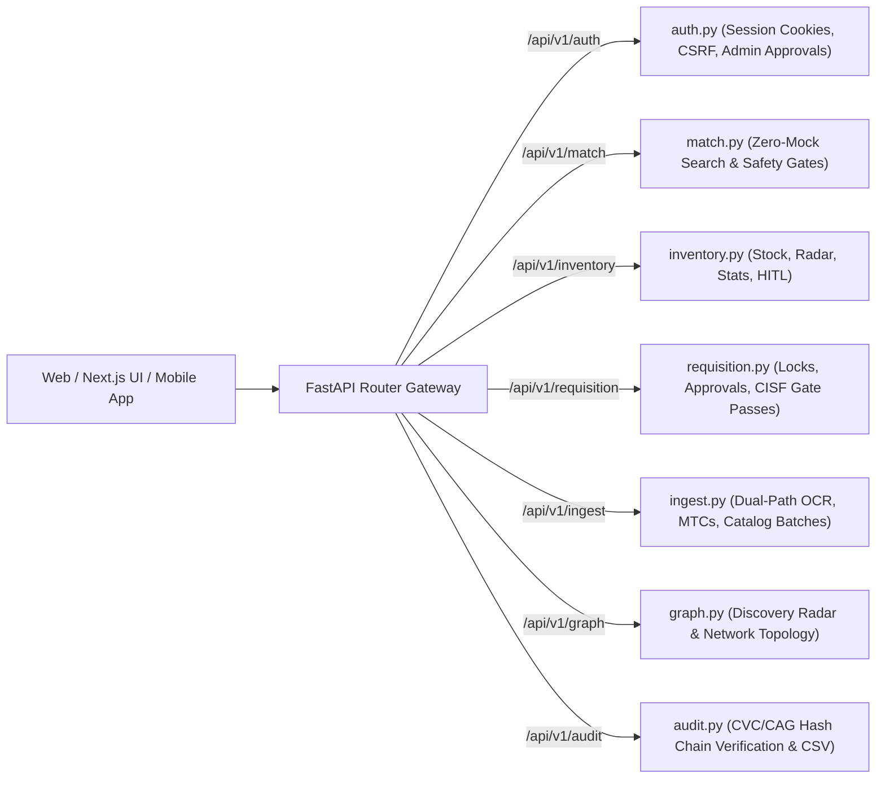

# HTTP Presentation & REST API Routers (`backend/app/api/routers/`)

## 1. Architectural Role & Overview

The `backend/app/api/routers/` package constitutes the primary HTTP controller layer for **Samanvay-AI**.

It exposes standard REST endpoints under the `/api/v1` namespace, mediating user requests, validating request bodies via Pydantic schemas, enforcing zero-trust session authentication, centralized permission policies (AUTH-007), strict CPSE multi-tenancy boundaries, CSRF defense, and idempotency guarantees before delegating execution to the underlying domain services in `backend/app/services/`.

---

## 2. Router Catalog & Endpoint Mappings

| Router File | URL Prefix | Primary Endpoints | Key Security & Middleware |
| :--- | :--- | :--- | :--- |
| [`auth.py`](file:///C:/Users/mayank/Development/Hackathons/Samanvay-AI/backend/app/api/routers/auth.py) | `/auth` | `POST /login` `POST /logout` `GET /me` `GET /csrf` `GET /seed-users` `GET /users` `POST /users/provision` `POST /users/{id}/approve` `POST /users/{id}/reject` | Server-side `__Host-samanvay_session` cookies, HIBP password checking, sliding-window rate limiting, timing-attack equalization, centralized account approvals. |
| [`match.py`](file:///C:/Users/mayank/Development/Hackathons/Samanvay-AI/backend/app/api/routers/match.py) | `/match` | `POST /search` | `require_permission(MATCH_READ)`, `require_csrf`, authoritative session CPSE candidate filtering. |
| [`inventory.py`](file:///C:/Users/mayank/Development/Hackathons/Samanvay-AI/backend/app/api/routers/inventory.py) | `/inventory` | `GET /` `GET /stats` `GET /surplus` `GET /hitl-queue` `GET /{sku}` `POST /` `PUT /{sku}/status` | `require_permission` (`INVENTORY_READ`, `INVENTORY_CREATE`, `INVENTORY_STATUS_CHANGE`), `require_csrf`, `validate_idempotency_key`, session-derived CPSE scoping. |
| [`requisition.py`](file:///C:/Users/mayank/Development/Hackathons/Samanvay-AI/backend/app/api/routers/requisition.py) | `/requisition` | `POST /` `GET /` `GET /{id}` `PUT /{id}/approve` `PUT /{id}/reject` `POST /{id}/gatepass` `PUT /{id}/dispatch` `PUT /{id}/deliver` | Segregation of duties validation (anti-self-approval), supplying/receiving CPSE tenant checks, `require_csrf`, `validate_idempotency_key`. |
| [`ingest.py`](file:///C:/Users/mayank/Development/Hackathons/Samanvay-AI/backend/app/api/routers/ingest.py) | `/ingest` | `POST /document` `POST /text` `POST /catalog` `GET /documents` `GET /documents/{id}` | Multipart file validation (15 MB limit), dual-path OCR execution, ASTM conformance checks, `require_permission` (`INGEST_DOCUMENT`, `INGEST_CATALOG`, `DOCUMENT_READ`), `require_csrf`. |
| [`graph.py`](file:///C:/Users/mayank/Development/Hackathons/Samanvay-AI/backend/app/api/routers/graph.py) | `/graph` | `GET /discover` `GET /item/{sku}/properties` `GET /depot/{depot}/surplus` `GET /logistics/{src}/{tgt}` `GET /topology` | `require_permission(GRAPH_READ)`, GIS logistics calculation, road tortuosity routing ($T=1.28$), SVG map coordinate projection, session CPSE scoping. |
| [`audit.py`](file:///C:/Users/mayank/Development/Hackathons/Samanvay-AI/backend/app/api/routers/audit.py) | `/audit` | `GET /` `GET\|POST /verify` `GET /export` `GET /{log_id}` `POST /feedback` | `require_permission` (`AUDIT_READ`, `AUDIT_EXPORT`, `AUDIT_FEEDBACK_CREATE`), `require_csrf`, on-the-fly SHA-256 chain verification, RFC 4180 CSV export. |
| [`__init__.py`](file:///C:/Users/mayank/Development/Hackathons/Samanvay-AI/backend/app/api/routers/__init__.py) | - | Package initialization | Namespace anchor. |

---

## 3. Deep-Dive Endpoint Specifications

### 3.1. Authentication Router (`auth.py`)
- **`POST /api/v1/auth/login`**:
  Authenticates user credentials using bcrypt. Enforces sliding-window rate limiting and timing-attack equalization (`verify_password_dummy`). Establishes a server-side session and sets the `__Host-samanvay_session` (or `samanvay_session`) cookie (`HttpOnly`, `SameSite=Lax`, `Secure` in production). Returns public user profile only — no JWT or secrets are returned in the response body.
- **`POST /api/v1/auth/logout`**:
  Revokes the active server-side session in `auth_sessions`, clears the session cookie from the browser, and logs a `SESSION_REVOKED` security event.
- **`GET /api/v1/auth/csrf`**:
  Returns a session-bound CSRF token (`CsrfTokenResponse`) required for subsequent state-changing mutations.
- **`POST /api/v1/auth/users/provision`**:
  Administrative user creation endpoint (requires `ACCOUNT_PROVISION` and CSRF). Checks password against Have I Been Pwned (HIBP) and sets account to `is_approved=False`. Emits `ACCOUNT_PROVISIONED` telemetry.
- **`POST /api/v1/auth/users/{user_id}/approve` & `reject`**:
  Administrative approval/rejection lifecycle managed by `SUPER_ADMIN`. Records `ACCOUNT_APPROVED` or `ACCOUNT_REJECTED` in `security_events`.

### 3.2. Match Router (`match.py`)
- **`POST /api/v1/match/search`**:
  Accepts free-form engineer text or structured queries (`MatchRequest`). Requires `MATCH_READ` permission and a verified CSRF session. Scopes candidate items authoritatively to the session CPSE. Normalizes parameters, evaluates 21 zero-tolerance safety rules, predicts continuous ML compatibility scores, applies Make-in-India bonuses, and computes GIS transit times. Commercial costs are stripped for cross-CPSE responses.

### 3.3. Inventory Router (`inventory.py`)
- **`GET /api/v1/inventory`**: Paginated plant inventory scoped strictly to the session caller's CPSE.
- **`GET /api/v1/inventory/stats`**: Aggregate KPIs including unlocked dormant capital ($\text{INR Crores}$), active surplus counts, and CPSE stock breakdowns.
- **`GET /api/v1/inventory/surplus`**: Returns Pre-Purchase Radar items across sister CPSEs with pricing data scrubbed.
- **`POST /api/v1/inventory`**: Creates new inventory item under the caller's authoritative CPSE. Requires `INVENTORY_CREATE` and CSRF verification.
- **`PUT /api/v1/inventory/{sku}/status`**: Transitions stock lifecycle (e.g., `TO_BE_CONSUMED` $\rightarrow$ `IDLE_SURPLUS`). Requires `INVENTORY_STATUS_CHANGE` and CSRF verification.

### 3.4. Requisition Router (`requisition.py`)
- **`POST /api/v1/requisition`**:
  Atomically reserves stock via pessimistic database locks (`SELECT ... FOR UPDATE`), debits available inventory, sets up a 7-day TTL lock, and computes initial SHA-256 audit seals. Protected by mandatory `Idempotency-Key` headers, `REQUISITION_CREATE`, and CSRF.
- **`PUT /api/v1/requisition/{id}/approve`**:
  Enforces strict segregation of duties: requesters cannot approve their own requests; only authorized personnel from the supplying CPSE can authorize releasing surplus materials (`REQUISITION_APPROVE`).
- **`POST /api/v1/requisition/{id}/gatepass`**:
  Generates the official CISF security pass with vehicle numbers, transporter name, driver ID, transit distance, and inline vector SVG QR code (`REQUISITION_GATEPASS`).
- **`PUT /api/v1/requisition/{id}/dispatch` & `/deliver`**:
  Guards physical handover. Dispatch is restricted to supplying CPSE; delivery confirmation is restricted to receiving CPSE.

### 3.5. Document Ingest Router (`ingest.py`)
- **`POST /api/v1/ingest/document`**:
  Handles multi-modal file uploads up to 15 MB. Automatically distinguishes digital vector PDFs from scanned raster sheets, extracts chemical composition and mechanical properties, computes IIW Carbon Equivalent and PREN, checks ASTM limits, and writes audit records to `IngestedDocument`. Requires `INGEST_DOCUMENT` and CSRF.
- **`POST /api/v1/ingest/catalog`**:
  Batch imports ERP spreadsheets (CSV, XLSX, XLS), enforcing that all declared rows match the caller's session CPSE. Requires `INGEST_CATALOG` and CSRF.

### 3.6. Supply Graph & Logistics Router (`graph.py`)
- **`GET /api/v1/graph/discover`**: Discovers cross-CPSE surplus within specified maximum road distances. Scoped to the session CPSE.
- **`GET /api/v1/graph/topology`**: Returns the complete national mesh topology: all plant nodes with latitude/longitude and projected SVG coordinates, active inventory counts, unlocked capital in ₹ Crores, and operational freight corridors.
- **`GET /api/v1/graph/logistics/{src}/{tgt}`**: Calculates road distance, transit lead hours, avoided $\text{CO}_2$ emissions, and estimated freight costs.

### 3.7. Sovereign Audit Ledger Router (`audit.py`)
- **`GET /api/v1/audit`**: Lists audit records within the caller's CPSE. Requires `AUDIT_READ`.
- **`GET|POST /api/v1/audit/verify`**: Evaluates hash continuity across the entire ledger ($H_i = \text{SHA256}(H_{i-1} \parallel \dots)$). Returns boolean validity and pinpoints broken index heights if corrupted.
- **`GET /api/v1/audit/export`**: Streams an RFC 4180 CSV export prepended with UTF-8 BOM (`\ufeff`) for statutory CVC/CAG audits. Requires `AUDIT_EXPORT`.
- **`POST /api/v1/audit/feedback`**: Appends active-learning human-in-the-loop decisions to the ledger. Requires `AUDIT_FEEDBACK_CREATE` and CSRF.
