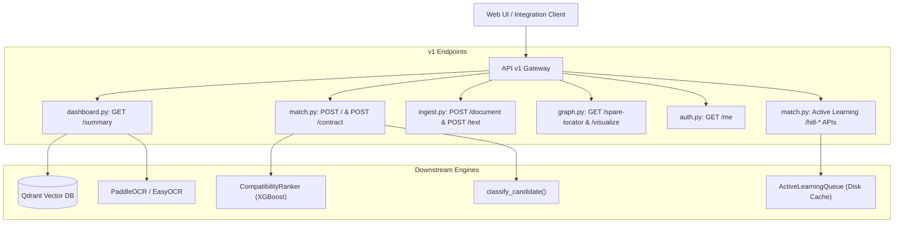

# API Version 1 Contract & Service Routers (`backend/app/api/v1/`)

## 1. Architectural Role & Overview

The `backend/app/api/v1/` package provides specialized contract-driven REST controllers and observability endpoints for the **Samanvay-AI** platform.

It interfaces directly with the typed DTO contracts defined in `backend/app/contracts/` and the machine learning subsystems in `machine_learning/`:
- Providing **Dashboard Readiness Probes** (`/summary`) that dynamically inspect Qdrant vector index readiness, on-disk embedding and reranker model weights, active learning queue depths, and OCR engine package states.
- Orchestrating **Vector-Driven Material Matching** (`/match`) utilizing BGE-M3 subvector similarity, XGBoost reranking, and deterministic ASME safety classification.
- Managing the **Active Learning & HITL Feedback Loop** (`/hitl-queue`, `/hitl-resolve`, `/hitl-bootstrap`).
- Delivering typed **Document Ingestion** endpoints (`/ingest/document`, `/ingest/text`).

---

## 2. Module Inventory

| File | URL Prefix / Route | Primary Responsibility |
| :--- | :--- | :--- |
| [`dashboard.py`](file:///C:/Users/mayank/Development/Hackathons/Samanvay-AI/backend/app/api/v1/dashboard.py) | `GET /summary` | Probes system readiness: tests Qdrant collection liveness with a probe vector, checks ML model files, counts HITL reviews, and reports OCR capabilities. |
| [`match.py`](file:///C:/Users/mayank/Development/Hackathons/Samanvay-AI/backend/app/api/v1/match.py) | `POST /` `POST /contract` `GET /hitl-queue` `GET /hitl-examples` `POST /hitl-bootstrap` `POST /hitl-resolve` | Evaluates material descriptions against candidate SKUs using vector search, GBDT reranking, and tolerance safety rules. Manages active learning feedback. |
| [`ingest.py`](file:///C:/Users/mayank/Development/Hackathons/Samanvay-AI/backend/app/api/v1/ingest.py) | `POST /document` `POST /text` | Uploads and processes MTC certificates, running dual-path extraction and returning `DocumentIngestResponse`. |
| [`graph.py`](file:///C:/Users/mayank/Development/Hackathons/Samanvay-AI/backend/app/api/v1/graph.py) | `GET /spare-locator` `GET /visualize` | Contract endpoints for locating equivalent materials and extracting Neo4j visualization graphs. |
| [`auth.py`](file:///C:/Users/mayank/Development/Hackathons/Samanvay-AI/backend/app/api/v1/auth.py) | `GET /me` | Contract endpoint returning caller identity context. |
| [`__init__.py`](file:///C:/Users/mayank/Development/Hackathons/Samanvay-AI/backend/app/api/v1/__init__.py) | Package initialization | Re-exports submodules. |

---

## 3. Key Controller Endpoints

### 3.1. Readiness & Observability Dashboard (`GET /summary`)
Inspects system components without side-effects, returning [`DashboardSummary`](file:///C:/Users/mayank/Development/Hackathons/Samanvay-AI/backend/app/contracts/dashboard.py):
- **Vector Search Liveness**: Encodes a probe text across 4 named subvector domains (`dim`, `met`, `pt`, `std`) and queries Qdrant with `limit=1`.
- **Model Storage Inspection**: Verifies that `model_weights/` directory exists and that `reranker.xgb` is on disk.
- **Review Capacity**: Queries the active learning queue for pending versus resolved review items.
- **OCR Engine Status**: Verifies availability of `PaddleOCR` and `EasyOCR` via `importlib.util.find_spec`.

### 3.2. Contract-Based Matching (`POST /match`)
- **Pipeline Execution**:
  1. Calls `extract_attributes(request.raw_description)` using the DeBERTa NER tagger.
  2. Executes Qdrant hybrid vector search with domain subvectors.
  3. Optionally invokes `CompatibilityRanker` for GBDT cross-encoder reranking.
  4. Runs `classify_candidate(attributes, top_candidate)` to evaluate ASME dimensional, pressure, and metallurgical safety rules.
  5. Assigns operational routing (`auto-link`, `hitl`, `manual-entry`).

### 3.3. Active Learning & Human-In-The-Loop (`/hitl-*`)
- **`GET /hitl-queue`**: Returns pending ambiguous or borderline Tier-2 matches awaiting human engineering sign-off.
- **`POST /hitl-resolve`**: Records an engineer's decision (`accepted: true/false`, optional `corrected_candidate`), appending it as a verified training example for subsequent GBDT re-training.
- **`POST /hitl-bootstrap`**: Seeds initial training pairs into the active learning cache.
