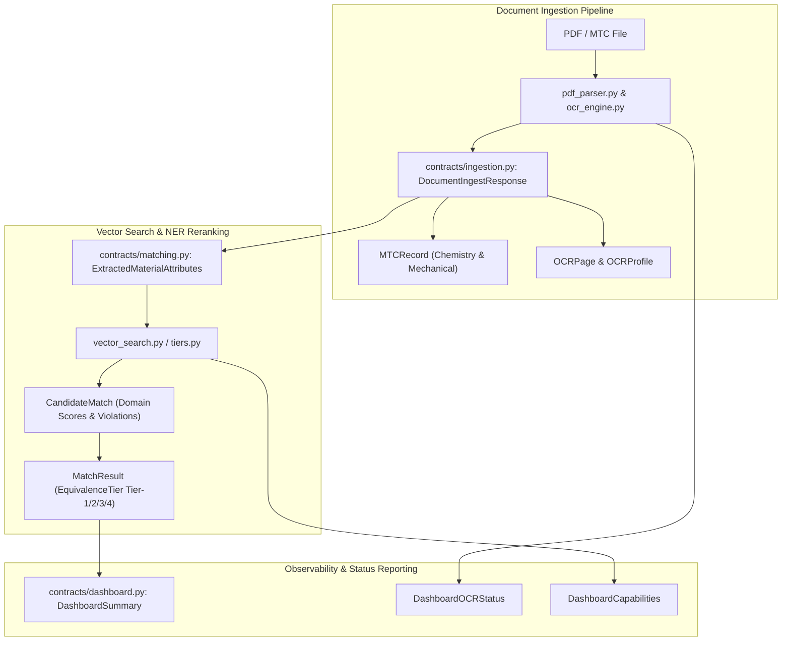

# Cross-Cutting Data Transfer Contracts (`backend/app/contracts/`)

## 1. Architectural Role & Overview

The `backend/app/contracts/` package defines typed, decoupled **Data Transfer Objects (DTOs)** and interoperability interfaces between the FastAPI presentation routers (`backend/app/api/`), the ingestion pipelines (`backend/app/ingestion/`), and the machine learning inference services (`machine_learning/`).

By encapsulating contract definitions here, the system achieves clean separation of concerns, ensuring that low-level OCR engine parsing structures, MTC chemical breakdowns, and multi-domain vector matching payloads do not couple directly to database ORM models or client request handlers.

---

## 2. Contract Inventory

| Contract File | Core DTOs & Models | Functional Purpose |
| :--- | :--- | :--- |
| [`ingestion.py`](file:///C:/Users/mayank/Development/Hackathons/Samanvay-AI/backend/app/contracts/ingestion.py) | `ChemicalComposition`, `MechanicalProperty`, `MTCRecord`, `OCRPage`, `IngestResponse`, `OCRProfile`, `DocumentIngestResponse` | Encapsulates parsed Material Test Certificate (MTC) chemical assays, mechanical test values, bounding boxes, and OCR engine profiling. |
| [`matching.py`](file:///C:/Users/mayank/Development/Hackathons/Samanvay-AI/backend/app/contracts/matching.py) | `EquivalenceTier`, `Tier`, `ExtractedMaterialAttributes`, `CandidateMatch`, `MatchResult` | Standardizes candidate match rankings, domain subvector similarity breakdowns, engineering rule violation lists, and routing metadata. |
| [`dashboard.py`](file:///C:/Users/mayank/Development/Hackathons/Samanvay-AI/backend/app/contracts/dashboard.py) | `DashboardOCRStatus`, `DashboardCapabilities`, `DashboardSummary` | Provides health, capability reporting, model readiness (embedding, reranker), review queue metrics, and OCR status for administrative dashboards. |
| [`auth.py`](file:///C:/Users/mayank/Development/Hackathons/Samanvay-AI/backend/app/contracts/auth.py) | `UserContext` | Lightweight identity context (`user_id`, `role`) passed across service boundaries. |
| [`canonical_schema.py`](file:///C:/Users/mayank/Development/Hackathons/Samanvay-AI/backend/app/contracts/canonical_schema.py) | `CanonicalMaterialItem`, `CANONICAL_COLUMNS`, `MANDATORY_COLUMNS`, `COLUMN_ALIASES`, `normalize_catalog_row` | Samanvay Canonical Material Schema (SCMS-27) defining the project-wide 27-column standard across CPSE ERP catalogs, database models, and API boundaries. |
| [`__init__.py`](file:///C:/Users/mayank/Development/Hackathons/Samanvay-AI/backend/app/contracts/__init__.py) | Package namespace exports | Exposes core canonical schema and matching contracts. |

---

## 3. Structural Specifications

### 3.1. Ingestion & MTC Contracts (`ingestion.py`)

- **`ChemicalComposition`**: Captures normalized weight percentages of alloying elements ($C, Mn, Si, P, S, Cr, Ni, Mo, V, Cu$) with measurement units.
- **`MechanicalProperty`**: Standardizes physical tensile metrics ($Yield\ Strength\ R_e$, $Tensile\ Strength\ R_m$, $Elongation\ A_5$, $Charpy\ Impact\ J$, $Hardness\ HB$).
- **`MTCRecord`**: Complete envelope combining certificate number, heat number, purchase order, material grade, and associated chemical and mechanical lists.
- **`DocumentIngestResponse`**: Master output from the document parsing service containing page-level bounding blocks (`OCRPage`), OCR execution metadata (`OCRProfile`), ASTM/ASME conformance status, and an explicit `requires_hitl` flag.

### 3.2. Matching & Equivalence Contracts (`matching.py`)

- **`ExtractedMaterialAttributes`**: 27-field structured representation of equipment parameters extracted via NER:
  - Technical: `item_type`, `size_nb_mm`, `pressure_class`, `metallurgy`, `facing_end`, `schedule`.
  - Indian Standards: `indian_standard` (IS), `oisd_standard` (OISD), `eil_specification` (EIL).
  - Public Procurement: `gem_category`, `gem_bid_number`, `cppp_tender_id`, `mesc_code`.
- **`CandidateMatch`**: Encapsulates a candidate item from the catalog, including its similarity score, 4-domain subvector scores (`domain_scores`), assigned `Tier` (`Tier-1`, `Tier-2`, `Tier-3`, `Tier-4-Reject`), rule violation descriptions, and engineering justification reasons.
- **`MatchResult`**: The final decision payload containing the selected best candidate, candidate list, system routing decision, and overall match confidence.

### 3.3. Observability & Dashboard Contracts (`dashboard.py`)

- **`DashboardOCRStatus`**: Reports raster DPI, active pre-processing filters, primary and fallback engine readiness (PaddleOCR vs. Tesseract), and specialized MTC extraction capabilities.
- **`DashboardSummary`**: Real-time snapshot of system health, vector database connectivity, model readiness, review queue volume (`pending_reviews`, `resolved_reviews`), and active learning status.
