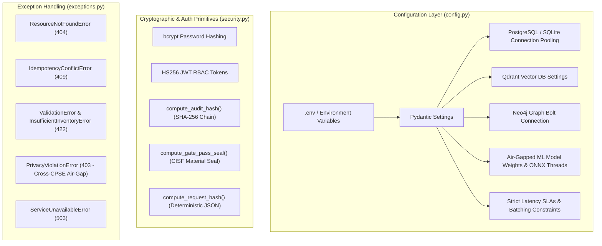
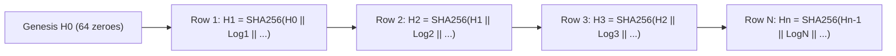

# Core Configuration, Security & Exception Handling (`backend/app/core/`)

## 1. Architectural Role & Overview

The `backend/app/core/` package establishes foundational platform invariants for **Samanvay-AI**. It serves as the single source of truth for runtime configuration, environment variables, cryptographic primitives, sovereign tamper-evident audit chains, CISF gate pass digital seals, and strict HTTP error contracts.



---

## 2. Module Inventory

| File | Primary Classes / Functions | Responsibility |
| :--- | :--- | :--- |
| [`config.py`](file:///C:/Users/mayank/Development/Hackathons/Samanvay-AI/backend/app/core/config.py) | `Settings`, `settings` | Pydantic `BaseSettings` managing database connection strings, Qdrant/Neo4j endpoints, ML model paths, dynamic batching, and compatibility thresholds. |
| [`security.py`](file:///C:/Users/mayank/Development/Hackathons/Samanvay-AI/backend/app/core/security.py) | `compute_audit_hash`, `compute_gate_pass_seal`, `compute_request_hash`, `verify_audit_chain`, `verify_password`, `get_password_hash`, `create_access_token`, `decode_access_token` | Cryptographic SHA-256 hash chaining, CISF digital gate pass seal generation, bcrypt password hashing, and signed JWT token handling. |
| [`exceptions.py`](file:///C:/Users/mayank/Development/Hackathons/Samanvay-AI/backend/app/core/exceptions.py) | `ResourceNotFoundError`, `ValidationError`, `IdempotencyConflictError`, `InsufficientInventoryError`, `ServiceUnavailableError`, `PrivacyViolationError` | Explicit FastAPI HTTP exceptions returning standardized JSON error envelopes with zero heuristic fallbacks. |
| [`__init__.py`](file:///C:/Users/mayank/Development/Hackathons/Samanvay-AI/backend/app/core/__init__.py) | Package exports | Exposes core settings and cryptographic hashing helpers. |

---

## 3. Configuration Architecture (`config.py`)

Platform settings are defined via Pydantic `BaseSettings` and automatically validated on startup:

### 3.1. Infrastructure & Storage Settings
- **PostgreSQL 16**: Managed through `postgres_url` property. Dynamically detects `psycopg` (v3) or `psycopg2` drivers. When `TESTING=1` or `USE_SQLITE=true`, seamlessly provides an in-memory `sqlite:///:memory:` connection pool for rapid, isolated testing.
- **Qdrant Vector Database**: Configures collection `samanvay_inventory`, dense dimension $D=1024$ (matching BAAI/bge-m3), HNSW index graph $M=16$, and construction search depth $ef\_construct=100$.
- **Neo4j Knowledge Graph**: Bolt URI endpoint (`bolt://localhost:7687`) with credentials for cross-CPSE supply chain traversal.

### 3.2. Air-Gapped ML & Inference SLAs
- **Model Storage Paths**:
  - NER DeBERTa: `machine_learning/model_weights/ner_deberta`
  - BGE-M3 ONNX: `machine_learning/model_weights/bge-m3-onnx`
  - XGBoost Reranker: `machine_learning/reranker/models/compatibility_ranker.json`
- **Strict Latency SLAs**:
  - PyMuPDF text stream extraction: $\le 50\text{ ms}$
  - PaddleOCR heavy scan inference: $\le 250\text{ ms}$
  - Qdrant dense vector search: $\le 15\text{ ms}$
- **Concurrency & Threads**:
  - `ocr_max_concurrency = 4`: Enforces `asyncio.Semaphore` bounded memory usage.
  - `onnx_intra_op_threads = 4`, `onnx_inter_op_threads = 2`.

### 3.3. Engineering Physics Thresholds
- **Compatibility Tier Boundaries**:
  - Tier 1 (Identical / Safe Over-Rating): $\ge 95\%$ ($\tau_1 = 0.95$)
  - Tier 2 (Functional Substitute): $\ge 80\%$ ($\tau_2 = 0.80$)
  - Tier 3 (Fatal Incompatible): $< 80\%$
- **Weldability Safety**: IIW Carbon Equivalent ($CE$) limit capped at $\le 0.43\%$ per ASME B31.3.
- **GIS Transport Routing**: Road tortuosity factor $T = 1.28$ applied to Haversine geodesics; average CPSE heavy freight speed set to $40.0\text{ km/h}$.

---

## 4. Cryptographic Security & Tamper-Evident Ledger (`security.py`)

### 4.1. Sovereign CVC / CAG Audit Hash Chain

To fulfill Central Vigilance Commission (CVC) and Comptroller and Auditor General (CAG) compliance mandates, every administrative action, matching inquiry, and requisition is recorded in a mathematically sealed hash chain:

$$H_i = \text{SHA-256}\Big(H_{i-1} \parallel \text{LogID} \parallel \text{Timestamp} \parallel \text{Actor} \parallel \text{Action} \parallel \text{RefID} \parallel \text{Details}\Big)$$

- The genesis entry uses $H_0 = \text{"0"}^{64}$ (`GENESIS_ROOT_64_HEX`).
- Any backdated tampering, insertion, or row deletion breaks the chain validation evaluated by `verify_audit_chain()`.



### 4.2. CISF Security Gate Pass Digital Seal

When an inter-CPSE transfer is approved, a tamper-proof digital seal is generated for physical verification at security checkpoints:

$$\text{Seal}_{\text{CISF}} = \text{SHA-256}\Big(\text{GatePassNo} \parallel \text{VehicleNo} \parallel \text{DriverID} \parallel \text{SKU} \parallel \text{Qty} \parallel \text{Officer} \parallel \text{Timestamp}\Big)$$

### 4.3. Deterministic Idempotency Key Hashing
Request bodies submitted with an `Idempotency-Key` header are serialized with deterministic key ordering (`json.dumps(body, sort_keys=True)`) and hashed with SHA-256. If a subsequent duplicate request arrives with mismatched contents, an immediate `IdempotencyConflictError` (HTTP 409) is raised.

---

## 5. Strict Error Contracts (`exceptions.py`)

All custom exceptions inherit from FastAPI's `HTTPException`, returning structured JSON error payloads with designated status codes:

```json
// Example: HTTP 422 InsufficientInventoryError
{
  "error": "INSUFFICIENT_INVENTORY",
  "sku_code": "OIL-FLG-00104",
  "available_qty": 4,
  "requested_qty": 10,
  "message": "Insufficient inventory for OIL-FLG-00104: 4 available, 10 requested."
}
```

- **`ResourceNotFoundError` (HTTP 404)**: Resource or identifier missing in relational or graph store.
- **`ValidationError` (HTTP 422)**: Payload schema violations.
- **`IdempotencyConflictError` (HTTP 409)**: Active concurrent or conflicting idempotent payload.
- **`InsufficientInventoryError` (HTTP 422)**: Requisition quantity exceeds available depot stock.
- **`PrivacyViolationError` (HTTP 403)**: Blocks attempts to expose cross-CPSE confidential commercial details.
- **`ServiceUnavailableError` (HTTP 503)**: Downstream vector or graph database connection drops.
