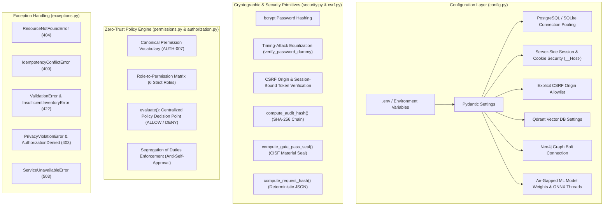

# Core Configuration, Security & Authorization (`backend/app/core/`)

## 1. Architectural Role & Overview

The `backend/app/core/` package establishes foundational platform invariants and zero-trust security controls for **Samanvay-AI**. It serves as the single source of truth for runtime configuration, environment variables, cryptographic primitives, sovereign tamper-evident audit chains, CISF gate pass digital seals, centralized RBAC/ABAC authorization policies, CSRF defenses, and strict HTTP error contracts.

---

## 2. Module Inventory

| File | Primary Classes / Functions | Responsibility |
| :--- | :--- | :--- |
| [`config.py`](file:///C:/Users/mayank/Development/Hackathons/Samanvay-AI/backend/app/core/config.py) | `Settings`, `settings` | Pydantic `BaseSettings` managing database connection strings, session cookie security (`__Host-samanvay_session`), CSRF origin allowlists, login rate-limiting thresholds, Qdrant/Neo4j endpoints, and ML model paths. |
| [`permissions.py`](file:///C:/Users/mayank/Development/Hackathons/Samanvay-AI/backend/app/core/permissions.py) | `ROLE_PERMISSIONS`, `VALID_ROLES`, `ALL_PERMISSIONS`, permission constants | Defines the frozen, canonical permission vocabulary across requisitions, inventory, matching, catalog ingestion, and audit ledgers, mapping each enterprise role to allowable permissions. |
| [`authorization.py`](file:///C:/Users/mayank/Development/Hackathons/Samanvay-AI/backend/app/core/authorization.py) | `evaluate()`, `build_subject()`, `AuthorizationRequest`, `AuthorizationDecision`, `ReasonCode` | Centralized policy provider returning `ALLOW` / `DENY` with structured fail-closed reason codes (`DENY_TENANT_MISMATCH`, `DENY_ACCOUNT_UNAPPROVED`, `DENY_PERMISSION_NOT_GRANTED`, etc.). |
| [`csrf.py`](file:///C:/Users/mayank/Development/Hackathons/Samanvay-AI/backend/app/core/csrf.py) | `origin_allowed()`, `generate_csrf_token()`, `verify_csrf_token()` | Validates browser request origins against an explicit allowlist and verifies HMAC session-bound CSRF tokens for state-changing operations. |
| [`security.py`](file:///C:/Users/mayank/Development/Hackathons/Samanvay-AI/backend/app/core/security.py) | `compute_audit_hash()`, `compute_gate_pass_seal()`, `compute_request_hash()`, `verify_audit_chain()`, `verify_password()`, `verify_password_dummy()`, `get_password_hash()` | Cryptographic SHA-256 hash chaining, CISF digital gate pass seal generation, bcrypt password hashing, and timing-attack equalization. |
| [`exceptions.py`](file:///C:/Users/mayank/Development/Hackathons/Samanvay-AI/backend/app/core/exceptions.py) | `ResourceNotFoundError`, `ValidationError`, `IdempotencyConflictError`, `InsufficientInventoryError`, `ServiceUnavailableError`, `PrivacyViolationError` | Explicit FastAPI HTTP exceptions returning standardized JSON error envelopes with zero heuristic fallbacks. |
| [`__init__.py`](file:///C:/Users/mayank/Development/Hackathons/Samanvay-AI/backend/app/core/__init__.py) | Package exports | Exposes core settings and cryptographic hashing helpers. |

---

## 3. Configuration Architecture (`config.py`)

Platform settings are defined via Pydantic `BaseSettings` and automatically validated on startup:

### 3.1. Infrastructure & Storage Settings
- **PostgreSQL 16**: Managed through `postgres_url` property. Dynamically detects `psycopg` (v3) or `psycopg2` drivers. Seamlessly provides in-memory `sqlite:///:memory:` connection pool for rapid, isolated testing.
- **Qdrant Vector Database**: Configures collection `samanvay_inventory`, dense dimension $D=1024$ (matching BAAI/bge-m3), HNSW index graph $M=16$, and construction search depth $ef\_construct=100$.
- **Neo4j Knowledge Graph**: Bolt URI endpoint (`bolt://localhost:7687`) with credentials for cross-CPSE supply chain traversal.

### 3.2. Server-Side Session & Cookie Security
- **Cookie Name**: `__Host-samanvay_session` in production (`samanvay_session` in local development).
- **Security Flags**: `HttpOnly`, `SameSite=Lax`, `Secure` in production environments.
- **Expiry**: Configurable absolute session expiry (default: 720 minutes / 12 hours).
- **CSRF Origin Allowlist**: Explicit configured Origin allowlist (`AUTH_ALLOWED_ORIGINS`, defaulting to `http://localhost:3000,http://localhost:3001` in development). Never derived from untrusted `Host` headers.
- **Rate-Limiting**: Login rate limit thresholds (default: 10 attempts per 60-second window per username).

### 3.3. Air-Gapped ML & Inference SLAs
- **Model Storage Paths**:
  - NER DeBERTa: `machine_learning/model_weights/ner_deberta`
  - BGE-M3 ONNX: `machine_learning/model_weights/bge-m3-onnx`
  - XGBoost Reranker: `machine_learning/reranker/models/compatibility_ranker.json`
- **Strict Latency SLAs**:
  - PyMuPDF text stream extraction: $\le 50\text{ ms}$
  - PaddleOCR heavy scan inference: $\le 250\text{ ms}$
  - Qdrant dense vector search: $\le 15\text{ ms}$
- **Concurrency & Threads**:
  - `ocr_max_concurrency = 4`: Enforces `asyncio.Semaphore` bounded memory usage.
  - `onnx_intra_op_threads = 4`, `onnx_inter_op_threads = 2`.

---

## 4. Centralized Authorization & RBAC (`permissions.py` & `authorization.py`)

### 4.1. Sovereign Enterprise Roles
The platform enforces 6 canonical roles aligned with Indian Public Sector Undertakings (CPSEs) and Central Vigilance Commission (CVC) governance:
1. `SITE_ENGINEER`: Submits material requisitions and views CPSE stock.
2. `MATERIALS_MANAGER`: Manages plant inventory, updates stock status, and approves inter-CPSE transfers.
3. `TECHNICAL_AUTHORITY`: Evaluates technical compatibility and signs off on engineering substitutions.
4. `CISF_SECURITY`: Issues and verifies digital material gate passes with vector QR codes.
5. `VIGILANCE_AUDITOR`: Read-only access to tamper-evident audit logs and statutory export reports across all CPSEs without mutation rights.
6. `SUPER_ADMIN`: Administrative user account provisioning, role assignment, and system governance.

### 4.2. Segregation of Duties (Anti-Self-Approval)
To comply with anti-fraud mandates, a Site Engineer cannot approve their own requisition:
$$\text{Requester} \neq \text{Approver}$$
Any attempt to self-approve is rejected server-side with `DENY_SELF_APPROVAL` and logged as an `AUTHORIZATION_FAILURE` security event.

---

## 5. Cryptographic Security & Tamper-Evident Ledger (`security.py`)

### 5.1. Sovereign CVC / CAG Audit Hash Chain
Every administrative action, matching inquiry, and requisition is recorded in a mathematically sealed hash chain:
$$H_i = \text{SHA-256}\Big(H_{i-1} \parallel \text{LogID} \parallel \text{Timestamp} \parallel \text{Actor} \parallel \text{Action} \parallel \text{RefID} \parallel \text{Details}\Big)$$
- The genesis entry uses $H_0 = \text{"0"}^{64}$ (`GENESIS_ROOT_64_HEX`).
- Any backdated tampering, insertion, or row deletion breaks the chain validation evaluated by `verify_audit_chain()`.

### 5.2. CISF Security Gate Pass Digital Seal
$$\text{Seal} = \text{SHA-256}\Big(\text{GatePassNo} \parallel \text{VehicleNo} \parallel \text{DriverID} \parallel \text{SKU} \parallel \text{Qty} \parallel \text{Officer} \parallel \text{Timestamp}\Big)$$

### 5.3. Timing-Attack Equalization (`verify_password_dummy`)
To prevent username enumeration via timing attacks during login, non-existent usernames trigger a dummy bcrypt computation against a fixed internal hash, equalizing response times between valid and invalid usernames.
