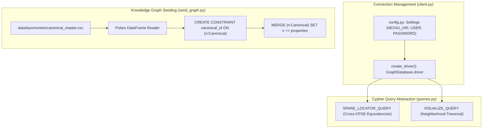

# Graph Database Client & Cypher Operations (`backend/app/graph/`)

## 1. Architectural Role & Overview

The `backend/app/graph/` package manages connection lifecycles, Cypher query orchestration, and catalog graph seeding for **Neo4j**, serving as the platform's supply chain knowledge graph engine.

While relational tables in PostgreSQL maintain transactional inventory ledgers, Neo4j models cross-CPSE supply relationships, facility topologies, canonical material equivalence mappings (`EQUIVALENT_TO`, `IDENTICAL_TO`), and multi-hop surplus discovery.



---

## 2. Module Inventory

| File | Primary Functions & Queries | Purpose |
| :--- | :--- | :--- |
| [`client.py`](file:///C:/Users/mayank/Development/Hackathons/Samanvay-AI/backend/app/graph/client.py) | `create_driver()` | Instantiates authenticated Neo4j Bolt driver using runtime application settings. |
| [`queries.py`](file:///C:/Users/mayank/Development/Hackathons/Samanvay-AI/backend/app/graph/queries.py) | `SPARE_LOCATOR_QUERY`, `VISUALIZE_QUERY` | Cypher query templates for finding interchangeable surplus across other CPSEs and extracting subgraph neighborhoods. |
| [`seed_graph.py`](file:///C:/Users/mayank/Development/Hackathons/Samanvay-AI/backend/app/graph/seed_graph.py) | `seed_graph(driver, canonical_csv)` | Reads canonical catalog CSV via Polars, establishes uniqueness constraints, and merges canonical nodes. |
| [`__init__.py`](file:///C:/Users/mayank/Development/Hackathons/Samanvay-AI/backend/app/graph/__init__.py) | Package initialization | Module namespace anchor. |

---

## 3. Query Design & Logic

### 3.1. Cross-CPSE Surplus Spare Locator (`SPARE_LOCATOR_QUERY`)
Finds idle materials in external CPSEs that are either directly identical or functionally equivalent:

```cypher
MATCH (item:Canonical {canonical_id: $canonical_id})-[:EQUIVALENT_TO|:IDENTICAL_TO*0..1]-(related:Canonical)
MATCH (stock:Inventory {canonical_id: related.canonical_id})
WHERE stock.cpse <> $requesting_cpse AND stock.idle_days >= $minimum_idle_days
RETURN related.canonical_id AS canonical_id, stock.cpse AS cpse, stock.depot_id AS depot_id,
       stock.depot_location AS depot_location, stock.idle_days AS idle_days
ORDER BY stock.idle_days DESC
```

- **Path Expansion (`*0..1`)**: Matches self-identity or 1-hop equivalence across the taxonomy DAG.
- **Air-Gap Separation (`stock.cpse <> $requesting_cpse`)**: Excludes the requesting plant's own depot to highlight true inter-CPSE surplus opportunities.
- **Idle Filter (`stock.idle_days >= $minimum_idle_days`)**: Prioritizes dormant capital for mobilization.

### 3.2. Subgraph Visualization (`VISUALIZE_QUERY`)
Fetches all 1-hop relationships for rendering interactive supply network graphs in the frontend visualization canvas:

```cypher
MATCH (item:Canonical {canonical_id: $canonical_id})-[relationship]-(related)
RETURN item, relationship, related
```

---

## 4. Seeding Pipeline (`seed_graph.py`)

1. **Uniqueness Enforcement**: Executes `CREATE CONSTRAINT canonical_id IF NOT EXISTS FOR (n:Canonical) REQUIRE n.canonical_id IS UNIQUE`.
2. **Batch Ingestion**: Reads `canonical_master.csv` using Polars and iteratively issues Cypher `MERGE` commands, setting all catalog taxonomy properties on the graph nodes.
