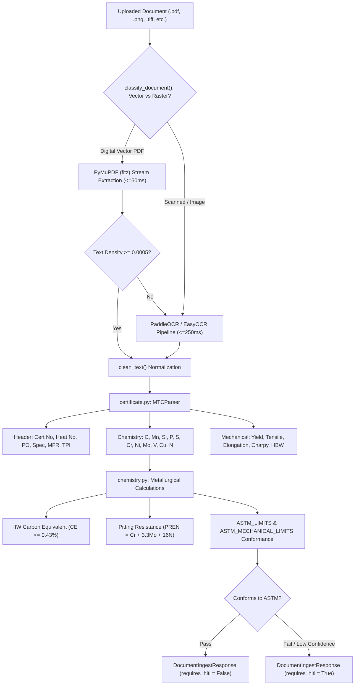

# Material Test Certificate (MTC) Ingestion & Chemical Analytics (`backend/app/ingestion/`)

## 1. Architectural Role & Overview

The `backend/app/ingestion/` package serves as the automated document parsing, Optical Character Recognition (OCR) orchestration, and metallurgical validation subsystem of **Samanvay-AI**.

It processes multi-format documents (digital vector PDFs, scanned paper delivery challans, purchase invoices, and EN 10204 3.1/3.2 Material Test Certificates), extracts elemental chemistry and mechanical test results, evaluates weldability and pitting resistance, and benchmarks against ASTM/ASME standards before items are ingested into the central inventory.

---

## 2. Module Inventory

| File | Primary Classes & Functions | Purpose |
| :--- | :--- | :--- |
| [`document.py`](file:///C:/Users/mayank/Development/Hackathons/Samanvay-AI/backend/app/ingestion/document.py) | `ingest_document()`, `process_document()` | Primary pipeline coordinator bridging OCR rasterization, MTC parsing, and ASTM conformance into `DocumentIngestResponse`. |
| [`certificate.py`](file:///C:/Users/mayank/Development/Hackathons/Samanvay-AI/backend/app/ingestion/certificate.py) | `MTCParser`, `parse_mtc()`, `chemical_composition_values()`, `mechanical_table_values()` | Specialized parser extracting certificate headers, chemical assays, and mechanical tensile/impact tables using layout-aware regex heuristics. |
| [`chemistry.py`](file:///C:/Users/mayank/Development/Hackathons/Samanvay-AI/backend/app/ingestion/chemistry.py) | `compute_carbon_equivalent()`, `classify_weldability()`, `compute_pren()`, `validate_composition()`, `validate_mechanical_properties()` | Metallurgical physics engine calculating IIW Carbon Equivalent ($CE$), weldability classification, and ASTM chemical/mechanical compliance. |
| [`ocr_engine.py`](file:///C:/Users/mayank/Development/Hackathons/Samanvay-AI/backend/app/ingestion/ocr_engine.py) | `OCREngine`, `extract_ocr_text()` | Dual-path document classification (vector PDF vs. raster scan), resolution upscaling, and bounding-box line reconstruction. |
| [`pdf_parser.py`](file:///C:/Users/mayank/Development/Hackathons/Samanvay-AI/backend/app/ingestion/pdf_parser.py) | `extract_pdf_text()`, `_text_density()` | Ultra-fast native text stream extractor using PyMuPDF (`fitz`), automatically falling back to OCR when character density falls below $0.0005$. |
| [`__init__.py`](file:///C:/Users/mayank/Development/Hackathons/Samanvay-AI/backend/app/ingestion/__init__.py) | Package namespace exports | Exposes clean public functions for API routers. |

---

## 3. Metallurgical Physics & Calculations (`chemistry.py`)

### 3.1. International Institute of Welding (IIW) Carbon Equivalent ($CE$)
To ensure structural weldability and prevent cold cracking during pipeline installation per ASME B31.3:

$$CE_{\text{IIW}} = \text{C} + \frac{\text{Mn}}{6} + \frac{\text{Cr} + \text{Mo} + \text{V}}{5} + \frac{\text{Ni} + \text{Cu}}{15}$$

- **`classify_weldability()` Boundary**:
  - If $CE \le 0.43\% \implies \text{"STANDARD\_WELDABLE"}$ (standard welding procedures permitted).
  - If $CE > 0.43\% \implies \text{"PREHEAT\_REQUIRED\_HIGH\_CE"}$ (requires mandatory thermal preheat and hydrogen-controlled electrodes).

### 3.2. Pitting Resistance Equivalent Number ($PREN$)
For austenitic stainless steels (SS316/SS316L) and duplex alloys (A182 F51 / 2205) in marine and sour services:

$$PREN = \text{Cr} + 3.3 \cdot \text{Mo} + 16 \cdot \text{N}$$

- Evaluates localized pitting resistance in chloride-rich environments.

### 3.3. Standard Limit Verification (`ASTM_LIMITS` & `ASTM_MECHANICAL_LIMITS`)
Validates parsed elemental values and mechanical test records against registered standard specifications:
- **Carbon Steels**: ASTM A105, ASTM A350 LF2 (cryogenic impact tested $\ge 20\text{ J}$ at $-46^\circ\text{C}$), ASTM A106 Gr. B.
- **Stainless Steels**: ASTM A182 F304, ASTM A182 F316, ASTM A182 F316L ($C \le 0.030\%$).
- **Duplex Stainless**: ASTM A182 F51 ($PREN \ge 34$).
- **High-Tensile Fasteners**: ASTM A193 B7 (Yield $\ge 725\text{ MPa}$, Tensile $\ge 860\text{ MPa}$).

---

## 4. Pipeline Execution & Routing Architecture (`document.py`)

1. **Format Validation**: Accepts `.pdf`, `.png`, `.jpg`, `.jpeg`, `.tiff`, `.bmp`, `.webp`.
2. **Dual-Path Routing**:
   - Native vector PDFs: Extracted via PyMuPDF in $< 50\text{ ms}$.
   - Scanned PDFs / images: Processed through PaddleOCR with angle classification in $< 250\text{ ms}$.
3. **MTC Layout Analysis**: Bounding boxes are reconstructed into coherent rows sorted by `(round(y / 8), x)`.
4. **ASTM Conformance & HITL Flagging**:
   - If chemical composition or mechanical properties violate ASTM limits, or if critical dimensions cannot be parsed, `requires_hitl = True` is assigned.
   - Low confidence scans ($< 0.70$) automatically route to the Technical Authority triage queue.
