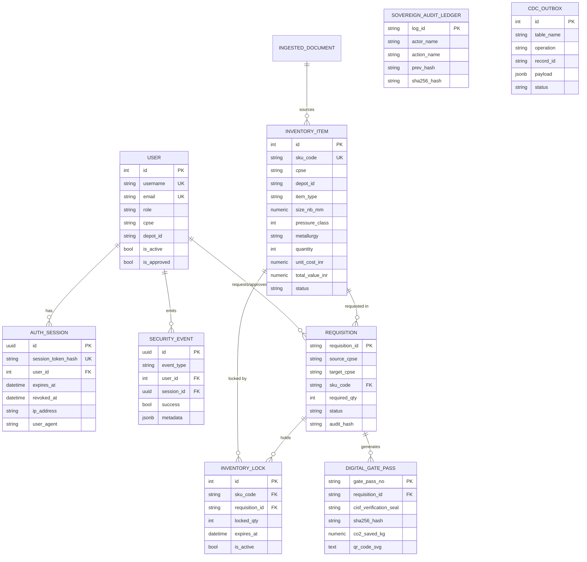

# Relational Database Models & Persistence Layer (`backend/app/models/`)

## 1. Architectural Role & Overview

The `backend/app/models/` package defines the relational domain schema, persistence abstractions, zero-trust session tables, and audit security events for **Samanvay-AI**, constructed using **SQLAlchemy 2.0 Declarative Mapping**.

It models the entire lifecycle of sovereign industrial inventory across Indian Public Sector Undertakings (CPSEs under MoPNG): ingestion of Material Test Certificates (MTCs), master plant catalog storage with dual Indian/International standard specifications, atomic multi-depot reservation locks, inter-CPSE transfer orders, CISF security gate passes, cryptographic audit logs, server-side authentication sessions, security event logs, and transactional Change Data Capture (CDC) outbox queues.

---

## 2. Module Inventory

| File | Primary Exports | Purpose |
| :--- | :--- | :--- |
| [`base.py`](file:///C:/Users/mayank/Development/Hackathons/Samanvay-AI/backend/app/models/base.py) | `Base`, `engine`, `SessionLocal`, `get_db`, `init_db`, `verify_schema_version` | SQLAlchemy declarative base, adaptive database engine connection pooling (PostgreSQL vs. in-memory SQLite with `StaticPool`), session lifecycle management, and production Alembic baseline verification. |
| [`tables.py`](file:///C:/Users/mayank/Development/Hackathons/Samanvay-AI/backend/app/models/tables.py) | `User`, `AuthSession`, `SecurityEvent`, `IngestedDocument`, `InventoryItem`, `Requisition`, `InventoryLock`, `DigitalGatePass`, `SovereignAuditLedger`, `ActiveLearningFeedback`, `IdempotencyKey`, `CdcOutbox` | Complete entity-relationship definitions for all platform tables, including check constraints, generated columns, and foreign key relations. |
| [`__init__.py`](file:///C:/Users/mayank/Development/Hackathons/Samanvay-AI/backend/app/models/__init__.py) | Package namespace exports | Exposes database sessions and ORM entities. |

---

## 3. Entity Specifications & Field Mappings

### 3.1. `User` (`users`) & Account Governance
Multi-tenant CPSE user authentication with Role-Based Access Control:
- **Roles**: `SITE_ENGINEER`, `MATERIALS_MANAGER`, `TECHNICAL_AUTHORITY`, `CISF_SECURITY`, `VIGILANCE_AUDITOR`, `SUPER_ADMIN`.
- **Multi-Tenancy**: Scoped strictly to `cpse` and `depot_id`.
- **Approval Lifecycle**: `is_active` (`server_default=text("true")`) and `is_approved` (`server_default=text("false")`). Newly provisioned accounts cannot authenticate until approved by a `SUPER_ADMIN`.

### 3.2. `AuthSession` (`auth_sessions`)
Server-side revocable browser authentication sessions:
- `id`: UUIDv4 primary key.
- `session_token_hash`: 64-character SHA-256 hash of the 256-bit entropy token held by the browser.
- `user_id`: Foreign key to `users.id` (`ondelete="CASCADE"`).
- `expires_at`: Mandatory expiration timestamp.
- `revoked_at`: Nullable revocation timestamp (non-null indicates explicit invalidation).
- `ip_address` & `user_agent`: Client metadata recorded at session establishment.
- Partial Index: `ix_auth_sessions_user_expires_active` on `(user_id, expires_at)` where `revoked_at IS NULL`.

### 3.3. `SecurityEvent` (`security_events`)
Authoritative authentication and security telemetry store:
- `id`: UUIDv4 primary key.
- `event_type`: Indexed string (`LOGIN_SUCCESS`, `LOGIN_FAILURE`, `SESSION_REVOKED`, `ACCOUNT_PROVISIONED`, `ACCOUNT_APPROVED`, `ACCOUNT_REJECTED`, `AUTHORIZATION_FAILURE`).
- `user_id` & `session_id`: Nullable foreign keys with `ON DELETE SET NULL`, preserving security event history across account or session deletions.
- `event_metadata`: Maps PostgreSQL column `metadata` (JSONB) storing sanitized audit context (never passwords or secrets).

### 3.4. `InventoryItem` (`inventory_items`)
The primary inventory ledger spanning all CPSE depots (OIL, NRL, IOCL, ONGC, BPCL, HPCL, GAIL):
- **Primary & Natural Keys**: Auto-increment integer `id`, unique indexed `sku_code` (e.g., `OIL-FLG-00104`).
- **MoPNG / Indian Standards Integration**:
  - `indian_standard`: Bureau of Indian Standards classification (e.g., `IS 1239`, `IS 2062`, `IS 14846`).
  - `oil_std_spec`: Oil Industry Safety Directorate / Engineers India Limited specifications (e.g., `OISD-RP-126`, `EIL 6-44-0012`).
  - `oil_material_code`: OIL SAP 8-digit MESC material code (e.g., `02.14.05.21`).
  - `make_in_india_class` & `local_content_percentage`: Public Procurement (Preference to Make in India) Order compliance tracking (`Class-I` $\ge 50\%$, `Class-II` $20\text{--}50\%$, `Non-Local` $< 20\%$).
- **Integrity Constraints**:
  - `CheckConstraint("quantity >= 0", name="ck_quantity_non_negative")`.
  - `total_value_inr`: PostgreSQL generated column computed dynamically via `Computed("quantity * unit_cost_inr")`.

### 3.5. `Requisition` (`requisitions`) & `InventoryLock` (`inventory_locks`)
Enforces high-concurrency atomic stock reservation and inter-CPSE transfer workflows:
- **Two-Phase Reservation**: When a requisition is initiated, an `InventoryLock` is inserted using pessimistic locking (`SELECT ... FOR UPDATE`).
- **Safety Window**: Contains `expires_at` timestamp. If not approved within the SLA, locks release automatically, preventing ghost reservations.
- **Integrity Constraints**: `CheckConstraint("required_qty > 0")`, `CheckConstraint("locked_qty > 0")`.

### 3.6. `DigitalGatePass` (`digital_gate_passes`)
Physical plant security clearance documentation issued to the Central Industrial Security Force (CISF):
- `cisf_verification_seal`: Cryptographic verification token.
- `sha256_hash`: Digital seal computed over vehicle, transporter, driver license, SKU, and timestamp.
- `qr_code_svg`: Embedded vector SVG QR code for offline field scanning at refinery perimeter gates.
- `co2_saved_kg`: Green logistics metric calculating avoided manufacturing emissions versus new procurement.

### 3.7. `SovereignAuditLedger` (`sovereign_audit_ledger`)
Immutable CVC/CAG compliance audit trail:
- Each row seals the previous row's hash via `prev_hash` and generates `sha256_hash`.
- Validated continuously to prevent administrative log tampering.

### 3.8. `CdcOutbox` (`cdc_outbox`)
Transactional outbox pattern implementation for PostgreSQL-to-Neo4j synchronization.

---

## 4. Session, Engine & Schema Verification (`base.py`)

- **Adaptive Pooling**:
  - In production (`PostgreSQL`): Configured with `pool_size=10`, `max_overflow=20`, and `pool_pre_ping=True` (proactively tests connection liveness before checking out of pool).
  - In testing (`SQLite`): Configured with `StaticPool` and `check_same_thread=False` to allow cross-thread in-memory state preservation during unit test fixtures.
- **Dependency Injection**: `get_db()` generator yields a database session per HTTP request and ensures strict session closure in `finally` blocks.
- **Production Startup Verification (`verify_schema_version`)**:
  - Fails closed (`RuntimeError`) if `alembic_version` is missing, if recorded revision differs from `BASELINE_REVISION`, or if any required baseline tables are absent.
  - Guarantees production environments never run unmanaged schema migrations at startup.
