# Data Validation, Serialization & API Schemas (`backend/app/schemas/`)

## 1. Architectural Role & Overview

The `backend/app/schemas/` package defines the **Pydantic v2** validation, serialization, and contract schemas for **Samanvay-AI**.

It establishes strict OpenAPI boundaries across four vital subdomains:
1. **Material & Matching Contracts**: Dynamic relational compatibility tiers, physical property scorecards, deterministic rule violation structures, and TreeSHAP explainability attributions.
2. **Inventory Management & Privacy Controls**: Segregated public versus internal schemas enforcing attribute-level privacy (commercial costs are strictly scrubbed in cross-CPSE responses).
3. **Inter-CPSE Requisitions & CISF Logistics**: Request and approval models, two-phase reservation parameters, and digitally sealed CISF material gate passes.
4. **Sovereign Audit & Zero-Trust Authentication**: CVC/CAG cryptographic hash chain envelopes, active learning HITL feedback schemas, session-bound CSRF contracts, and administrative provisioning payloads.

```mermaid
flowchart TD
    subgraph ClientRequests["Client Request Schemas"]
        MR["MatchRequest"] --> IngestionEngine["Matching & Normalization"]
        ICR["InventoryCreateRequest"] --> StockEngine["Inventory Service"]
        RCR["RequisitionCreateRequest"] --> ReqEngine["Requisition Service"]
        ALF["ActiveLearningFeedback"] --> MLLoop["Active Learning Service"]
        UPR["UserProvisionRequest"] --> AuthEngine["Auth & User Management"]
    end

    subgraph EvaluationContracts["Domain Schemas (material.py)"]
        IngestionEngine --> EMA["ExtractedMaterialAttributes (with degradation)"]
        IngestionEngine --> PSC["PropertyScorecard (Dims, Pressure, Metallurgy)"]
        IngestionEngine --> RV["RuleViolation (Module, Standard, Failure Mode)"]
        IngestionEngine --> DCT["DynamicCompatibilityTier (Tier 1 / 2 / 3)"]
    end

    subgraph ResponseBoundaries["Response Schemas & Privacy Firewalls"]
        StockEngine -->|Cross-CPSE Public| IIR["InventoryItemResponse (Prices Stripped)"]
        StockEngine -->|Own Facility Internal| IIPR["InventoryItemPrivateResponse (Includes Unit Cost & PO)"]
        ReqEngine --> GPR["GatePassResponse (SHA-256 Seal & QR SVG)"]
        ReqEngine --> AVR["AuditVerificationResponse (Chain Integrity)"]
        AuthEngine --> CSRF_RESP["CsrfTokenResponse (Session-Bound Token)"]
        AuthEngine --> UR["UserResponse (Sanitized Profile Without Secrets)"]
    end
```

---

## 2. Schema Catalog

| Schema File | Core Classes & Enums | Functional Purpose |
| :--- | :--- | :--- |
| [`material.py`](file:///C:/Users/mayank/Development/Hackathons/Samanvay-AI/backend/app/schemas/material.py) | `DynamicCompatibilityTier`, `ExtractedMaterialAttributes`, `PhysicalAttributes`, `MatchRequest`, `PropertyScorecard`, `RuleViolation`, `CandidateMatchResult`, `MatchResponse`, `CompatibilityResult` | Dynamic compatibility evaluation, OCR extraction with graceful degradation, and multi-property breakdown contracts. |
| [`inventory.py`](file:///C:/Users/mayank/Development/Hackathons/Samanvay-AI/backend/app/schemas/inventory.py) | `InventoryStatus`, `InventoryItemResponse`, `InventoryItemPrivateResponse`, `InventoryCreateRequest`, `SurplusRadarItem` | Inventory lifecycle tracking and attribute-level commercial privacy firewall enforcement. |
| [`requisition.py`](file:///C:/Users/mayank/Development/Hackathons/Samanvay-AI/backend/app/schemas/requisition.py) | `UrgencyLevel`, `RequisitionStatus`, `RequisitionCreateRequest`, `RequisitionResponse`, `GatePassCreateRequest`, `GatePassResponse` | Inter-CPSE transfer requests, approval/rejection lifecycle, and CISF material gate pass contracts. |
| [`audit.py`](file:///C:/Users/mayank/Development/Hackathons/Samanvay-AI/backend/app/schemas/audit.py) | `AuditActionCategory`, `AuditLogEntry`, `AuditLogCreateRequest`, `AuditVerificationResponse`, `ActiveLearningFeedback` | Tamper-evident CVC/CAG audit log serialization, active learning feedback, and hash-chain verification responses. |
| [`auth.py`](file:///C:/Users/mayank/Development/Hackathons/Samanvay-AI/backend/app/schemas/auth.py) | `UserRole`, `UserLogin`, `UserProvisionRequest`, `CsrfTokenResponse`, `UserResponse`, `SeedUserInfo`, `SEED_USERS` | Multi-tenant CPSE authentication, server-side session responses, administrative provisioning contracts, and pre-seeded test user directory. |
| [`__init__.py`](file:///C:/Users/mayank/Development/Hackathons/Samanvay-AI/backend/app/schemas/__init__.py) | Package namespace exports | Central hub re-exporting all API contracts. |

---

## 3. Deep-Dive Specification & Design Principles

### 3.1. Dynamic Compatibility Matching (`material.py`)

- **Dynamic Tier Computation**: Tiers are never static database attributes. They are computed on-the-fly relative to a specific query part $Q$ and candidate part $C$:
  - `TIER_1_IDENTICAL`: $\ge 95\%$ match composite score, identical dimensions and metallurgy.
  - `TIER_2_SUBSTITUTE`: $80\% - 94\%$ match composite score, safe standard upgrades requiring Human-In-The-Loop (HITL) sign-off.
  - `TIER_3_INCOMPATIBLE`: $< 80\%$ composite score OR any zero-tolerance engineering rule violation.
- **Granular Property Breakdown (`PropertyScorecard`)**:
  Returns explicit sub-scores across dimensional tolerance, pressure safety, metallurgy suitability, and facing/end finish.
- **Explainable Violations (`RuleViolation`)**:
  When an item is rejected, returns the specific engineering safety module (e.g. `M04_Metallurgy`), reference standard (e.g. `ASME B31.3`), and root-cause failure mode.

### 3.2. Privacy Firewalls & Sensitive Data Scrubbing (`inventory.py`)

To prevent anti-competitive price signaling between sister CPSEs while enabling surplus discovery:
- **`InventoryItemResponse`** (Public Cross-CPSE Schema):
  Completely omits `unit_cost_inr`, `total_value_inr`, and procurement order references.
- **`InventoryItemPrivateResponse`** (Internal Same-CPSE Schema):
  Includes financial valuations and purchase order details, rendered only when the requesting officer matches the inventory item's owning CPSE.

### 3.3. Inter-CPSE Requisition Contracts (`requisition.py`)

- **`RequisitionCreateRequest`**: Requires target CPSE, SKU code, requested quantity, and urgency level (`CRITICAL_SHUTDOWN`, `PLANNED_MAINTENANCE`, `ROUTINE_STOCK`).
- **`GatePassResponse`**: Returns the complete SVG QR payload and cryptographic digital seal for CISF checkpoint verification.

### 3.4. Session Authentication Contracts (`auth.py`)

- **`UserLogin`**: Accepts username and password for server-side credential verification.
- **`UserProvisionRequest`**: Super-admin account provisioning payload enforcing min-8 char passwords, email validation, and sovereign role assignment.
- **`CsrfTokenResponse`**: Returns the HMAC session-bound CSRF token required for browser mutations.
- **`UserResponse`**: Safe user representation containing identity, CPSE, and role without passwords or session secrets.
