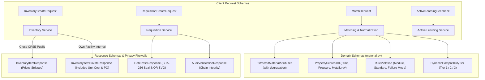

# Data Validation, Serialization & API Schemas (`backend/app/schemas/`)

## 1. Architectural Role & Overview

The `backend/app/schemas/` package defines the **Pydantic v2** validation, serialization, and contract schemas for **Samanvay-AI**.

It establishes strict OpenAPI boundaries across four vital subdomains:
1. **Material & Matching Contracts**: Dynamic relational compatibility tiers, physical property scorecards, deterministic rule violation structures, and TreeSHAP explainability attributions.
2. **Inventory Management & Privacy Controls**: Segregated public versus internal schemas enforcing attribute-level privacy (commercial costs are strictly scrubbed in cross-CPSE responses).
3. **Inter-CPSE Requisitions & CISF Logistics**: Request and approval models, two-phase reservation parameters, and digitally sealed CISF material gate passes.
4. **Sovereign Audit & RBAC Authentication**: CVC/CAG cryptographic hash chain envelopes, active learning HITL feedback schemas, and multi-tenant JWT payload contracts.

---

## 2. Schema Catalog

| Schema File | Core Classes & Enums | Functional Purpose |
| :--- | :--- | :--- |
| [`material.py`](file:///C:/Users/mayank/Development/Hackathons/Samanvay-AI/backend/app/schemas/material.py) | `DynamicCompatibilityTier`, `ExtractedMaterialAttributes`, `PhysicalAttributes`, `MatchRequest`, `PropertyScorecard`, `RuleViolation`, `CandidateMatchResult`, `MatchResponse`, `CompatibilityResult` | Dynamic compatibility evaluation, OCR extraction with graceful degradation, and multi-property breakdown contracts. |
| [`inventory.py`](file:///C:/Users/mayank/Development/Hackathons/Samanvay-AI/backend/app/schemas/inventory.py) | `InventoryStatus`, `InventoryItemResponse`, `InventoryItemPrivateResponse`, `InventoryCreateRequest`, `SurplusRadarItem` | Inventory lifecycle tracking and attribute-level commercial privacy firewall enforcement. |
| [`requisition.py`](file:///C:/Users/mayank/Development/Hackathons/Samanvay-AI/backend/app/schemas/requisition.py) | `UrgencyLevel`, `RequisitionStatus`, `RequisitionCreateRequest`, `RequisitionResponse`, `GatePassCreateRequest`, `GatePassResponse` | Inter-CPSE transfer requests, approval/rejection lifecycle, and CISF material gate pass contracts. |
| [`audit.py`](file:///C:/Users/mayank/Development/Hackathons/Samanvay-AI/backend/app/schemas/audit.py) | `AuditActionCategory`, `AuditLogEntry`, `AuditLogCreateRequest`, `AuditVerificationResponse`, `ActiveLearningFeedback` | Tamper-evident CVC/CAG audit log serialization, active learning feedback, and hash-chain verification responses. |
| [`auth.py`](file:///C:/Users/mayank/Development/Hackathons/Samanvay-AI/backend/app/schemas/auth.py) | `UserRole`, `UserLogin`, `UserSignup`, `UserResponse`, `Token`, `TokenPayload`, `SeedUserInfo`, `SEED_USERS` | Multi-tenant CPSE authentication, JWT bearer token claims, and pre-seeded test user directory. |
| [`__init__.py`](file:///C:/Users/mayank/Development/Hackathons/Samanvay-AI/backend/app/schemas/__init__.py) | Package namespace exports | Central hub re-exporting all API contracts. |

---

## 3. Deep-Dive Specification & Design Principles

### 3.1. Dynamic Compatibility Matching (`material.py`)

- **Dynamic Tier Computation**: Tiers are never static database attributes. They are computed on-the-fly relative to a specific query part $Q$ and candidate part $C$:
  - `TIER_1_IDENTICAL`: $\ge 95\%$ match composite score, identical dimensions and metallurgy.
  - `TIER_2_SUBSTITUTE`: $80\% - 94\%$ match composite score, safe standard upgrades requiring Human-In-The-Loop (HITL) sign-off.
  - `TIER_3_INCOMPATIBLE`: $< 80\%$ composite score OR any zero-tolerance engineering rule violation.
- **Granular Property Breakdown (`PropertyScorecard`)**:
  Separates physical dimensions, pressure ratings, metallurgy, connection ends, and component-specific properties into distinct `PropertyEvaluation` nodes with dedicated statuses (`IDENTICAL`, `SAFE_UPGRADE`, `ADAPTABLE`, `HARD_REJECT`).
- **Extracted Attributes & Graceful Degradation (`ExtractedMaterialAttributes`)**:
  Features model validators that parse shorthand units (e.g., converting `"4 INCH"` or `4"` to `100.0 mm`, and `300#` to integer `300`). If non-critical fields on degraded scans cannot be parsed, the schema flags `is_incomplete=True` and populates `missing_attributes` without raising validation errors.

### 3.2. Attribute-Level Privacy Firewall (`inventory.py`)

To satisfy strict MoPNG commercial confidentiality mandates during inter-CPSE surplus discovery:
- `InventoryItemResponse`: Emits technical specifications, quantities, and idle days, but **strictly omits** `unit_cost_inr`, `total_value_inr`, `po_no`, and `heat_no`.
- `InventoryItemPrivateResponse`: Inherits from `InventoryItemResponse` and includes cost and vendor metadata. This schema is restricted to authenticated users belonging to the owning facility.
- `SurplusRadarItem`: Dedicated schema for the Pre-Purchase Radar where commercial prices are scrubbed at the serialization boundary.

### 3.3. Inter-CPSE Requisition & CISF Gate Pass (`requisition.py`)

- **`RequisitionCreateRequest`**: Requires `sku_code`, `required_qty > 0`, `source_unit`, `justification`, `urgency_level` (`EMERGENCY_SHUTDOWN`, `PLANNED_MAINTENANCE`, `ROUTINE`), and an `Idempotency-Key` header.
- **`GatePassResponse`**: Returns the complete security document containing the `cisf_verification_seal`, `sha256_hash`, transit metrics (`transit_distance_km`, `estimated_transit_hours`), ecological impact (`co2_saved_kg`), and inline `qr_code_svg` for field barcode verification.

### 3.4. Sovereign Cryptographic Audit & HITL (`audit.py`)

- **`AuditVerificationResponse`**: Delivers the result of on-the-fly chain verification (`is_valid`, `total_entries`, `entries_verified`, `first_broken_index`).
- **`ActiveLearningFeedback`**: Captures engineer override decisions (`APPROVE`, `REJECT`, `RECLASSIFY`) with optional `tier_override` and confidence scores, triggering retraining datasets.

### 3.5. Multi-Tenant Role-Based Access Control (`auth.py`)

- **6 Functional Roles (`UserRole`)**:
  - `SITE_ENGINEER`: Creates search inquiries, reviews engineering upgrades.
  - `MATERIALS_MANAGER`: Manages plant stock, initiates inter-CPSE requisitions.
  - `TECHNICAL_AUTHORITY`: Reviews and triage-signs Tier-2 substitutes.
  - `CISF_SECURITY`: Inspects digital gate passes, authorizes perimeter dispatch.
  - `VIGILANCE_AUDITOR`: Inspects SHA-256 tamper-evident ledgers.
  - `SUPER_ADMIN`: Ministry-level administrative access.
- **Seed User Catalog (`SEED_USERS`)**:
  Pre-configures authentic CPSE test accounts across OIL Duliajan, IOCL Panipat, ONGC Uran, GAIL Pata, BPCL Mumbai, HPCL Visakh, NRL Numaligarh, and MoPNG.
