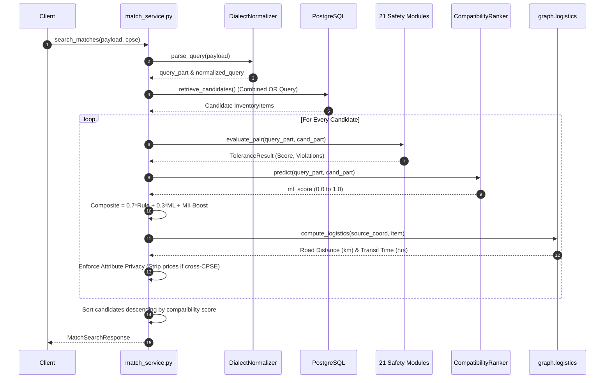

# Business Logic Services & Workflows (`backend/app/services/`)

## 1. Architectural Role & Overview

The `backend/app/services/` package encapsulates core business logic, domain workflows, zero-trust session management, and cross-subsystem orchestration for **Samanvay-AI**.

It acts as the intermediary between the presentation layer (`backend/app/api/`), the relational persistence models (`backend/app/models/`), the machine learning inference services (`machine_learning/`), and the knowledge graph (`graph/`), implementing transactional safety, privacy firewalls, and audit integrity.

```mermaid
flowchart TD
    subgraph APILayer["API Routers (backend/app/api/)"]
        R_Auth["routers/auth.py"]
        R_Match["routers/match.py"]
        R_Inv["routers/inventory.py"]
        R_Req["routers/requisition.py"]
        R_Audit["routers/audit.py"]
    end

    subgraph ServiceLayer["Core Domain & Security Services (backend/app/services/)"]
        AUTH_SESS["auth_session_service.py: Zero-Trust Server Sessions"]
        HIBP["hibp_service.py: HaveIBeenPwned k-Anonymity API"]
        RL["auth_rate_limit.py: Sliding Window Brute-Force Defense"]
        SCHEMA_VER["schema_verification.py: Production Baseline Checks"]
        MS["match_service.py: Zero-Mock Matching Pipeline"]
        IS["inventory_service.py: Multi-Tenant Stock & Privacy"]
        RS["requisition_service.py: 2-Phase Locks & CISF Gate Passes"]
        AS["audit_service.py: CVC/CAG SHA-256 Hash Chaining"]
        CDC["cdc_manager.py: Real-Time PostgreSQL -> Neo4j CDC"]
        SEED["seeder.py: Auto-Provisioning & Seed Personas"]
    end

    subgraph ExternalBackends["Engines & Storage Engines"]
        PG[(PostgreSQL 16)]
        NEO[(Neo4j Graph)]
        ML[ML Models & Safety Rules]
        HIBP_API["HIBP Range API (External)"]
    end

    R_Auth --> AUTH_SESS
    R_Auth --> HIBP
    R_Auth --> RL
    HIBP --> HIBP_API
    AUTH_SESS --> PG

    R_Match --> MS
    R_Inv --> IS
    R_Req --> RS
    R_Audit --> AS

    MS --> ML
    MS --> PG
    IS --> PG
    IS --> AS
    RS --> PG
    RS --> AS
    CDC --> PG
    CDC --> NEO
    SEED --> PG
```

---

## 2. Service Inventory

| Service File | Core Functions | Architectural Responsibility |
| :--- | :--- | :--- |
| [`auth_session_service.py`](file:///C:/Users/mayank/Development/Hackathons/Samanvay-AI/backend/app/services/auth_session_service.py) | `create_session()`, `resolve_session_with_outcome()`, `revoke_session()`, `record_security_event()`, `record_invalid_session_attempt()` | Server-side session lifecycle management, cryptographically hashed token lookup, active session tracking, and audit-grade `SecurityEvent` emission. |
| [`hibp_service.py`](file:///C:/Users/mayank/Development/Hackathons/Samanvay-AI/backend/app/services/hibp_service.py) | `check_password_breached()`, `verify_password_hygiene()` | Integrates with the Have I Been Pwned k-anonymity SHA-1 range API, preventing users from registering or setting breached passwords without exposing plaintext credentials. |
| [`auth_rate_limit.py`](file:///C:/Users/mayank/Development/Hackathons/Samanvay-AI/backend/app/services/auth_rate_limit.py) | `get_rate_limit_guard()`, `consume()`, `RateLimitGuard` | In-memory sliding-window rate limiter protecting login and credential endpoints against brute-force, credential stuffing, and dictionary attacks. |
| [`schema_verification.py`](file:///C:/Users/mayank/Development/Hackathons/Samanvay-AI/backend/app/services/schema_verification.py) | `verify_deployed_schema()`, `assert_baseline_intact()` | Production startup inspection verifying that PostgreSQL catalog matches the Alembic migration baseline, failing closed if any tables or version heads are missing. |
| [`match_service.py`](file:///C:/Users/mayank/Development/Hackathons/Samanvay-AI/backend/app/services/match_service.py) | `search_matches()`, `parse_query()`, `retrieve_candidates()`, `score_candidate()`, `compute_logistics()` | End-to-end zero-mock matching pipeline combining 21 safety rules (70%), GBDT ML ranker (30%), Indian standard equivalence, and Make-in-India scoring. |
| [`requisition_service.py`](file:///C:/Users/mayank/Development/Hackathons/Samanvay-AI/backend/app/services/requisition_service.py) | `create_requisition()`, `approve_requisition()`, `reject_requisition()`, `generate_gate_pass()`, `dispatch_requisition()`, `deliver_requisition()` | Multi-depot transactional inventory reservations (`SELECT ... FOR UPDATE`), inter-CPSE transfer lifecycle, and CISF SVG gate passes with digital seals. |
| [`inventory_service.py`](file:///C:/Users/mayank/Development/Hackathons/Samanvay-AI/backend/app/services/inventory_service.py) | `list_inventory()`, `get_item()`, `transition_status()`, `get_surplus_radar()`, `get_inventory_stats()` | Plant stock queries, lifecycle transitions, attribute-level privacy enforcement (cost stripping), and ministry metrics computation. |
| [`audit_service.py`](file:///C:/Users/mayank/Development/Hackathons/Samanvay-AI/backend/app/services/audit_service.py) | `create_audit_entry()`, `verify_chain()`, `list_audit_entries()`, `export_csv()` | Tamper-evident CVC/CAG cryptographic hash chaining, continuous integrity verification, and RFC 4180 CSV export with UTF-8 BOM. |
| [`cdc_manager.py`](file:///C:/Users/mayank/Development/Hackathons/Samanvay-AI/backend/app/services/cdc_manager.py) | `init_cdc_schema()`, `start_cdc_worker()`, `process_pending_events()`, `backfill_graph_if_empty()` | Real-time PostgreSQL Change Data Capture using advisory locks (`0x53414D41`), outbox triggers, `LISTEN/NOTIFY`, and Neo4j mirroring. |
| [`seeder.py`](file:///C:/Users/mayank/Development/Hackathons/Samanvay-AI/backend/app/services/seeder.py) | `seed_database_if_empty()`, `seed_users_if_empty()` | Automated startup provisioning loading 5,000 catalog items, Genesis audit entry, and 23 seed persona accounts across 7 CPSEs (development only). |
| [`__init__.py`](file:///C:/Users/mayank/Development/Hackathons/Samanvay-AI/backend/app/services/__init__.py) | Package initialization | Namespace anchor. |

---

## 3. Deep-Dive Service Architecture

### 3.1. Zero-Trust Session Management (`auth_session_service.py`)

Replaces vulnerable client-side tokens with database-backed, revocable server-side sessions:
1. **Cryptographic Token Separation**:
   - The user agent receives a 256-bit entropy random secret via `__Host-samanvay_session`.
   - The database only ever stores the 64-character SHA-256 hash (`session_token_hash`). If the database is compromised, active session secrets cannot be re-derived.
2. **Deterministic Lifecycle States**:
   - Evaluates sessions into four mutually exclusive outcomes: `live`, `expired`, `revoked`, or `unknown`.
   - Upon encountering any non-live session, immediately emits an HTTP `Set-Cookie` deletion header to clear the client's cookie jar.
3. **Security Telemetry (`SecurityEvent`)**:
   - Automatically records structured audit events: `LOGIN_SUCCESS`, `LOGIN_FAILURE`, `SESSION_REVOKED`, `ACCOUNT_PROVISIONED`, `ACCOUNT_APPROVED`, `ACCOUNT_REJECTED`, and `AUTHORIZATION_FAILURE`.
   - Strips sensitive credentials, passwords, and tokens before persistence.

---

### 3.2. Password Hygiene & Breach Prevention (`hibp_service.py`)

Protects public sector infrastructure against compromised credential reuse:
- Hashes user password via SHA-1: $\text{Hash} = \text{SHA1}(P)$.
- Transmits only the first 5 hexadecimal characters (prefix) to the Have I Been Pwned API.
- Re-assembles the remaining 35-character suffix locally in memory, verifying whether the hash appears in known global breach dumps.
- Rejects any breached password with clear user guidance to select a secure alternative.

---

### 3.3. Zero-Mock Matching Pipeline (`match_service.py`)

The matching service executes a 6-stage evaluation pipeline for cross-CPSE spare part discovery:

- **Attribute-Level Privacy Firewall**: If `item.cpse != requester_cpse`, commercial prices (`unit_cost_inr`, `total_value_inr`, `po_no`) are stripped before transmission.
- **Cross-Standard Equivalence Engine**: Detects dual-certified materials (e.g., `IS 1239` $\longleftrightarrow$ `ASTM A106 Gr. B` / `API 5L`, `IS 2062` $\longleftrightarrow$ `ASTM A105`, `IS 14846` $\longleftrightarrow$ `API 600 WCB`).
- **Make-in-India (PPP-MII) Compliance**: Rewards Class-I local content ($\ge 50\%$) with a $+0.03$ score bonus while flagging non-local materials with compliance warnings.

---

### 3.4. Inter-CPSE Requisitions & Consignment Lifecycle (`requisition_service.py`)

Enforces financial and physical asset custody transitions:
1. **Two-Phase Reservation Locking**:
   - Executes `SELECT ... FOR UPDATE` on `InventoryItem`.
   - Inserts `InventoryLock` record with 7-day TTL expiration.
   - Debits `quantity` immediately to prevent double-allocation across concurrent plant requests.
2. **Rejection Rollback**:
   - If rejected, releases the active `InventoryLock` and atomically restores `item.quantity`.
3. **CISF Digital Gate Pass Issuance**:
   - Requires `status == "APPROVED"`.
   - Computes SHA-256 seal: $\text{Seal} = \text{SHA256}(\text{GatePassNo} \parallel \text{Vehicle} \parallel \text{Driver} \parallel \text{SKU} \parallel \text{Qty} \parallel \text{Officer} \parallel \text{Time})$.
   - Embeds vector SVG QR code for offline field scanning at refinery security gates.
   - Calculates road distance and carbon emissions saved ($\text{CO}_2\text{ saved in kg}$).
4. **Dispatch & Delivery**:
   - Transitions state from `APPROVED` $\longrightarrow$ `GATE_PASS_ISSUED` $\longrightarrow$ `DISPATCHED` $\longrightarrow$ `DELIVERED`.
   - Permanently deactivates the reservation lock upon verified delivery.

---

### 3.5. Change Data Capture Manager (`cdc_manager.py`)

Maintains sub-millisecond real-time synchronization between relational PostgreSQL records and the Neo4j knowledge graph:
- **Startup Concurrency Control**: Uses PostgreSQL transaction advisory lock (`0x53414D41`) to guarantee idempotent DDL execution across multi-worker deployments.
- **Dual Triggers**: Attaches `fn_cdc_capture()` triggers to `inventory_items` and `requisitions`, writing mutations to `cdc_outbox` and emitting `pg_notify('samanvay_cdc_channel')`.
- **Worker Loop**: Listens on the PostgreSQL notification channel using non-blocking `select.select(..., 2.0)` with automated outbox backlog draining upon reconnects.

---

### 3.6. Sovereign Cryptographic Audit Ledger (`audit_service.py`)

Implements tamper-evident audit trails for CVC and CAG compliance:
- Anchors each new event to the previous record's SHA-256 digest ($H_0 = \text{"0"}^{64}$).
- `verify_chain()` scans ledger height in chronological sequence, confirming parent pointer continuity and recomputing SHA-256 hashes.
- `export_csv()` formats records to RFC 4180 with UTF-8 Byte Order Mark (`\ufeff`) for seamless Excel and audit software import.
