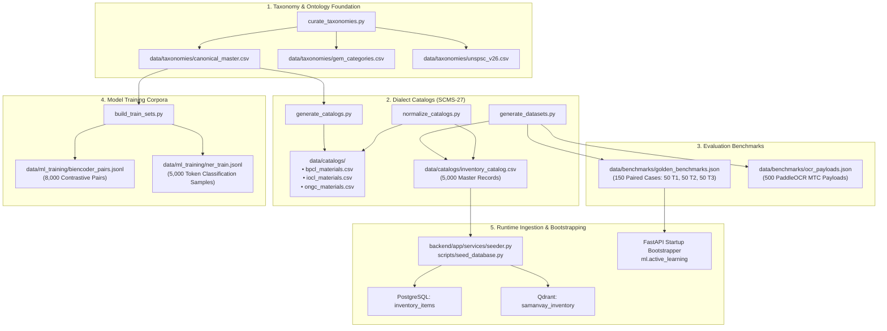

# Data Subsystem & Global Material Schema Architecture (`data/`)

The `data/` package serves as the single sovereign source of truth for all CPSE material catalogs, canonical taxonomies, evaluation benchmarks, and ML training sets in Samanvay-AI. All former legacy `datasets/` locations have been unified under `data/`, standardizing the project on the **Samanvay Canonical Material Schema (SCMS-27)**.

---

## 1. Directory Organization

```
data/
├── catalogs/               # Multi-CPSE inventory ledgers & ERP dialect catalogs
│   ├── inventory_catalog.csv   # Master 5,000-item multi-CPSE catalog (PostgreSQL/Qdrant seeder)
│   ├── bpcl_materials.csv      # BPCL Shell MESC metric dialect catalog (3,600 items)
│   ├── iocl_materials.csv      # IOCL refinery dialect catalog (3,600 items)
│   ├── ongc_materials.csv      # ONGC offshore verbose dialect catalog (3,600 items)
│   └── README.md
├── benchmarks/             # Golden evaluation test suites & OCR stress payloads
│   ├── golden_benchmarks.json  # 150 paired engineering test cases (Tier 1/2/3 safety traps)
│   └── ocr_payloads.json       # 500 PaddleOCR MTC payloads (degraded scans & hallucinations)
├── taxonomies/             # Master engineering ontologies & national procurement codes
│   ├── canonical_master.csv    # 2,201 canonical size, class, and metallurgy combinations
│   ├── gem_categories.csv      # Government e-Marketplace (GeM) category mappings
│   ├── unspsc_v26.csv          # UNSPSC v26 commodity classification codes
│   └── README.md
├── ml_training/            # Fine-tuning corpora for NER and bi-encoder models
│   ├── biencoder_pairs.jsonl   # 8,000 hard positive/negative contrastive pairs
│   ├── ner_train.jsonl         # 5,000 character-annotated token classification samples
│   └── README.md
├── raw/                    # Raw vector test PDFs & ground truth extraction labels
│   ├── sample_mtc_*.pdf        # EN 10204 Type 3.1 Mill Test Certificates
│   ├── sample_mtc_ground_truth.json
│   └── README.md
├── generators/             # Synthetic data generators & dialect noise models
│   ├── generate_datasets.py    # Master dataset generator for catalogs and benchmarks
│   └── README.md
├── build_train_sets.py     # Generates NER token data & bi-encoder contrastive pairs
├── curate_taxonomies.py    # Builds canonical master catalog and ontology hierarchies
├── generate_catalogs.py    # Synthesizes 10,800+ realistic CPSE dialect catalog rows
├── normalize_catalogs.py   # Automated SCMS-27 schema normalizer for catalog CSVs
└── seed_documents.py       # ReportLab PDF MTC and Delivery Challan synthesizer
```

---

## 2. Samanvay Canonical Material Schema (SCMS-27)

All CSV files under `data/catalogs/`, database models ([`InventoryItem`](file:///C:/Users/mayank/Development/Hackathons/Samanvay-AI/backend/app/models/tables.py)), and contract DTOs ([`CanonicalMaterialItem`](file:///C:/Users/mayank/Development/Hackathons/Samanvay-AI/backend/app/contracts/canonical_schema.py)) enforce the **27 standard canonical columns** organized into 6 functional tiers:

### Tier 1: Identity & Multi-Tenant Partitioning
| Column | Type | Description | Example |
| :--- | :--- | :--- | :--- |
| `sku_code` | `VARCHAR(64)` | Unique CPSE SKU / Local material code | `OIL-STU-00001`, `ONGC-MAT-0000001` |
| `canonical_id` | `VARCHAR(64)` | Normalized canonical ontology ID | `CAN-000590` |
| `cpse` | `VARCHAR(32)` | CPSE operating entity (IOCL, ONGC, BPCL, OIL, etc.) | `OIL`, `ONGC`, `IOCL` |
| `depot_id` | `VARCHAR(64)` | Internal depot code | `OIL_CENTRAL_MATERIALS_WAREHOUSE` |
| `depot_location`| `VARCHAR(255)`| Physical warehouse depot location & state | `OIL Central Materials Warehouse, Duliajan, Assam` |

### Tier 2: Physical & Engineering Specifications
| Column | Type | Description | Example |
| :--- | :--- | :--- | :--- |
| `item_type` | `VARCHAR(64)` | Standardized equipment category | `VALVE_BALL`, `FLANGE_WELD_NECK`, `PIPE` |
| `description` | `TEXT` | Full engineering / catalog description | `VLV BL 500 MM NB (20IN) PN 100 ...` |
| `size_nb_mm` | `NUMERIC(8,2)`| Nominal bore in millimeters | `50.0`, `150.0`, `500.0` |
| `pressure_class`| `INTEGER` | ASME pressure rating | `150`, `300`, `600`, `900`, `1500` |
| `pressure_rating_bar`| `NUMERIC(8,2)`| Metric PN pressure rating in Bar | `16.0`, `20.0`, `100.0`, `250.0` |
| `metallurgy` | `VARCHAR(64)` | ASTM / AISI metallurgical specification | `ASTM A105`, `ASTM A350 LF2`, `316L SS` |
| `facing_end` | `VARCHAR(32)` | Flange facing or pipe end connection | `RF`, `RTJ`, `BW`, `FF`, `NPT` |
| `schedule` | `VARCHAR(32)` | Pipe or fitting wall schedule | `SCH 40`, `SCH 80`, `SCH 160`, `SCH XXS` |

### Tier 3: Standards, Compliance & National Mandates
| Column | Type | Description | Example |
| :--- | :--- | :--- | :--- |
| `standard` | `VARCHAR(64)` | International standard (API / ASME / ASTM) | `ASME B16.5`, `API 6D`, `BS EN ISO 17292` |
| `indian_standard`| `VARCHAR(100)`| Bureau of Indian Standards (BIS / IS) | `IS 1367 Part 3 Class 8.8`, `IS 9890` |
| `oil_std_spec` | `VARCHAR(100)`| OISD safety standard or EIL specification | `OISD-STD-118`, `EIL 6-44-0012` |
| `make_in_india_class`| `VARCHAR(32)`| PPP-MII preference classification | `Class-I`, `Class-II`, `Non-Local` |
| `local_content_percentage`| `NUMERIC(5,2)`| Indigenous manufacturing percentage | `58.7`, `75.0`, `92.0` |

### Tier 4: Public Procurement & Catalog Mapping
| Column | Type | Description | Example |
| :--- | :--- | :--- | :--- |
| `oil_material_code`| `VARCHAR(32)`| 8-digit OIL SAP MESC material code | `02.14.23.21.58`, `05.02.64.14.13` |
| `gem_category_id` | `VARCHAR(100)`| GeM product category classification | `GeM/CAT/VALVES/BALL/API6D` |
| `cppp_tender_ref` | `VARCHAR(100)`| Central Public Procurement Portal tender ID | `OIL/DUL/MAT/2026/0002` |
| `po_no` | `VARCHAR(128)`| Historical purchase order reference | `OIL/PO/2024/662275` |

### Tier 5: Inventory, Valuation & Lifecycle
| Column | Type | Description | Example |
| :--- | :--- | :--- | :--- |
| `quantity` | `INTEGER` | Current on-hand stock quantity ($\ge 0$) | `61`, `90`, `250` |
| `unit_cost_inr` | `NUMERIC(14,2)`| Unit acquisition cost in INR | `1614.33`, `23357.31` |
| `status` | `VARCHAR(32)` | Material lifecycle status | `TO_BE_CONSUMED`, `SURPLUS_DECLARED` |
| `days_idle` | `INTEGER` | Days stock has remained unconsumed | `74`, `117`, `450` |
| `is_broadcasted_surplus`| `BOOLEAN` | Cross-CPSE surplus exchange broadcast flag | `true`, `false` |

### Tier 6: Extensible Key-Value Properties
Additional equipment-specific attributes (`heat_no`, `gem_product_id`, `pressure_rating_psi`, `location_state`, `hsn_code`, `unspsc_code`, `trim`, `port_bore`, `seal_plan`) are stored in the database model and encapsulated within the `properties` JSONB dictionary.

---

## 3. Data Flow Architecture



---

## 4. Normalization Rules & Aliases

The [`normalize_catalog_row`](file:///C:/Users/mayank/Development/Hackathons/Samanvay-AI/backend/app/contracts/canonical_schema.py) contract automatically maps legacy CPSE headers into canonical columns:

- `cpse_name`, `company`, `psu` $\rightarrow$ `cpse`
- `raw_description`, `item_description`, `material_desc` $\rightarrow$ `description`
- `local_code`, `material_code`, `item_code` $\rightarrow$ `sku_code`
- `nominal_bore_mm`, `size_mm`, `extracted_size_nb_mm` $\rightarrow$ `size_nb_mm`
- `extracted_item_type`, `equipment_type` $\rightarrow$ `item_type`
- `extracted_pressure_class`, `rating_class` $\rightarrow$ `pressure_class`
- `extracted_metallurgy`, `material_grade` $\rightarrow$ `metallurgy`
- `extracted_facing`, `facing`, `end_connection` $\rightarrow$ `facing_end`
- `extracted_standard`, `std` $\rightarrow$ `standard`
- `idle_days`, `aging_days` $\rightarrow$ `days_idle`
- `mesc_code`, `sap_material_code` $\rightarrow$ `oil_material_code`
- `gem_category` $\rightarrow$ `gem_category_id`
- `cppp_tender_id` $\rightarrow$ `cppp_tender_ref`
- `is_surplus` $\rightarrow$ `is_broadcasted_surplus`
