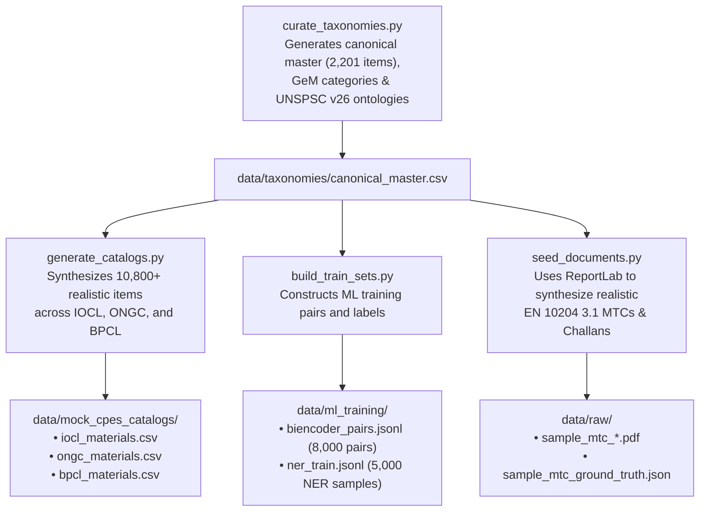

# Data Pipelines & Catalog Generation Subsystem

The `data` package generates, synthesizes, and maintains the training corpora, mock CPSE inventory catalogs, PDF test documents, and material taxonomies for Samanvay-AI.

---

## Data Architecture & Workflow

---

## Script Breakdown

### 1. `curate_taxonomies.py`
- Curates the canonical master catalog (`taxonomies/canonical_master.csv`) spanning 2,200+ distinct size, class, and metallurgical combinations.
- Generates `taxonomies/gem_categories.csv` and `taxonomies/unspsc_v26.csv`.

### 2. `generate_catalogs.py`
- Ingests the canonical master catalog and applies CPSE-specific dialect noise models to produce:
  - `mock_cpes_catalogs/iocl_materials.csv`: Downstream refinery dialect.
  - `mock_cpes_catalogs/ongc_materials.csv`: Upstream offshore dialect.
  - `mock_cpes_catalogs/bpcl_materials.csv`: Shell MESC dialect.
- Assigns physical warehouse locations, idle stock days ($30 \dots 1200\text{ days}$), and surplus availability flags.

### 3. `build_train_sets.py`
- Synthesizes 5,000 character-annotated token classification samples (`ml_training/ner_train.jsonl`).
- Generates 8,000 hard negative and positive pairs for bi-encoder fine-tuning (`ml_training/biencoder_pairs.jsonl`).

### 4. `seed_documents.py`
- Uses ReportLab to generate vector PDF Mill Test Certificates (MTCs conforming to EN 10204 Type 3.1) and delivery challans into `data/raw/`.
- Pairs PDFs with exact ground truth chemical and mechanical annotations in `data/raw/sample_mtc_ground_truth.json`.
