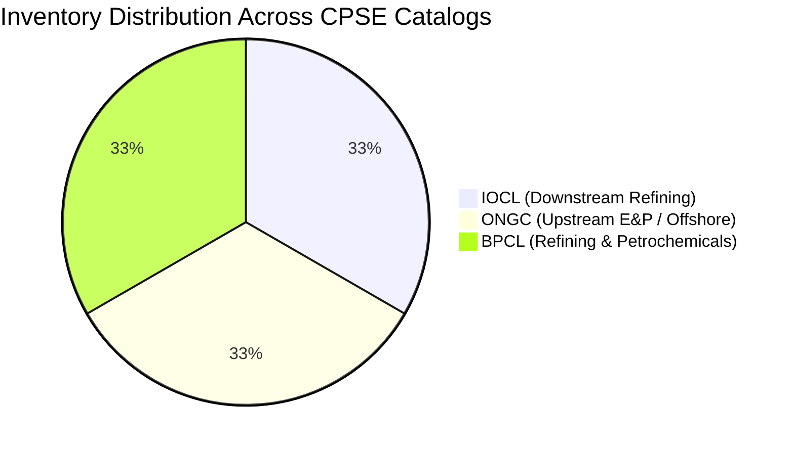

# Multi-CPSE Mock Enterprise Material Catalogs

The `data/mock_cpes_catalogs` directory contains realistic synthetic inventory catalogs totaling 10,800+ line items distributed across India's three largest oil & gas CPSEs.

---

## Catalog Overview

---

## File Breakdown & Enterprise Dialect Profiles

### 1. `iocl_materials.csv` (Indian Oil Corporation Limited)
- **Item Count**: 3,601 records.
- **Operating Depots**: Panipat (`DEPOT-IOCL-PNP`), Mathura (`DEPOT-IOCL-MTH`), Guwahati (`DEPOT-IOCL-GWT`), Koyali (`DEPOT-IOCL-KYL`), Paradip (`DEPOT-IOCL-PRD`).
- **Dialect Characteristics**: Heavy text truncation, omission of non-critical vowels, concatenated alphanumeric tokens, and imperial pound symbols (e.g. `FLG WNRF 4IN 300# A105`, `VLV GT 2IN 150LB WCB`).

### 2. `ongc_materials.csv` (Oil and Natural Gas Corporation)
- **Item Count**: 3,601 records.
- **Operating Depots**: Hazira Plant (`DEPOT-ONGC-HZR`), Uran Gas Terminal (`DEPOT-ONGC-URN`), Ankleshwar Asset (`DEPOT-ONGC-ANK`), Mumbai Offshore Logistics Base (`DEPOT-ONGC-MBO`), Rajahmundry Asset (`DEPOT-ONGC-RJM`).
- **Dialect Characteristics**: Upstream offshore standards, API 6D pipeline nomenclature, NACE MR0175 sour service tags, and metric nominal diameters (e.g. `GATE VALVE DN50 CL150 NACE SOUR MR0175`, `BALL VALVE 6" 600# RTJ FB API 6D`).

### 3. `bpcl_materials.csv` (Bharat Petroleum Corporation Limited)
- **Item Count**: 3,601 records.
- **Operating Depots**: Mumbai Mahul Refinery (`DEPOT-BPCL-MUM`), Kochi Refinery (`DEPOT-BPCL-KCH`), Bina Refinery (`DEPOT-BPCL-BIN`), Numaligarh Base (`DEPOT-BPCL-NML`).
- **Dialect Characteristics**: Shell MESC alignment (`MESC 03.10.45.19`), European metric PN ratings (`PN50`, `PN20`), and full engineering noun descriptions.

---

## Standard Schema Across Catalogs

| Column Header | Data Type | Example Value | Description |
| :--- | :--- | :--- | :--- |
| `sku_code` | String (Unique) | `IOCL-MTH-FLG-0812` | Unique enterprise stock keeping unit identifier |
| `cpse_id` | String | `IOCL` | Central Public Sector Enterprise acronym |
| `depot_id` | String | `DEPOT-IOCL-MTH` | Physical warehouse / plant identifier |
| `raw_description`| String | `FLG WNRF 4IN 300# A105`| Non-standardized native ERP catalog string |
| `canonical_id` | String | `CANON-FLG-WN-0012` | Link to standardized canonical master item |
| `quantity` | Integer | `45` | Real-time stock on hand in physical warehouse |
| `unit_cost_inr` | Float | `14500.00` | Book value in Indian Rupees |
| `is_surplus` | Boolean | `True` | Declared eligible for cross-CPSE mutual aid transfer |
| `days_idle` | Integer | `485` | Inactivity duration identifying dormant dead stock |
