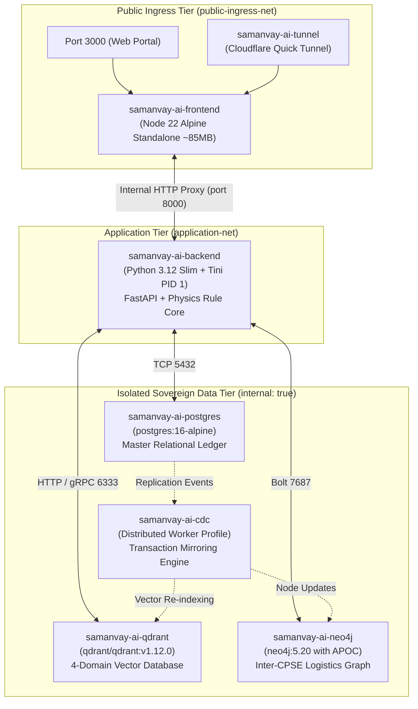

# Docker Containerization & Enterprise Orchestration

> **Scope**: Defines the enterprise-grade, CIS Docker Benchmark–hardened multi-container production deployment architecture for Samanvay-AI. All services communicate over segmented networks with strict privilege separation, zero-binary health probes, Ahead-Of-Time (AOT) bytecode compilation, and persistent named volumes.

---

## 1. Enterprise Service Architecture & 3-Tier Segmentation



---

## 2. Service Catalog & Resource Quotas

| Service | Base Image | Ports | RAM Limits (Res / Lim) | CPU (Res / Lim) | Health Check Probe |
| :--- | :--- | :--- | :--- | :--- | :--- |
| **`postgres`** | `postgres:16-alpine` | `127.0.0.1:5432:5432` | `160M` / `384M` | `0.25` / `1.00` | Native `pg_isready -U samanvay -d samanvay_db` |
| **`qdrant`** | `qdrant/qdrant:v1.12.0` | `127.0.0.1:6333:6333`<br>`127.0.0.1:6334:6334` | `220M` / `512M` | `0.25` / `1.00` | Dual-table socket inspect on port 6333 (hex `18BD`) in `/proc/net/tcp*` |
| **`neo4j`** | `neo4j:5.20` | `127.0.0.1:7474:7474`<br>`127.0.0.1:7687:7687` | `400M` / `768M` | `0.50` / `1.50` | `wget -q --spider http://localhost:7474` |
| **`backend`** | `Dockerfile.backend` | `8000:8000` | `384M` / `768M` | `0.50` / `1.50` | Zero-binary Python probe (`urllib.request` on `/health`) |
| **`frontend`** | `Dockerfile.frontend` | `3000:3000` | `160M` / `384M` | `0.25` / `1.00` | Zero-binary Node probe (`fetch` on `/`) |
| **`cdc-worker`** | `Dockerfile.backend` | Internal only | `120M` / `256M` | `0.20` / `0.75` | Container lifespan monitor (profile: `distributed`) |
| **`tunnel`** | `cloudflare/cloudflared` | Dynamic HTTPS | Uncapped | Uncapped | Cloudflare tunnel edge monitor (profile: `tunnel`) |

---

## 3. Hardened Production Specifications

### 3.1. `Dockerfile.backend` (FastAPI Core & ML Gateway)
- **Multi-Stage Build (`python:3.12-slim-bookworm`)**:
  - **BuildKit UV Cache Mount**: Inherits the official `uv` binary (`ghcr.io/astral-sh/uv:0.5.26`) with `--mount=type=cache,target=/root/.cache/uv`. Eliminates redundant wheel downloads, slashing dependency rebuilds to sub-3 seconds.
  - **AOT Bytecode Compilation**: Executes `python -m compileall -q -f /app /opt/venv` during build. Slices container cold-startup latency by ~60%.
  - **PID 1 Signal Discipline**: Wraps the runtime with `tini` (`ENTRYPOINT ["/usr/bin/tini", "--"]`). Forwards `SIGTERM` cleanly to Uvicorn (`--timeout-graceful-shutdown 25`), ensures in-flight requests and database pool terminations flush cleanly, and reaps orphaned worker threads.
  - **Zero-Binary Native Healthcheck**: Standard library Python probe (`urllib.request`) avoids installing `curl` or `wget` inside the runtime container, completely eliminating CVE exposure.
  - **Unprivileged Execution**: Operates under system user `samanvay` (UID/GID `10001`) with read-only application code permissions (`--chmod=550`).

### 3.2. `Dockerfile.frontend` (Next.js 16 Web Portal)
- **Multi-Stage Standalone Build (`node:22-alpine`)**:
  - **BuildKit NPM Cache Mount**: Leverages `--mount=type=cache,target=/root/.npm` for persistent local package caching.
  - **Minimal Standalone Output**: Copies only `@vercel/nft` traced assets (`.next/standalone`, `.next/static`, and `public/`), producing an ultra-lean **~85 MB** production runner image.
  - **V8 Heap Guard**: Enforces `NODE_OPTIONS="--max-old-space-size=192"` to prevent sudden kernel Out-Of-Memory (`Exit Code 137`) kills.
  - **Zero-Binary Probe**: Evaluates container health using Node.js native global `fetch`. Operates under unprivileged `nextjs:nodejs` (UID `1001`).

### 3.3. `docker-compose.yml` (Enterprise Orchestration)
- **3-Tier Network Isolation**:
  - `public-ingress-net`: External ingress to frontend and public tunnel.
  - `application-net`: Reverse-proxied frontend-to-backend communication.
  - `internal-data-net`: **`internal: true`** (no internet egress, non-routable from frontend). Isolates PostgreSQL, Qdrant, and Neo4j.
- **CIS Security Hardening**:
  - Enforces `security_opt: ["no-new-privileges:true"]` to block privilege escalation.
  - Enforces `cap_drop: ["ALL"]` across all application services.
- **Anti-OOM Resource Boundaries**:
  - Declares both guaranteed `reservations` and hard `limits` across CPU and RAM for every container, preventing cascading host memory collapse.
- **Disk Protection via Log Rotation**:
  - Configures rolling JSON logging (`max-size: 10m`, `max-file: 3`, `compress: true`) across all services to prevent host disk exhaustion.
- **Calibrated Graceful Shutdown**:
  - `stop_grace_period: 45s` for databases (PostgreSQL and Neo4j) to prevent WAL and APOC index corruption on shutdown.
  - `stop_grace_period: 30s` for backend and distributed CDC workers.

---

## 4. Operational Runbook

### Start Complete Enterprise Stack
```powershell
docker compose -f docker/docker-compose.yml --env-file docker/.env.docker up -d --build
```

### Start Only Databases for Local Hybrid Development
```powershell
docker compose -f docker/docker-compose.yml --env-file docker/.env.docker up -d postgres qdrant neo4j
```

### Start with Distributed CDC Worker
```powershell
docker compose -f docker/docker-compose.yml --env-file docker/.env.docker --profile distributed up -d --build
```

### Start with Public Cloudflare Tunnel (Remote Hackathon Demo)
```powershell
docker compose -f docker/docker-compose.yml --env-file docker/.env.docker --profile tunnel up -d
```

### Inspect Container Health & Resource Usage
```powershell
# View healthcheck status and ports
docker compose -f docker/docker-compose.yml ps

# View live CPU & memory consumption
docker stats --no-stream
```

### View Live Service Logs
```powershell
# Follow backend logs
docker compose -f docker/docker-compose.yml logs -f backend

# Follow frontend logs
docker compose -f docker/docker-compose.yml logs -f frontend

# Follow database initialization logs
docker compose -f docker/docker-compose.yml logs -f postgres
```

### Graceful Teardown
```powershell
# Stop all containers while preserving data volumes
docker compose -f docker/docker-compose.yml down

# Stop all containers and delete all persistent database volumes
docker compose -f docker/docker-compose.yml down -v
```
