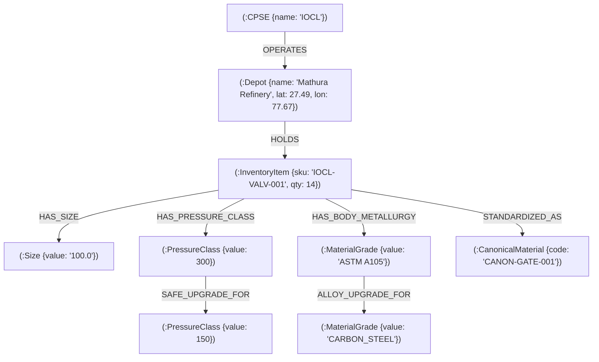

# Inter-CPSE Mutual Aid Graph & Logistics Mesh

The `graph` package implements the Neo4j 5.20 property graph topology, geospatial depot logistics calculations, and real-time relational-to-graph synchronization for Samanvay-AI. It powers mutual aid inventory sharing across Indian CPSEs (**IOCL, ONGC, BPCL, HPCL, GAIL, OIL, and NRL**).

---

## Topology & Knowledge Model

---

## File Breakdown

### 1. `schema.py` (Graph Ontology & Enums)
- **`NodeTypes`**: Primary entity labels (`CPSE`, `Depot`, `InventoryItem`, `CanonicalMaterial`, `Size`, `PressureClass`, `MaterialGrade`, `PipeSchedule`, `FlangeFacing`, `ValveTrim`, `GeMCategory`, `UNSPSCCommodity`).
- **`RelTypes`**: Graph edge relationships (`OPERATES`, `HOLDS`, `HAS_SIZE`, `HAS_PRESSURE_CLASS`, `HAS_BODY_METALLURGY`, `STANDARDIZED_AS`, `CLASSIFIED_UNDER`).
- **`CompatEdges`**: Engineering tolerance upgrade paths stored directly as traversable graph edges (`EXACT_MATCH`, `SAFE_UPGRADE_FOR`, `ALLOY_UPGRADE_FOR`, `TRIM_UPGRADE_FOR`).

### 2. `logistics.py` (Geospatial Transit & Carbon Footprint)
- **`DEPOT_COORDINATES`**: Accurate latitude/longitude coordinates for 35+ Indian oil & gas facilities across Assam (Duliajan, Digboi, Numaligarh), Gujarat (Hazira, Koyali, Ankleshwar), Maharashtra (Mumbai High, Uran, Mahul), Uttar Pradesh (Mathura), Haryana (Panipat), Odisha (Paradip), and Kerala (Kochi).
- **`haversine_distance(lat1, lon1, lat2, lon2) -> float`**: Great-circle distance using Earth radius $R = 6371.0\text{ km}$.
- **`road_distance(lat1, lon1, lat2, lon2) -> float`**: Accounts for Indian national highway topography using standard tortuosity multiplier of $1.28\times$.
- **`estimate_transit_hours(distance_km)`**: Computes heavy commercial vehicle transit duration at average speed of $40\text{ km/h}$.
- **`estimate_freight_cost_inr(distance_km, weight_tonnes)`**: Freight pricing model: $\text{Base } 1500\text{ INR} + \text{INR } 4.50 \times \text{Distance (km)} \times \text{Weight (t)}$.
- **`compute_co2_saved(distance_km, weight_tonnes)`**: Calculates Bureau of Energy Efficiency (BEE) freight emissions avoided: $0.089\text{ kg } CO_2/\text{tonne-km}$.

### 3. `queries.py` (`GraphQuerier`)
- Executes multi-hop Cypher queries to discover available surplus stock in neighboring sister CPSE depots satisfying exact nominal size with valid pressure/alloy upgrade traversals (`SAFE_UPGRADE_FOR*`).

### 4. `syncer.py` (`Neo4jSyncer`)
- Ensures unique constraints on `:CPSE(name)`, `:Depot(id)`, `:InventoryItem(sku)`, and `:Requisition(id)`.
- Replicates relational database rows into Neo4j nodes and connects property relationships in real-time.

### 5. `seed_graph.py` (`GraphSeeder`)
- Populates initial database topology: 7 national CPSEs, 35 operational depots, standard pressure class ladders ($150 \rightarrow 300 \rightarrow 600 \dots$), and metallurgical grade DAGs.
