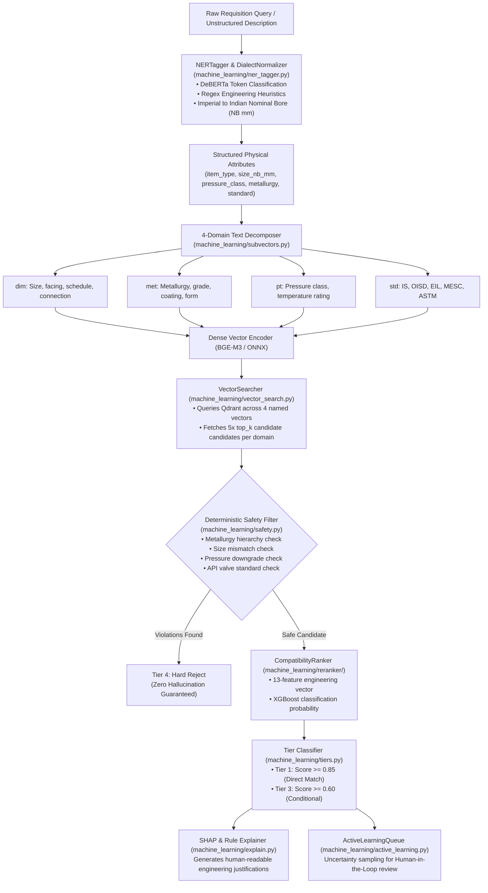

# Machine Learning Core Architecture

The `machine_learning` package houses the intelligence core of Samanvay-AI. It combines neural named entity recognition (NER), 4-domain subvector dense retrieval, an XGBoost compatibility reranker, deterministic industrial safety gates, and a human-in-the-loop active learning queue.

---

## Machine Learning Pipeline Architecture



---

## File Breakdown & Module Responsibilities

### 1. `ner_tagger.py` (Attribute Extraction & Dialect Normalization)
- **`NERTagger`**: Transformer pipeline wrapping fine-tuned DeBERTa (`ner_deberta`) with character-offset token classification for 18 entity labels (`ITEM_TYPE`, `SIZE`, `PRESSURE_RATING`, `METALLURGY`, `INDIAN_STANDARD`, `OISD_STANDARD`, `EIL_SPECIFICATION`, `MESC_CODE`, `MII_CLASS`, etc.).
- **`DialectNormalizer`**: Industrial dialect normalizer designed for Indian PSU procurement terminology.
  - Automatically maps imperial nominal sizes (`4IN`, `2"`, `1/2 INCH`) to Indian Standard Nominal Bore equivalents (`4.0` in $\rightarrow$ `100.0` mm NB).
  - Normalizes metric units (`100mm NB` $\rightarrow$ `100.0`).
  - Standardizes pressure ratings (`300#`, `CLASS 300`, `PN 50` $\rightarrow$ `300`).
  - Extracts MESC codes (`03.10.45.19`), OISD standards, and Make-in-India (`Class-I` / `Class-II`) classifications.
- **`extract_attributes(raw_description)`**: High-level convenience entrypoint.

### 2. `subvectors.py` (4-Domain Semantic Decomposition)
- **`DOMAINS = ("dim", "met", "pt", "std")`**: Defines the four semantic projections.
- **`subvector_texts(value)`**: Decomposes an item dictionary into domain-specific text segments:
  - `dim`: Dimensional specs (`size_nb_mm`, `size_inch`, `dn_code`, `dimension`, `schedule`, `end_connection`).
  - `met`: Material specs (`metallurgy`, `material_grade`, `coating`, `product_form`).
  - `pt`: Pressure-temperature ratings (`pressure_class`, `temperature_rating`, `pressure_rating`).
  - `std`: Standards and codes (`standard`, `indian_standard`, `oisd_standard`, `eil_specification`, `mesc_code`, `gem_category`).
- **`encode_subvectors(value, encoder)`**: Encodes each domain text into normalized dense vectors.

### 3. `vector_search.py` (`VectorSearcher` & Qdrant Indexer)
- **`VectorSearcher`**:
  - Executes simultaneous subvector search on Qdrant using `using=domain`.
  - Filters by canonical item family (`FLANGE`, `VALVE`, `BOLT`, etc.).
  - Calculates combined score: $Score = 0.75 \times \max(\text{scores}) + 0.25 \times \text{mean}(\text{scores})$.
  - Dispatches candidates through `safety_violations()` and optional `CompatibilityRanker`.
  - Automatically routes non-Tier-1 candidates to the active learning queue.
- **`index_canonical_master(csv_path, client, encoder)`**:
  - Implements **zero-downtime alias swap**. Creates a temporary staging collection, streams batch embeddings, upserts point payloads, and atomically points the production collection alias to the newly built index.

### 4. `safety.py` (Failure-Secure Safety Invariants)
- **`_METALLURGY_RANKS`**: Strict hierarchical metallurgy ordering:
  $$\text{CARBON/A105/WCB (0)} < \text{LF2/F11/F22 (1)} < \text{SS304/SS316 (2)} < \text{DUPLEX 2205 (3)} < \text{SUPER DUPLEX 2507 (4)} < \text{INCONEL/HASTELLOY (5)}$$
- **`_metallurgy_compatible(q, c)`**: Ensures candidate metallurgy rank $\ge$ query metallurgy rank.
- **`_valve_standard_family(value)`**: Disallows incompatible valve standard substitutions (e.g. API 594 check vs API 600 gate vs API 608 ball).
- **`safety_violations(query, candidate)`**: Returns explicit failure strings (`size mismatch`, `pressure downgrade`, `metallurgy downgrade`, `item type mismatch`, `incompatible standards`).
- **`is_safe(query, candidate)`**: Boolean check confirming complete absence of safety violations.

### 5. `tiers.py` (Tier Resolution)
- **`assign_tier(score: float, violations: list[str]) -> Tier`**:
  - Returns `Tier.TIER_4_REJECT` if any safety violations are present.
  - Returns `Tier.TIER_1` (Direct Match) for score $\ge 0.85$.
  - Returns `Tier.TIER_3` (Conditional) for score $\ge 0.60$.
  - Returns `Tier.TIER_4_REJECT` for score $< 0.60$.

### 6. `active_learning.py` (Human-in-the-Loop & Uncertainty Sampling)
- **`ActiveLearningQueue(capacity=500)`**: Bounded, thread-safe, LRU-evicting queue storing edge cases for human engineer verification.
  - Uncertainty metric: $1.0 - \min(1.0, |similarity - 0.5| \times 2)$.
- **`ActiveLearningCache`**: Thread-safe memory cache of engineer approvals and rejections (`lookup`, `record_decision`, `boost_approved`, `demote_rejected`).
- **`seed_from_golden_benchmarks(cache, benchmarks_path)`**: Auto-seeds cache from golden test cases during application startup.

### 7. `explain.py` (Model Decision Explainability)
- **`explain(query, candidate, model)`**: Extracts tree SHAP contributions (`pred_contribs=True`) from XGBoost booster, returning human-readable justifications:
  - `✓ Exact size match (100.0 mm)`
  - `✓ Pressure class upgrade (150 → 300)`
  - `✓ Metallurgy: ASTM A105 → ASTM A105`

### 8. `train_*.py` (Model Training Suite)
- **`train_ner.py`**: DeBERTa token classification fine-tuning with character-offset BIO alignment and `seqeval` evaluation.
- **`train_biencoder.py`**: BGE-M3 bi-encoder fine-tuning using leak-proof `canonical_id` held-out splitting.
- **`train_all.py`**: CLI orchestrator running all training stages in sequential dependency order:
  ```powershell
  uv run python -m machine_learning.train_all --stage ner,biencoder,reranker
  ```
