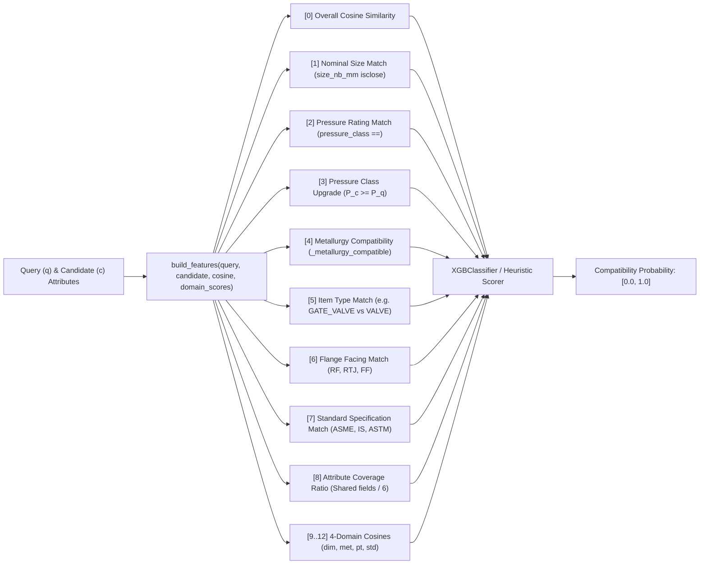

# Compatibility Reranker Subsystem

The `machine_learning/reranker` package implements the 13-feature gradient boosted decision tree (GBDT) compatibility reranker. It scores pairwise equivalence and safety substitution feasibility between a procurement requisition query $\vec{q}$ and a candidate inventory item $\vec{c}$.

---

## 13-Dimensional Feature Vector Architecture

The reranker transforms heterogeneous physical specifications into a 13-dimensional vector via `build_features` in `features.py`:

### Feature Indices Breakdown
- **`[0]` Dense Vector Cosine**: Semantic similarity between query and candidate descriptions.
- **`[1]` Size Match**: Boolean indicator ($1.0$ if $|size_q - size_c| < 10^{-6}\text{ mm}$, else $0.0$; $0.5$ if either is missing).
- **`[2]` Pressure Match**: Boolean indicator ($1.0$ if $Class_q == Class_c$, else $0.0$).
- **`[3]` Pressure Upgrade**: Safe substitution indicator ($1.0$ if candidate pressure rating $\ge$ query pressure rating).
- **`[4]` Metallurgy Compatibility**: Evaluated against the hierarchical steel alloy ordering ($316L \ge 316 \ge 304L \ge 304 \ge WCB/A105 \ge CS$).
- **`[5]` Item Type Match**: Case-insensitive normalized equivalence (e.g., `GATE_VALVE` $\leftrightarrow$ `VALVE`).
- **`[6]` Facing End Match**: Flange sealing face equivalence (`RF` Raised Face, `RTJ` Ring Type Joint, `FF` Flat Face).
- **`[7]` Standard Match**: Standard cross-equivalence (e.g. `IS 1239` $\leftrightarrow$ `ASTM A53`).
- **`[8]` Attribute Coverage**: Degree of mutual property completeness across six critical fields.
- **`[9..12]` 4-Domain Cosines**: Independent semantic similarity for Dimensional (`dim`), Metallurgy (`met`), Pressure-Temperature (`pt`), and Standards (`std`).

---

## File Breakdown

### 1. `ranker.py` (`CompatibilityRanker`)
- **`CompatibilityRanker(model_path="machine_learning/model_weights/reranker.xgb")`**:
  - Loads trained `XGBClassifier` weights if present.
  - **Deterministic Heuristic Fallback**: When model weights are absent or in unit tests, executes deterministic scoring:
    $$\text{Score} = \max\left(0.0, \min\left(1.0, 0.5 \times \text{features}[0] + 0.5 \times \frac{\sum_{i=1}^{12}\text{features}[i]}{12}\right)\right)$$
  - **`predict(query, candidate) -> float`**: Evaluates attribute match and estimates cosine alignment when raw vector embeddings are omitted.
  - **`predict_batch(query, candidates) -> list[float]`**: Batch prediction over candidate dictionaries.
  - **`score(query, candidate, cosine, domain_scores) -> float`**: Low-level scoring with explicit cosine inputs.

### 2. `features.py` (`build_features`)
- Extracts and maps dictionary properties, Pydantic models, or raw text descriptions.
- Implements `_value_match`, `_attribute_coverage_feature`, and integrates domain cosine vectors.

### 3. `train.py` (Model Training Pipeline)
- **`train_from_rows(rows, output_path)`**: Stratified train/validation splitting ($80/20$), XGBoost training with early stopping on validation AUC (`n_estimators=500`, `max_depth=5`, `learning_rate=0.05`), and serializes binary model to disk.
- **`train(train_file, output_path)`**: Reads labeled pairs from Parquet (`data/ml_training/reranker_pairs.parquet`) and initiates training.

### 4. `__init__.py`
- Exposes `CompatibilityRanker` and `build_features`.
