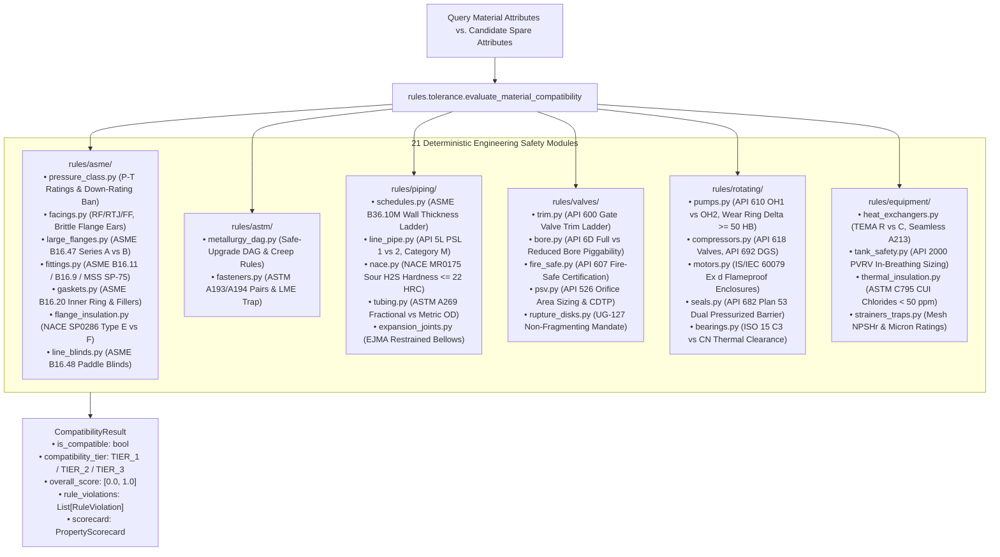

# Deterministic Engineering Safety Rules Engine

The `rules` directory houses the master deterministic engineering safety rules for Samanvay-AI. It coordinates **21 distinct industrial failure-prevention modules** covering ASME, ASTM, API, NACE, TEMA, ISO, and IEC standards.

---

## Safety Invariant Architecture

---

## 21 Codified Engineering Safety Modules

| Module # | Module Path | Governing Standard | Critical Failure Trap Prevented |
| :---: | :--- | :--- | :--- |
| **1** | `rules/asme/pressure_class.py` | ASME B16.5 / B16.34 | **Fatal Rupture Trap**: Down-rating pressure class under line design pressure. |
| **2** | `rules/astm/metallurgy_dag.py` | ASTM / ASME Sec II | **Corrosion & Creep Rupture Trap**: Metallurgical downgrades and Cr-Mo creep mismatches. |
| **3** | `rules/piping/schedules.py` | ASME B36.10M / B36.19M | **Pipe Burst Hazard**: Thin-wall schedule downgrades under internal pressure. |
| **4** | `rules/piping/nace.py` | NACE MR0175 / ISO 15156 | **Sulfide Stress Cracking (SSC) Trap**: Non-NACE or $> 22\text{ HRC}$ steel in wet $H_2S$. |
| **5** | `rules/asme/large_flanges.py` | ASME B16.47 | **BCD Mismatch Trap**: Cross-bolting Series A (MSS SP-44) with Series B (API 605). |
| **6** | `rules/valves/trim.py` | API 600 Table 3 | **Rapid Seat Washout Trap**: Demoting Trim 8/Trim 5 to utility Trim 1 in erosive service. |
| **7** | `rules/valves/bore.py` | API 6D | **Pipeline PIG Blockage Trap**: Installing Reduced Bore valves in piggable scraping lines. |
| **8** | `rules/valves/fire_safe.py` | API 607 / API 6FA | **Refinery Fire Disaster Trap**: Non-fire-safe soft seated valves in hydrocarbon lines. |
| **9** | `rules/valves/psv.py` | API 520 / API 526 | **Overpressure Vessel Detonation Trap**: Undersized relief orifice area ($D \dots T$). |
| **10** | `rules/asme/fittings.py` | ASME B16.9 / B16.11 | **Fitting Rupture / Pig Jam Trap**: Forged fitting down-rating and short-radius elbows. |
| **11** | `rules/asme/facings.py` | ASME B16.5 / B31.3 | **Flange Ear Fracture Trap**: Bolting Raised Face steel flanges to Flat Face cast iron. |
| **12** | `rules/asme/gaskets.py` | ASME B16.20 / B16.21 | **Gasket Inward Buckling Trap**: Missing solid inner rings in Class 900+ SWG gaskets. |
| **13** | `rules/astm/fasteners.py` | ASTM A193 / A194 | **Liquid Metal Embrittlement (LME) Trap**: Galvanized bolts above $200^\circ\text{C}$; thread shear. |
| **14** | `rules/piping/line_pipe.py` | API 5L / ASME B31.3 | **Brittle Fracture & Toxic Escape**: API 5L PSL 1 in gas lines; threaded joints in Cat M. |
| **15** | `rules/piping/tubing.py` | ASTM A269 | **Tube Blow-Off Disaster Trap**: Mating metric $12\text{ mm}$ fittings onto $1/2"$ ($12.7\text{ mm}$) tubes. |
| **16** | `rules/rotating/motors.py` | IS/IEC 60079-1 | **Fatal Explosion Trap**: Non-Ex standard motors in hazardous Zone 1/Zone 2 areas. |
| **17** | `rules/rotating/seals.py` | API 682 | **Toxic Seal Blowout Trap**: Single unpressurized flush plans in toxic light hydrocarbons. |
| **18** | `rules/rotating/bearings.py`| ISO 15 | **Thermal Lockup & Shaft Snap**: Normal CN clearance bearings replacing high-heat C3. |
| **19** | `rules/equipment/heat_exchangers.py` | TEMA 10th Ed. | **Bundle Bypass & Tube Failure**: TEMA C in TEMA R duty; welded tubes in reboilers. |
| **20** | `rules/rotating/pumps.py` | API 610 | **Galling Seizure & Thermal Misalignment**: $< 50\text{ HB}$ wear ring delta; OH1 in $>150^\circ\text{C}$. |
| **21** | `rules/rotating/compressors.py` | API 618 / API 617 | **Cylinder Detonation & Impeller Burst**: Inverted cylinder valves; un-aged 17-4PH impellers. |

---

## Key Entrypoint Functions

- **`evaluate_material_compatibility(query, candidate) -> CompatibilityResult`**: Primary evaluation engine consuming `ExtractedMaterialAttributes` instances and generating a full multi-dimensional engineering scorecard.
- **`evaluate_pair(query_dict, candidate_dict) -> CompatibilityResult`**: Dictionary-compatible wrapper used by API routers and high-throughput batch evaluation loops.
