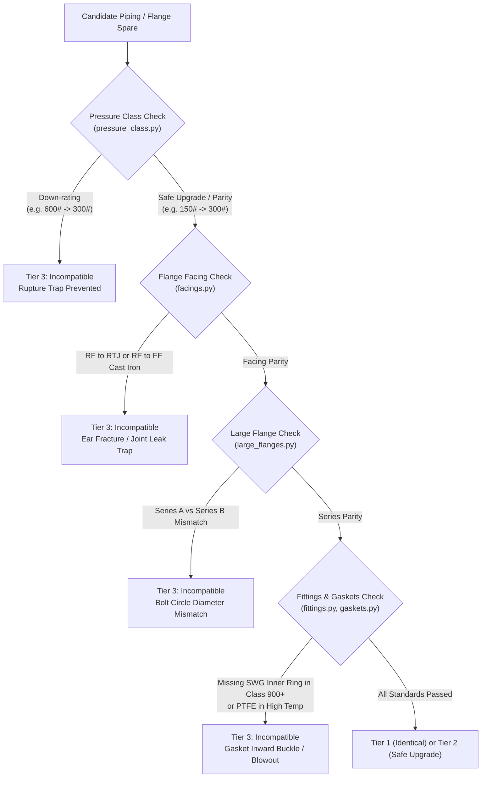

# ASME / ANSI Piping & Flange Mechanical Rules

The `rules/asme` module encodes deterministic failure-secure rules derived from **ASME B16.5, ASME B16.47, ASME B16.9, ASME B16.11, ASME B16.20, ASME B16.48, and ASME B31.3**. These rules act as non-negotiable physical safety gates during spare part substitution.

---

## Architecture & Rule Flow

---

## File Breakdown & Invariant Rules

### 1. `pressure_class.py` (Pressure-Temperature Hierarchy)
- **Hierarchy Ladder**: $\text{Class } 150 < 300 < 600 < 900 < 1500 < 2500$.
- **Metric PN Conversions**: $PN16 / PN20 \rightarrow 150$, $PN40 / PN50 \rightarrow 300$, $PN100 \rightarrow 600$.
- **Hard Invariants**:
  - **Down-rating is strictly Tier 3**: A lower pressure class part is blocked with zero tolerance (fatal rupture risk).
  - **Flanged vs Inline Distinction**: Upgrading pressure class on inline welded pipes/fittings is permitted as Tier 2; upgrading flanged valves/flanges alters bolt circle diameter (BCD) and requires a spool adapter.

### 2. `facings.py` (Flange Facing & Joint Mechanics)
- **Facing Geometry Parity**: `RF` $\leftrightarrow$ `RF`, `RTJ` $\leftrightarrow$ `RTJ`, `FF` $\leftrightarrow$ `FF`.
- **RF-to-RTJ Mismatch**: Strictly incompatible (an RF face cannot seat into an RTJ ring groove).
- **Cast Iron Brittle Flange Invariant**: Bolting a Raised Face (RF) steel flange to a Flat Face (FF) cast iron pump/valve body concentrates stress on the unbacked outer ring, shearing the brittle cast iron flange ears (ASME B31.3 Section 312.2).
- **Severe Cyclic Service**: Slip-on (SO) flanges prohibited in place of Weld Neck (WN) due to fillet weld fatigue vulnerability.

### 3. `large_flanges.py` (ASME B16.47 NPS 26 to NPS 60)
- **Series A (MSS SP-44)**: Heavier flange with larger bolt diameters and fewer bolt holes.
- **Series B (API 605)**: Compact flange with smaller bolt diameters and higher bolt hole counts.
- **Bolt Circle Incompatibility**: Series A and Series B cannot mate under any circumstances.

### 4. `fittings.py` (ASME B16.9 Buttweld & B16.11 Forged Fittings)
- **Forged Ratings Ladder**: Threaded ($2000\# < 3000\# < 6000\#$), Socket-weld ($3000\# < 6000\# < 9000\#$).
- **Piggability Invariant**: Short Radius (SR, $1.0D$) elbows in place of Long Radius (LR, $1.5D$) elbows in scrapable/piggable pipelines trigger a mechanical restriction trap.
- **MSS SP-75 Pipeline Fittings**: High-yield pipeline fittings (`WPHY 42`, `52`, `60`, `65`, `70`) cannot be downgraded to standard `A234 WPB`.

### 5. `gaskets.py` (ASME B16.20 / B16.21 Sealing Elements)
- **Inner Ring Mandate**: Spiral Wound Gaskets (SWG) in ASME Class 900+, PTFE-filled SWG, and vacuum service mandate a solid metallic inner ring to prevent inward radial buckling into the process stream.
- **Thermal Filler Invariant**: Flexible graphite (rated to $650^\circ\text{C}$) substituted with PTFE (rated to $260^\circ\text{C}$) triggers a decomposition leak trap.
- **RTJ Ring Types**: Octagonal (R) and Oval (R) fit standard R grooves; API 6A BX rings cannot fit ASME B16.5 R grooves.

### 6. `flange_insulation.py` (NACE SP0286 Cathodic Protection)
- **Type E (Full Face) vs Type F (Raised Face)**: In buried or subsea bimetallic joints, installing Type F allows conductive mud/seawater to bridge the outer gap, defeating cathodic isolation and accelerating galvanic perforation.
- **Dielectric Retainers**: NEMA G10/G11 retainers required for temperatures $> 100^\circ\text{C}$ where phenolic materials degrade.

### 7. `line_blinds.py` (ASME B16.48 Positive Isolation)
- **Certified Blinds**: Rejects uncalculated field-cut flat plates in positive isolation service.
- **Handle Identification**: Distinguishes solid rectangular paddle spade handles from drilled paddle spacer open bore handles.
