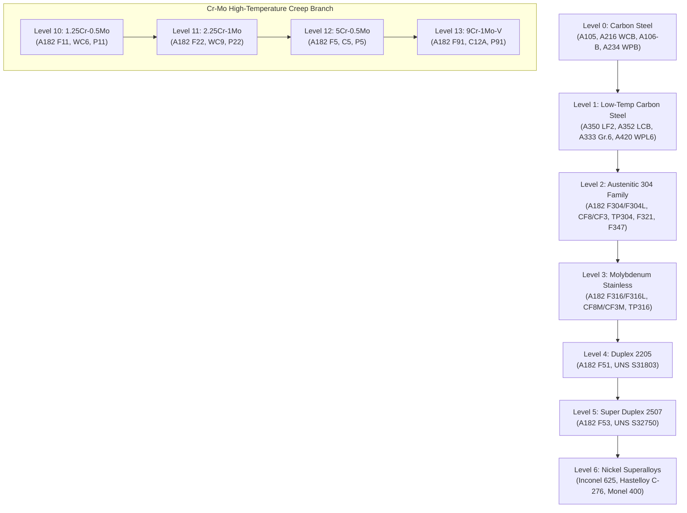

# ASTM Metallurgy & Fasteners Tolerance Rules

The `rules/astm` module governs material compatibility, corrosion resistance hierarchies, high-temperature creep resistance, and fastener stud-nut mechanical integrity based on **ASTM, ASME Section II, and NACE MR0175/ISO 15156**.

---

## Metallurgy Directed Acyclic Graph (DAG) Hierarchy

---

## File Breakdown

### 1. `metallurgy_dag.py` (Safe-Upgrade Directed Acyclic Graph)
- **Monotonic Upgrade Law**: Moving **UP** the hierarchy (e.g. replacing Carbon Steel with 316L Stainless Steel) is permitted as a safe engineering upgrade (**Tier 2**). Moving **DOWN** the hierarchy is an unapproved downgrade blocked as **Tier 3 (Incompatible)** due to fatal corrosion, stress cracking, or thermal degradation.
- **Creep vs Austenitic Isolation**: Cr-Mo creep steels (`F11`, `F22`, `F91`) operate under high-temperature stress rupture mechanics ($> 450^\circ\text{C}$). Substituting standard austenitic stainless steel into a Cr-Mo line without re-rating is blocked as a high-temperature creep cracking trap.
- **Low-Temperature Toughness Invariant**: In cryogenic service ($< -29^\circ\text{C}$), standard carbon steel (`A105`, `WCB`) undergoes ductile-to-brittle transition; Charpy V-notch tested materials (`A350 LF2`, `A333 Gr.6`) are strictly mandatory.

### 2. `fasteners.py` (ASTM A193 / A194 / A320 Fastener Integrity)
- **Stud-to-Nut Metallurgical Pairing**:
  - `A193 Gr. B7` (High-temp Cr-Mo alloy stud) mandates `ASTM A194 Gr. 2H` (Heavy hex heat-treated carbon steel nut). Pairing B7 studs with standard Grade 2 commercial nuts causes catastrophic thread shear under bolting torque.
  - `A193 Gr. B16` ($450^\circ\text{C}-540^\circ\text{C}$ creep duty) requires `A194 Gr. 7` or `Gr. 4`.
  - `A320 Gr. L7` (Low-temperature $-101^\circ\text{C}$) mandates `A194 Gr. 7` impact-tested nuts.
  - `NACE MR0175` Sour Service: Maximum hardness $22\text{ HRC}$; mandates `A193 Gr. B7M` paired with `A194 Gr. 2HM`.
- **Liquid Metal Embrittlement (LME) Trap**: Above $200^\circ\text{C} - 250^\circ\text{C}$, cadmium-plated, zinc-electroplated, or hot-dip galvanized fasteners suffer molten zinc/cadmium diffusion along grain boundaries, causing rapid intergranular catastrophic fracture. High-temperature lines strictly block galvanized/cadmium bolting.
- **Yield Strength Parity**: Rejects any replacement fastener where candidate yield strength is lower than design specifications.
