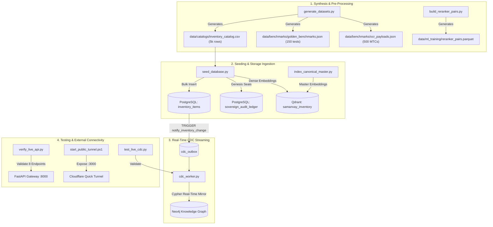
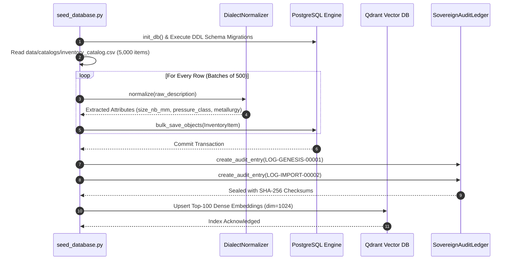
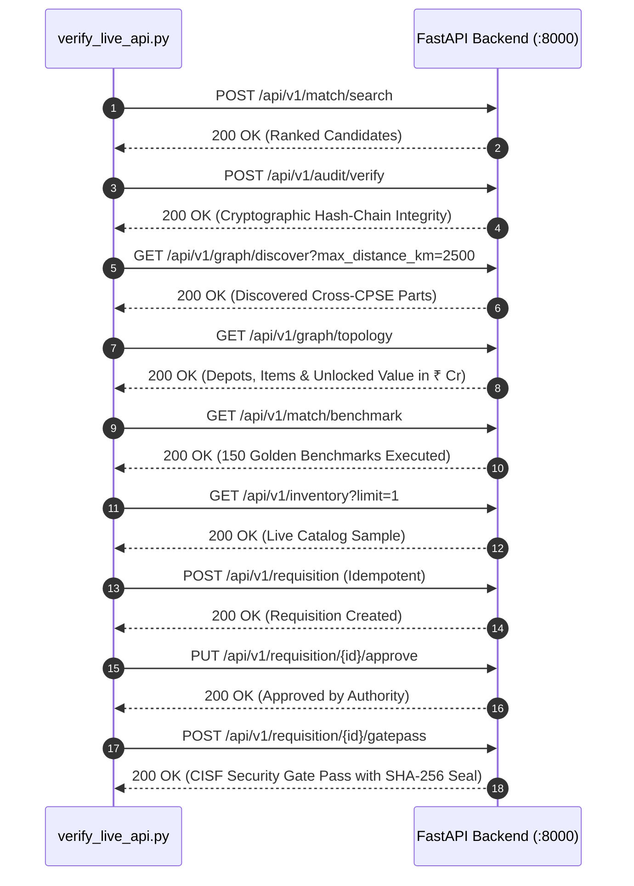

# Operations, Automation & Orchestration Scripts (`scripts/`)

## 1. Architectural Role & Overview

The `scripts/` directory provides operational tooling, database provisioning, machine learning training data generation, real-time synchronization, and automated verification suites for the **Samanvay-AI** platform.

These utilities decouple runtime orchestration from core API code, enabling repeatable environment initialization, reproducible dataset generation, zero-downtime Change Data Capture (CDC) streaming between PostgreSQL and Neo4j, vector store indexing in Qdrant, and comprehensive end-to-end smoke testing.



---

## 2. Inventory of Operational Scripts

| Script File | Language / Runtime | Primary Function & System Boundary |
| :--- | :--- | :--- |
| [`build_reranker_pairs.py`](file:///C:/Users/mayank/Development/Hackathons/Samanvay-AI/scripts/build_reranker_pairs.py) | Python 3.12 (`uv`) | Synthesizes hard negative and positive pair tuples with BGE-M3 dense and domain subvector similarities to train the GBDT ranker. |
| [`cdc_worker.py`](file:///C:/Users/mayank/Development/Hackathons/Samanvay-AI/scripts/cdc_worker.py) | Python 3.12 (`uv`) | Standalone daemon listening to PostgreSQL transactional events and streaming graph mutations to Neo4j. |
| [`generate_datasets.py`](file:///C:/Users/mayank/Development/Hackathons/Samanvay-AI/scripts/generate_datasets.py) | Python 3.12 (`uv`) | Generates 5,000 authentic CPSE catalog rows, 150 triple-tier golden benchmarks, and 500 MTC OCR test payloads. |
| [`index_canonical_master.py`](file:///C:/Users/mayank/Development/Hackathons/Samanvay-AI/scripts/index_canonical_master.py) | Python 3.12 (`uv`) | CLI utility that encodes `canonical_master.csv` items via BGE-M3 and indexes them into Qdrant vector store. |
| [`seed_database.py`](file:///C:/Users/mayank/Development/Hackathons/Samanvay-AI/scripts/seed_database.py) | Python 3.12 (`uv`) | Initializes SQL tables, applies MoPNG/GeM/CPPP schema migrations, normalizes dialects, and populates PostgreSQL, Audit Ledger, and Qdrant. |
| [`setup.ps1`](file:///C:/Users/mayank/Development/Hackathons/Samanvay-AI/scripts/setup.ps1) | PowerShell 7+ | Windows bootstrapper verifying Python installation, creating `.venv`, installing dependencies in editable mode, and running quick tests. |
| [`start_public_tunnel.ps1`](file:///C:/Users/mayank/Development/Hackathons/Samanvay-AI/scripts/start_public_tunnel.ps1) | PowerShell 7+ | Boots an official Cloudflare Tunnel container attached to the Docker bridge network, providing zero-configuration public `trycloudflare.com` routing. |
| [`sync-upstream-data.ps1`](file:///C:/Users/mayank/Development/Hackathons/Samanvay-AI/scripts/sync-upstream-data.ps1) | PowerShell 7+ | Synchronizes remote upstream datasets and taxonomy catalogs from GitHub into local `data/`. |
| [`test_live_cdc.py`](file:///C:/Users/mayank/Development/Hackathons/Samanvay-AI/scripts/test_live_cdc.py) | Python 3.12 (`uv`) | End-to-end integration test verifying real-time transactional propagation from PostgreSQL through `cdc_outbox` to Neo4j. |
| [`verify_live_api.py`](file:///C:/Users/mayank/Development/Hackathons/Samanvay-AI/scripts/verify_live_api.py) | Python 3.12 (`uv`) | Automated end-to-end smoke test verifying 8 core REST API endpoints including matching, audits, graph discovery, and CISF gate pass issuance. |

---

## 3. Detailed Component Architecture & Execution

### 3.1. Master Database & Vector Store Seeder (`seed_database.py`)

Seeds relational, audit, and vector storage engines in a single deterministic pipeline:



- **DDL Dynamic Migration**: Automatically verifies and executes `ALTER TABLE inventory_items ADD COLUMN IF NOT EXISTS` for procurement fields: `indian_standard`, `oil_std_spec`, `oil_material_code`, `gem_category_id`, `gem_product_id`, `cppp_tender_ref`, `make_in_india_class`, `local_content_percentage`, `pressure_rating_bar`, and `location_state`.
- **Dialect Normalization**: Extracts structured dimensions using [`DialectNormalizer`](file:///C:/Users/mayank/Development/Hackathons/Samanvay-AI/machine_learning/ner_tagger.py) before writing to PostgreSQL.
- **Sovereign Audit Genesis**: Writes `LOG-GENESIS-00001` (System Initialization) and `LOG-IMPORT-00002` (5,000 Item Batch Import) with cryptographic hash linking.
- **Execution**:
  ```powershell
  # Standard execution (skips if records already exist)
  uv run python scripts/seed_database.py

  # Force reload (truncates and re-seeds cleanly)
  uv run python scripts/seed_database.py --force
  ```

---

### 3.2. Real-Time Change Data Capture Worker (`cdc_worker.py`)

A standalone long-running worker that bridges the relational transactional boundary with the Neo4j knowledge graph:

```mermaid
flowchart LR
    API[FastAPI / Direct SQL] -->|Write Transaction| PG[(PostgreSQL Table)]
    PG -->|Trigger: trg_inventory_cdc| Outbox[(cdc_outbox Table)]
    PG -->|pg_notify('cdc_channel')| Worker[cdc_worker.py]
    Worker -->|Read Unprocessed| Outbox
    Worker -->|Execute Cypher MERGE / SET| Neo4j[(Neo4j Graph)]
    Worker -->|Mark status='PROCESSED'| Outbox
```

- **Fault-Tolerant Outbox Pattern**: In addition to PostgreSQL `LISTEN/NOTIFY`, changes are logged to the `cdc_outbox` table, preventing lost mutations during network disconnects.
- **Execution**:
  ```powershell
  uv run python scripts/cdc_worker.py
  ```

---

### 3.3. Live CDC Verification Test (`test_live_cdc.py`)

Validates the full transactional lifecycle across disparate databases:
1. **Insert**: Creates an experimental `TEST-CDC-VALVE-*` record in PostgreSQL.
2. **Outbox Verification**: Verifies `cdc_outbox` captured the trigger payload.
3. **Graph Inspection**: Queries Neo4j Cypher to ensure the node and relationships (`CPSE -> Depot -> InventoryItem -> MaterialGrade`) were created.
4. **Update**: Alters status to `SURPLUS_DECLARED` and quantity to `25` in PostgreSQL; verifies immediate propagation to Neo4j.
5. **Teardown**: Deletes the test record in PostgreSQL and confirms deletion in Neo4j.

- **Execution**:
  ```powershell
  uv run python scripts/test_live_cdc.py
  ```

---

### 3.4. Full API Live Verification Suite (`verify_live_api.py`)

Automated end-to-end integration suite verifying live system behavior:



- **Execution**:
  ```powershell
  uv run python scripts/verify_live_api.py
  ```

---

### 3.5. Dataset Generator (`generate_datasets.py`)

Synthesizes production-grade training, validation, and benchmarking datasets:
1. `data/catalogs/inventory_catalog.csv`: 5,000 authentic records across 7 CPSEs (OIL 30%, NRL 10%, IOCL 15%, ONGC 15%, BPCL 10%, HPCL 10%, GAIL 10%) with authentic ERP naming dialects (OIL MESC dual standards, IOCL hash tokens, ONGC verbose engineering syntax, and BPCL/HPCL hyphenated metric notation).
2. `data/benchmarks/golden_benchmarks.json`: 150 test cases:
   - **50 Tier-1 Identical / Safe Over-Rating Cases** ($\ge 95\%$ match).
   - **50 Tier-2 Functional Substitute Cases** ($80\% - 94\%$ match, requires HITL sign-off).
   - **50 Tier-3 Fatal Hazard Invariant Traps** ($0\%$ match / rejection across all 21 physics and standards rule modules).
3. `data/benchmarks/ocr_payloads.json`: 500 Material Test Certificates (MTC EN 10204 3.1) with chemical analysis, IIW carbon equivalent, mechanical tensile/yield/Charpy results, 10% degraded scans (0.65-0.84 confidence), and 5% OCR character substitutions.

- **Execution**:
  ```powershell
  uv run python scripts/generate_datasets.py
  ```

---

### 3.6. Reranker Pairs Builder (`build_reranker_pairs.py`)

Builds cosine-scored reranker training pairs:
- Reads `data/taxonomies/canonical_master.csv`.
- Groups items by `item_type`.
- For each query item, extracts $k=5$ positives (identical dimensions, pressure class, and metallurgy) and $k=15$ hard negatives (divergent metallurgy or pressure classes).
- Computes global BGE-M3 embeddings and 4 domain subvector embeddings (family, size, pressure, metallurgy).
- Emits Apache Parquet dataset with feature vectors ready for LightGBM/XGBoost training.

- **Execution**:
  ```powershell
  uv run python scripts/build_reranker_pairs.py --canonical-csv data/taxonomies/canonical_master.csv --output data/ml_training/reranker_pairs.parquet
  ```

---

### 3.7. Cloudflare Public Tunnel (`start_public_tunnel.ps1`)

Automates zero-configuration public access:
- Verifies Docker engine health.
- Confirms the frontend container is running; auto-starts the stack via `docker compose` if dormant.
- Runs official `cloudflare/cloudflared:latest` container joined to `samanvay-ai-network`.
- Securely exposes frontend (port 3000) and reverse-proxied FastAPI routes (port 8000) via ephemeral `https://*.trycloudflare.com`.

- **Execution**:
  ```powershell
  .\scripts\start_public_tunnel.ps1
  ```

---

### 3.8. Environment Setup & Data Sync (`setup.ps1` & `sync-upstream-data.ps1`)

- `setup.ps1`: Configures Python 3.11/3.12 virtual environment, installs development dependencies, and runs sanity checks.
- `sync-upstream-data.ps1`: Synchronizes data catalogs from the upstream master repository via shallow git clone or HTTPS zip fallback.

---

## 4. Operational Playbook & Execution Sequence

When spinning up a fresh environment or staging server, execute the scripts in the following prescribed order:

```powershell
# 1. Setup python environment
.\scripts\setup.ps1

# 2. Sync upstream taxonomies
.\scripts\sync-upstream-data.ps1

# 3. Generate benchmark and catalog datasets
uv run python scripts/generate_datasets.py

# 4. Build reranker training pairs
uv run python scripts/build_reranker_pairs.py

# 5. Start infrastructure containers (PostgreSQL, Qdrant, Neo4j, Redis)
docker compose -f docker/docker-compose.yml up -d postgres qdrant neo4j redis

# 6. Seed relational tables, audit genesis ledger, and vector store
uv run python scripts/seed_database.py --force

# 7. Start real-time Change Data Capture worker
uv run python scripts/cdc_worker.py

# 8. Run live verification test suite
uv run python scripts/test_live_cdc.py
uv run python scripts/verify_live_api.py
```
