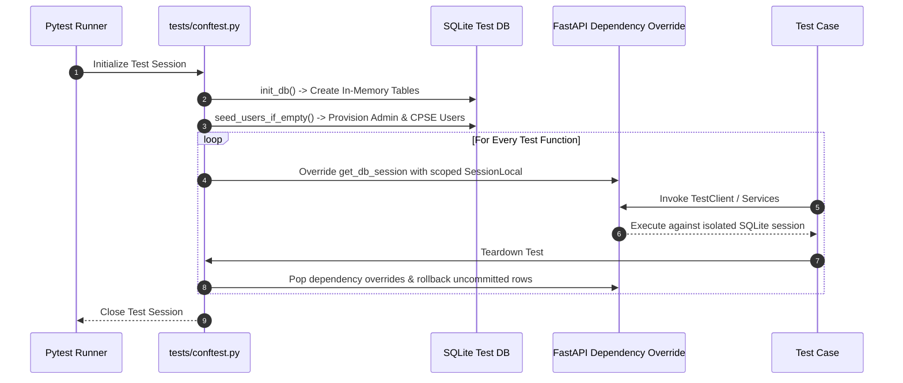

# Samanvay AI — Test Suite & Quality Assurance Architecture (`tests/`)

> **Executive Scope**: The `tests/` directory houses the complete verification harness for Samanvay AI, comprising **393+ automated tests** across unit, integration, machine learning, and API tiers. It validates deterministic physical compliance (ASME/ASTM), neural semantic search, dual-path OCR ingestion, Indian CPSE/MoPNG standards, and cryptographic audit integrity.

---

## 1. Test Suite Topology & Organization

The test directory is partitioned into four specialized functional layers alongside root ingestion and integration suites:

```mermaid
graph TD
    subgraph "Root Test Harness (tests/)"
        CONF[conftest.py<br/>Session DB, Mock Overrides, Fixtures]
        TDI[test_document_ingest.py<br/>End-to-End Intake & HITL]
        TIAPI[test_ingest_api.py<br/>FastAPI /v1/ingest Endpoints]
        TI[test_ingestion.py<br/>Hybrid OCR, Deskew & Layout]
        TMH[test_match_hitl_api.py<br/>Vector Match & HITL Feedback]
        TM[test_matching.py<br/>Tolerance Tier Routing]
        TMTC[test_mtc_chemistry.py<br/>MTC Chemistry & Mech Extraction]
        TNT[test_ner_tagger.py<br/>Procurement Token Extraction]
        TON[test_ocr_normalization.py<br/>Thesaurus & Dialect Expansion]
    end

    subgraph "Specialized Sub-Harnesses"
        API[api/<br/>Full CRUD & Role Auth Verification]
        INT[integration/<br/>240 Golden Accuracy Benchmarks]
        ML[ml/<br/>Bi-Encoder, GBDT Reranker & Active Learning]
        UNIT[unit/<br/>36 ASME Tolerance Rules & Cryptography]
    end

    CONF --> API
    CONF --> INT
    CONF --> ML
    CONF --> UNIT
    CONF --> TDI
    CONF --> TIAPI
```



### Directory Submodules
- [`tests/api/`](file:///C:/Users/mayank/Development/Hackathons/Samanvay-AI/tests/api/README.md): REST API endpoints, JWT role-based access control, requisition lifecycles, and inventory transfers.
- [`tests/integration/`](file:///C:/Users/mayank/Development/Hackathons/Samanvay-AI/tests/integration/README.md): 240 Golden benchmark test cases verifying cross-CPSE fuzzy matching across 6 Indian energy operators.
- [`tests/ml/`](file:///C:/Users/mayank/Development/Hackathons/Samanvay-AI/tests/ml/README.md): Machine learning models, bi-encoder embeddings, LightGBM reranker, NER tokenizers, active learning queues, and subvector projections.
- [`tests/unit/`](file:///C:/Users/mayank/Development/Hackathons/Samanvay-AI/tests/unit/README.md): Isolated unit tests for IIW carbon equivalence, 36 parametric tolerance scenarios, logistics routing, and SHA-256 audit block hashing.

---

## 2. Test Harness Lifecycle & `conftest.py` Architecture

[`conftest.py`](file:///C:/Users/mayank/Development/Hackathons/Samanvay-AI/tests/conftest.py) establishes the global testing context for pytest:

1. **Environment Flagging**: Automatically sets `os.environ["TESTING"] = "1"` to bypass real database connection pools and background network calls.
2. **Database Initialization**: The session-scoped fixture `setup_test_db` executes [`init_db()`](file:///C:/Users/mayank/Development/Hackathons/Samanvay-AI/backend/app/models/base.py) to generate SQLite tables in memory, then triggers [`seed_users_if_empty()`](file:///C:/Users/mayank/Development/Hackathons/Samanvay-AI/backend/app/services/seeder.py) to provision deterministic test CPSE identities (`IOCL_OFFICER`, `ONGC_OFFICER`, etc.).
3. **Dependency Overrides**: The autouse fixture `override_db` redirects FastAPI dependency injection from production PostgreSQL connection strings to isolated `SessionLocal` instances per test.



---

## 3. Root Test Suite File Catalog

| File | Target Modules | Primary Verifications |
| :--- | :--- | :--- |
| [`conftest.py`](file:///C:/Users/mayank/Development/Hackathons/Samanvay-AI/tests/conftest.py) | `backend.app.models.base`, `backend.app.api.dependencies` | Global testing environment configuration, SQLite in-memory initialization, CPSE seed credentials, and dependency overrides. |
| [`test_document_ingest.py`](file:///C:/Users/mayank/Development/Hackathons/Samanvay-AI/tests/test_document_ingest.py) | [`backend.app.ingestion.document`](file:///C:/Users/mayank/Development/Hackathons/Samanvay-AI/backend/app/ingestion/document.py) | Native PDF fast-path extraction via PyMuPDF; scanned raster OCR via PaddleOCR fallback; non-MTC graceful degradation to HITL; attribute conversion; parser error handling. |
| [`test_ingest_api.py`](file:///C:/Users/mayank/Development/Hackathons/Samanvay-AI/tests/test_ingest_api.py) | [`backend.app.api.v1.ingest`](file:///C:/Users/mayank/Development/Hackathons/Samanvay-AI/backend/app/api/v1/ingest.py) | HTTP endpoints `POST /v1/ingest/text` and `POST /v1/ingest/document`; MIME validation (rejecting non-PDF/PNG/JPEG with 400); 15MB file size limit (HTTP 413); shared contract output format. |
| [`test_ingestion.py`](file:///C:/Users/mayank/Development/Hackathons/Samanvay-AI/tests/test_ingestion.py) | [`OCR.pipeline`](file:///C:/Users/mayank/Development/Hackathons/Samanvay-AI/OCR/pipeline.py), [`OCR.engine`](file:///C:/Users/mayank/Development/Hackathons/Samanvay-AI/OCR/engine.py), [`OCR.normalization`](file:///C:/Users/mayank/Development/Hackathons/Samanvay-AI/OCR/normalization.py) | Hybrid per-page OCR routing (PyMuPDF + PaddleOCR @ 300 DPI); 11-angle skew detection; box-overlap reading order; PaddleOCR failover to EasyOCR; OCR error caching; multi-line MTC metadata parsing. |
| [`test_match_hitl_api.py`](file:///C:/Users/mayank/Development/Hackathons/Samanvay-AI/tests/test_match_hitl_api.py) | [`backend.app.api.v1.match`](file:///C:/Users/mayank/Development/Hackathons/Samanvay-AI/backend/app/api/v1/match.py), [`backend.app.api.v1.dashboard`](file:///C:/Users/mayank/Development/Hackathons/Samanvay-AI/backend/app/api/v1/dashboard.py) | Active learning queue bootstrapping, listing, and resolution; `/v1/match` candidate ranking with subvector domain scores (`dim`, `met`, `pt`, `std`); 503 handling when models are uninstalled; dashboard telemetry. |
| [`test_matching.py`](file:///C:/Users/mayank/Development/Hackathons/Samanvay-AI/tests/test_matching.py) | [`backend.app.matching.tolerance`](file:///C:/Users/mayank/Development/Hackathons/Samanvay-AI/backend/app/matching/tolerance.py) | Fast tolerance classification: higher pressure rating as safe substitute (`Tier 1 auto-link`); nominal size mismatch as hard incompatible (`Tier 4 reject`). |
| [`test_mtc_chemistry.py`](file:///C:/Users/mayank/Development/Hackathons/Samanvay-AI/tests/test_mtc_chemistry.py) | [`backend.app.ingestion.certificate`](file:///C:/Users/mayank/Development/Hackathons/Samanvay-AI/backend/app/ingestion/certificate.py) | MTC chemistry table column parsing (C, Mn, Si, S, P, Cr, Ni, Mo); key-value pair parsing; mechanical properties extraction (yield, tensile, elongation); metadata dict preservation. |
| [`test_ner_tagger.py`](file:///C:/Users/mayank/Development/Hackathons/Samanvay-AI/tests/test_ner_tagger.py) | [`machine_learning.ner_tagger`](file:///C:/Users/mayank/Development/Hackathons/Samanvay-AI/machine_learning/ner_tagger.py) | Procurement abbreviation expansion: parsing dense industrial shorthand (e.g., `FLG WN RF 4IN 300# A105` $\to$ `item_type="FLANGE"`, `size_nb_mm=101.6`, `pressure_class=300`, `facing="WELD_NECK"`). |
| [`test_ocr_normalization.py`](file:///C:/Users/mayank/Development/Hackathons/Samanvay-AI/tests/test_ocr_normalization.py) | [`OCR.normalization`](file:///C:/Users/mayank/Development/Hackathons/Samanvay-AI/OCR/normalization.py) | Dialect thesaurus completeness ($\ge 40$ procurement mappings); Indian CPSE expansions (EIL, OISD, GeM, CPPP, MESC); token preservation guards for grades like `SS316L` and English words like `IS`. |

---

## 4. Execution Commands & Workflow

To execute tests according to project standards:

```powershell
# Run the complete test suite (all 393+ tests)
uv run pytest tests/

# Run tests with short traceback on failures
uv run pytest tests/ --tb=short

# Run a specific sub-harness
uv run pytest tests/unit/
uv run pytest tests/integration/
uv run pytest tests/ml/
uv run pytest tests/api/

# Run a targeted root suite file
uv run pytest tests/test_document_ingest.py -v
uv run pytest tests/test_match_hitl_api.py -v
```

> [!NOTE]
> All automated tests should be triggered via `uv run pytest` to ensure exact dependency resolution against `.venv`. Tests must remain strictly self-contained and not rely on live network access or external database instances.
