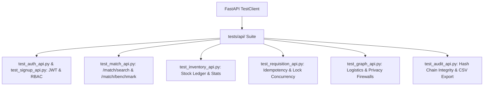

# REST API Integration & Security Test Suite (`tests/api/`)

## 1. Architectural Role & Overview

The `tests/api/` package provides comprehensive HTTP-level integration tests for all REST routers defined in `backend/app/api/routers/`.

Executed via `pytest` and `fastapi.testclient.TestClient`, these tests validate HTTP status codes, request/response payload contracts, JWT bearer token issuance, Role-Based Access Control (RBAC), multi-tenant enterprise data isolation, attribute-level commercial privacy firewalls, and cryptographic audit hash continuity.



---

## 2. Test File Inventory

| Test File | Target Router / Component | Tested Invariants & Behaviors |
| :--- | :--- | :--- |
| [`test_auth_api.py`](file:///C:/Users/mayank/Development/Hackathons/Samanvay-AI/tests/api/test_auth_api.py) | `/api/v1/auth` | Seed user retrieval, password verification, 24-hr JWT token issuance, multi-tenant role/depot claims, HTTP 401 unauthorized rejections, and `/seed` idempotency. |
| [`test_signup_api.py`](file:///C:/Users/mayank/Development/Hackathons/Samanvay-AI/tests/api/test_signup_api.py) | `/api/v1/auth/signup` | New personnel self-registration, instant JWT issuance, duplicate username rejection (409), duplicate email rejection (409), and invalid role enum handling (422). |
| [`test_match_api.py`](file:///C:/Users/mayank/Development/Hackathons/Samanvay-AI/tests/api/test_match_api.py) | `/api/v1/match` | Query normalization, ASME dimensional fit rules, continuous ML ranker scoring, live search endpoint execution, and 150 Golden Benchmark evaluation. |
| [`test_inventory_api.py`](file:///C:/Users/mayank/Development/Hackathons/Samanvay-AI/tests/api/test_inventory_api.py) | `/api/v1/inventory` | Inventory CRUD lifecycle, cross-CPSE commercial price stripping, and aggregate inventory stats calculation. |
| [`test_requisition_api.py`](file:///C:/Users/mayank/Development/Hackathons/Samanvay-AI/tests/api/test_requisition_api.py) | `/api/v1/requisition` | `Idempotency-Key` deduplication caching and atomic multi-depot inventory locking safety. |
| [`test_graph_api.py`](file:///C:/Users/mayank/Development/Hackathons/Samanvay-AI/tests/api/test_graph_api.py) | `/api/v1/graph` | Road distance geodetic accuracy, transit hours estimation, avoided $\text{CO}_2$ calculations, and attribute privacy compliance. |
| [`test_audit_api.py`](file:///C:/Users/mayank/Development/Hackathons/Samanvay-AI/tests/api/test_audit_api.py) | `/api/v1/audit` | Cryptographic SHA-256 chain verification ($H_i = \text{SHA256}(H_{i-1} \parallel \dots)$), tamper detection at height $i=0$, and RFC 4180 CSV export with UTF-8 BOM. |
| [`__init__.py`](file:///C:/Users/mayank/Development/Hackathons/Samanvay-AI/tests/api/__init__.py) | Package initialization | Test namespace anchor. |

---

## 3. Key Invariant Assertions & Security Verifications

### 3.1. Authentication & Multi-Tenancy (`test_auth_api.py` & `test_signup_api.py`)
- Verifies that `POST /api/v1/auth/login` returns a valid JWT embedding `sub`, `role`, `cpse`, and `depot_id`.
- Ensures that protected endpoints (`/api/v1/auth/me`) reject unauthenticated requests with HTTP 401.
- Confirms that duplicate usernames or emails are rejected with HTTP 409 conflict errors.

### 3.2. Attribute-Level Commercial Privacy (`test_match_api.py` & `test_graph_api.py`)
- **MoPNG Privacy Invariant**: When an entity from CPSE $A$ (e.g. `IOCL`) queries the platform, any candidate part owned by CPSE $B$ (e.g. `ONGC`, `OIL`) **must not** reveal commercial pricing data.
- Tested specifically by asserting:
  ```python
  for cand in response.candidates:
      if cand.cpse != "IOCL":
          assert cand.unit_cost_inr is None
          assert cand.total_value_inr is None
  ```

### 3.3. Zero-Tolerance Safety Gating & Benchmarks (`test_match_api.py`)
- Verifies that `GET /api/v1/match/benchmark` evaluates all 150 test cases from `datasets/golden_benchmarks.json`.
- Confirms that `precision_zero_tolerance == 1.0` (zero hazardous substitutions pass undetected).

### 3.4. Cryptographic Tamper-Evidence (`test_audit_api.py`)
- Constructs valid multi-block audit ledgers and verifies `is_valid == True`.
- Injects single-byte alterations into historical payload text and asserts that `verify_audit_chain()` immediately reports `is_valid == False` and identifies the exact corrupted index height.

---

## 4. Running the API Test Suite

```powershell
# Run the complete API test module
uv run pytest tests/api/ -v

# Run a specific router test suite
uv run pytest tests/api/test_auth_api.py -v
uv run pytest tests/api/test_match_api.py -v
```
