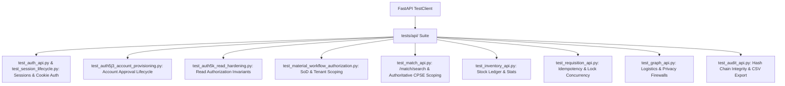

# REST API Integration & Security Test Suite (`tests/api/`)

## 1. Architectural Role & Overview

The `tests/api/` package provides comprehensive HTTP-level integration tests for all REST routers defined in `backend/app/api/routers/`.

Executed via `pytest` and `fastapi.testclient.TestClient`, these tests validate HTTP status codes, request/response payload contracts, zero-trust server-side session lifecycles, Role-Based Access Control (RBAC), Segregation of Duties (SoD), multi-tenant enterprise data isolation, attribute-level commercial privacy firewalls, and cryptographic audit hash continuity.

---

## 2. Test File Inventory

| Test File | Target Router / Component | Tested Invariants & Behaviors |
| :--- | :--- | :--- |
| [`test_auth_api.py`](file:///C:/Users/mayank/Development/Hackathons/Samanvay-AI/tests/api/test_auth_api.py) | `/api/v1/auth` | Seed persona listing without credential disclosure, session cookie establishment on login, `/auth/me` identity resolution, and 401 unauthorized rejections. |
| [`test_session_lifecycle.py`](file:///C:/Users/mayank/Development/Hackathons/Samanvay-AI/tests/api/test_session_lifecycle.py) | `AuthSession` & `auth_session_service` | Login session creation, database persistence, cookie deletion headers upon logout, session timeout, and concurrent session tracking. |
| [`test_auth5j3_account_provisioning.py`](file:///C:/Users/mayank/Development/Hackathons/Samanvay-AI/tests/api/test_auth5j3_account_provisioning.py) | `/auth/users/provision` & `/approve` | Super Admin account provisioning, atomic `ACCOUNT_PROVISIONED` telemetry, approval workflows, and unapproved account denial. |
| [`test_auth5k_read_hardening.py`](file:///C:/Users/mayank/Development/Hackathons/Samanvay-AI/tests/api/test_auth5k_read_hardening.py) | `/inventory`, `/graph`, `/ingest` | Authoritative session-derived CPSE scoping across read routes, verifying that client-supplied `X-CPSE-ID` headers cannot broaden access. |
| [`test_material_workflow_authorization.py`](file:///C:/Users/mayank/Development/Hackathons/Samanvay-AI/tests/api/test_material_workflow_authorization.py) | `/requisition` & `/inventory` | Segregation of duties (prohibition of self-approval), supplying CPSE gate pass issuance, and receiving CPSE delivery confirmation. |
| [`test_match_api.py`](file:///C:/Users/mayank/Development/Hackathons/Samanvay-AI/tests/api/test_match_api.py) | `/api/v1/match` | Query normalization, ASME dimensional fit rules, continuous ML ranker scoring, `MATCH_READ` permission gating, and CPSE candidate scoping. |
| [`test_signup_api.py`](file:///C:/Users/mayank/Development/Hackathons/Samanvay-AI/tests/api/test_signup_api.py) | `/api/v1/auth/signup` | Confirms that the legacy public signup endpoint is retired (404) in favor of supervised administrative account provisioning. |
| [`test_inventory_api.py`](file:///C:/Users/mayank/Development/Hackathons/Samanvay-AI/tests/api/test_inventory_api.py) | `/api/v1/inventory` | Inventory CRUD lifecycle, cross-CPSE commercial price stripping, and aggregate inventory stats calculation. |
| [`test_requisition_api.py`](file:///C:/Users/mayank/Development/Hackathons/Samanvay-AI/tests/api/test_requisition_api.py) | `/api/v1/requisition` | `Idempotency-Key` deduplication caching and atomic multi-depot inventory locking safety. |
| [`test_graph_api.py`](file:///C:/Users/mayank/Development/Hackathons/Samanvay-AI/tests/api/test_graph_api.py) | `/api/v1/graph` | Road distance geodetic accuracy, transit hours estimation, avoided $\text{CO}_2$ calculations, and attribute privacy compliance. |
| [`test_audit_api.py`](file:///C:/Users/mayank/Development/Hackathons/Samanvay-AI/tests/api/test_audit_api.py) | `/api/v1/audit` | Cryptographic SHA-256 chain verification ($H_i = \text{SHA256}(H_{i-1} \parallel \dots)$), tamper detection at height $i=0$, and RFC 4180 CSV export with UTF-8 BOM. |
| [`__init__.py`](file:///C:/Users/mayank/Development/Hackathons/Samanvay-AI/tests/api/__init__.py) | Package initialization | Test namespace anchor. |

---

## 3. Key Invariant Assertions & Security Verifications

### 3.1. Zero-Trust Session Authentication (`test_auth_api.py` & `test_session_lifecycle.py`)
- Verifies that `POST /api/v1/auth/login` sets an `HttpOnly`, `SameSite=Lax`, `Secure` session cookie (`__Host-samanvay_session` in production).
- Asserts that no bearer/JWT tokens, secrets, or passwords appear in the response payload.
- Confirms that invalid, expired, or revoked session presentations result in HTTP 401 with an explicit `Set-Cookie` deletion header.

### 3.2. Segregation of Duties & Workflow Boundaries (`test_material_workflow_authorization.py`)
- **Anti-Self-Approval**: Asserts that a Site Engineer attempting to approve their own requisition is denied with `HTTP 403 Forbidden` (`DENY_SELF_APPROVAL`).
- **Supplying CPSE Isolation**: Asserts that only personnel belonging to the supplying CPSE can issue a digital CISF gate pass.
- **Receiving CPSE Confirmation**: Asserts that delivery receipt confirmation is restricted to the receiving CPSE.

### 3.3. Authoritative Multi-Tenant Scoping (`test_auth5k_read_hardening.py` & `test_match_api.py`)
- **MoPNG Privacy Invariant**: Asserts that spoofing `X-CPSE-ID` headers or injecting `cpse` into request bodies cannot bypass server-side tenant boundaries.
- Confirms that cross-CPSE candidates have their commercial pricing (`unit_cost_inr`, `total_value_inr`) scrubbed.

### 3.4. Cryptographic Tamper-Evidence (`test_audit_api.py`)
- Constructs valid multi-block audit ledgers and verifies `is_valid == True`.
- Verifies that modifying any historical field breaks all subsequent SHA-256 seals.
