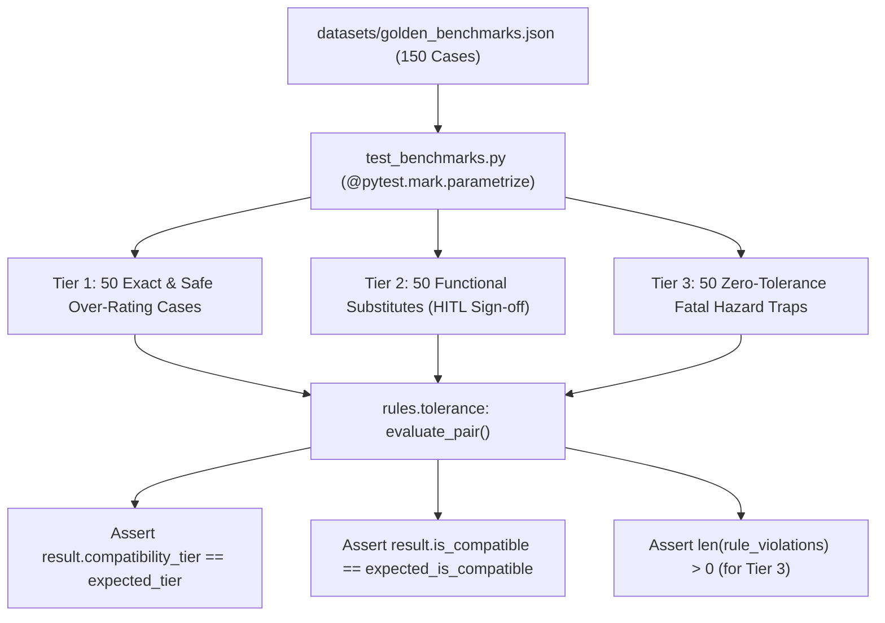

# Integration & Golden Benchmark Test Suite (`tests/integration/`)

## 1. Architectural Role & Overview

The `tests/integration/` package provides parameterized integration benchmarks validating the core safety, tolerance, and physics rules engines across all 150 standardized test scenarios in `datasets/golden_benchmarks.json`.

Unlike isolated unit tests, these integration tests verify the end-to-end evaluation pipeline of `rules.tolerance.evaluate_pair`, ensuring that query and candidate attribute specifications correctly traverse all 21 specialized engineering rules modules (ASME, ASTM, API, NACE, TEMA, EJMA).



---

## 2. Test File Inventory

| Test File | Target Subsystem | Tested Specifications |
| :--- | :--- | :--- |
| [`test_benchmarks.py`](file:///C:/Users/mayank/Development/Hackathons/Samanvay-AI/tests/integration/test_benchmarks.py) | `rules.tolerance.evaluate_pair()` | 150 parameterized test cases: 50 Tier-1 identical drop-ins, 50 Tier-2 qualified substitutes, and 50 Tier-3 fatal invariant failure modes across all 21 rules modules. |
| [`__init__.py`](file:///C:/Users/mayank/Development/Hackathons/Samanvay-AI/tests/integration/__init__.py) | Package initialization | Namespace anchor. |

---

## 3. Benchmark Verification Methodology

Each golden benchmark case in `datasets/golden_benchmarks.json` specifies:
- `query_part`: Desired component dimensions, pressure rating, metallurgy, and equipment-specific properties.
- `candidate_part`: Available surplus catalog item specifications.
- `expected_tier`: Target classification (`TIER_1_IDENTICAL`, `TIER_2_SUBSTITUTE`, `TIER_3_INCOMPATIBLE`).
- `expected_is_compatible`: Boolean compatibility flag (`True` for Tiers 1 and 2; `False` for Tier 3).
- `expected_violation_code`: Specific failure mode code (e.g. `FATAL_PRESSURE_DOWN_RATING`, `FATAL_CRYOGENIC_BRITTLE_FRACTURE`, `FATAL_NACE_SOUR_SERVICE_VIOLATION`).

### 3.1. Tested Failure Mode Categories (Tier 3 Traps)
1. **Pressure Down-Rating**: Capping Class 300 lines with Class 150 components (rupture hazard).
2. **Cryogenic Brittle Fracture**: Non-impact-tested A105 carbon steel proposed for $-46^\circ\text{C}$ duty instead of impact-tested A350 LF2.
3. **Hydrogen & High-Temperature Creep**: Carbon steel substituted for 2.25Cr-1Mo (P22) in $510^\circ\text{C}$ furnace lines.
4. **Sour Gas & NACE MR0175**: Non-NACE valve ($> 22\text{ HRC}$) proposed for wet $\text{H}_2\text{S}$ duty (sulfide stress cracking).
5. **Facing Incompatibility**: Mating Raised Face (RF) flanges to Ring Type Joint (RTJ) grooves.
6. **Cast Iron Flat Face Fracture**: Bolting Raised Face steel flanges to Flat Face cast iron valve bodies.
7. **Piggability Obstruction**: Installing reduced bore valves or short-radius elbows into piggable pipeline corridors.
8. **Electrical Explosion**: Non-Ex safe-area motors proposed for Zone 1 hazardous areas.

---

## 4. Running the Integration Benchmark Suite

```powershell
# Run all 150 benchmark tests
uv run pytest tests/integration/test_benchmarks.py -v

# Run only Tier 1 benchmark cases
uv run pytest tests/integration/test_benchmarks.py -k "TIER_1" -v

# Run only Tier 3 zero-tolerance trap cases
uv run pytest tests/integration/test_benchmarks.py -k "TIER_3" -v
```
