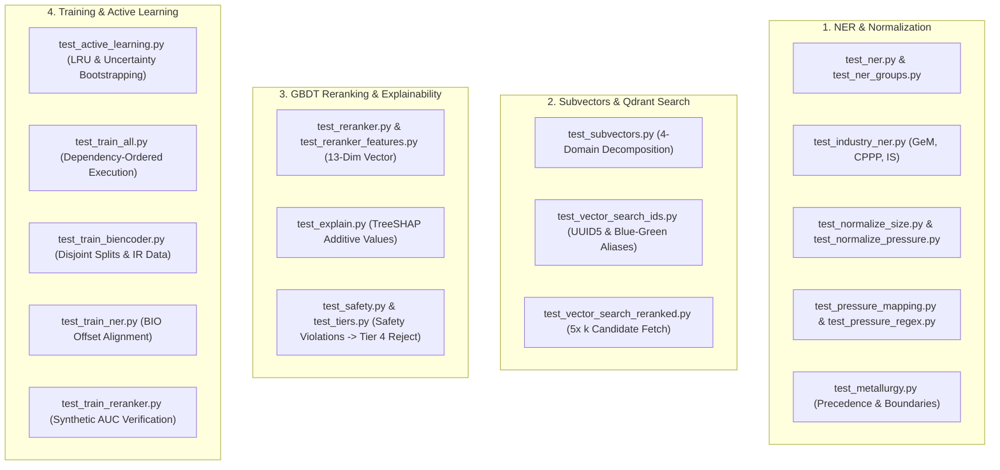

# Machine Learning & AI Pipeline Test Suite (`tests/ml/`)

## 1. Architectural Role & Overview

The `tests/ml/` package provides unit, regression, and functional validation for all machine learning models and data transformation utilities in `machine_learning/`.

It covers the complete machine learning lifecycle of **Samanvay-AI**:
1. **Named Entity Recognition & Dialect Normalization**: DeBERTa-v3 token classification, BIO label alignment, token-bounded metallurgy extraction, and Indian procurement entities (`IS`, `OISD`, `EIL`, `GeM`, `CPPP`, `MESC`).
2. **Dense & Subvector Embeddings**: BGE-M3 4-domain decomposition (`dim`, `met`, `pt`, `std`) and deterministic UUID5 Qdrant indexing.
3. **GBDT Compatibility Reranking**: 13-dimensional cross-encoder feature engineering, deterministic fallback scoring, and TreeSHAP explainability attributions.
4. **Deterministic Safety Gating & Tier Assignment**: ASME/ASTM invariant rules and strict zero-tolerance reject enforcement.
5. **Active Learning & Human-in-the-Loop (HITL)**: Uncertainty-based queuing, LRU cache eviction, and online retraining pair generation.



---

## 2. Test File Inventory

| Test File | Target Module | Key Validations & Invariants |
| :--- | :--- | :--- |
| [`test_active_learning.py`](file:///C:/Users/mayank/Development/Hackathons/Samanvay-AI/tests/ml/test_active_learning.py) | `machine_learning.active_learning` | LRU eviction under capacity limits, uncertainty sampling prioritization ($|P - 0.5|$), cosine retention, and training pair serialization. |
| [`test_explain.py`](file:///C:/Users/mayank/Development/Hackathons/Samanvay-AI/tests/ml/test_explain.py) | `machine_learning.explain` | TreeSHAP feature contribution summation ($\sum \phi_i = \text{margin}$), size match explanations, and pressure downgrade detection. |
| [`test_industry_ner.py`](file:///C:/Users/mayank/Development/Hackathons/Samanvay-AI/tests/ml/test_industry_ner.py) | `machine_learning.ner_tagger` | Extraction of Indian standards (`IS 1239`), OISD specs, EIL specs, GeM categories vs bid numbers, CPPP tender IDs, and MESC codes. |
| [`test_metallurgy.py`](file:///C:/Users/mayank/Development/Hackathons/Samanvay-AI/tests/ml/test_metallurgy.py) | `machine_learning.ner_tagger` | Greedy substring matching (e.g. `316L` preferred over `316`), case-insensitivity, and non-token character boundary rejection. |
| [`test_ner.py`](file:///C:/Users/mayank/Development/Hackathons/Samanvay-AI/tests/ml/test_ner.py) | `machine_learning.ner_tagger` | Dialect token expansion (e.g. `"S.S."` $\rightarrow$ `"STAINLESS STEEL"`) and structured slot extraction. |
| [`test_ner_groups.py`](file:///C:/Users/mayank/Development/Hackathons/Samanvay-AI/tests/ml/test_ner_groups.py) | `machine_learning.ner_tagger` | Normalization across all 6 primary entity groups, certificate number disambiguation, and lazy singleton tagger reuse. |
| [`test_normalize_pressure.py`](file:///C:/Users/mayank/Development/Hackathons/Samanvay-AI/tests/ml/test_normalize_pressure.py) | `machine_learning.ner_tagger` | Pressure rating conversions across `#`, `CLASS`, `CL-`, and `PN`. |
| [`test_normalize_size.py`](file:///C:/Users/mayank/Development/Hackathons/Samanvay-AI/tests/ml/test_normalize_size.py) | `machine_learning.ner_tagger` | Nominal bore normalization across inches (`1 1/2"` $\rightarrow 38.1\text{ mm}$), metric `DN`, and `MM NB`. |
| [`test_pressure_mapping.py`](file:///C:/Users/mayank/Development/Hackathons/Samanvay-AI/tests/ml/test_pressure_mapping.py) | `machine_learning.ner_tagger` | Exact DIN/EN PN-to-ASME class mappings (PN6-PN420 $\rightarrow$ 150-2500#) and rejection of invalid pressure ratings. |
| [`test_pressure_regex.py`](file:///C:/Users/mayank/Development/Hackathons/Samanvay-AI/tests/ml/test_pressure_regex.py) | `machine_learning.ner_tagger` | Extraction across diverse industrial textual patterns (`CL-300`, `CLASS 600`, `PN16`, `900 LB`, `150#`). |
| [`test_reranker.py`](file:///C:/Users/mayank/Development/Hackathons/Samanvay-AI/tests/ml/test_reranker.py) | `machine_learning.reranker` | Deterministic fallback score formula when XGBoost is absent, and batch score sorting in candidate order. |
| [`test_reranker_features.py`](file:///C:/Users/mayank/Development/Hackathons/Samanvay-AI/tests/ml/test_reranker_features.py) | `machine_learning.reranker.features` | 13-dimensional feature vector boundedness ($[0.0, 1.0]$), 4-domain subvector integration, and cross-process stability. |
| [`test_safety.py`](file:///C:/Users/mayank/Development/Hackathons/Samanvay-AI/tests/ml/test_safety.py) | `machine_learning.safety` | Deterministic safety gate violations (size mismatches, pressure downgrades, metallurgical downgrades, incompatible standards). |
| [`test_subvectors.py`](file:///C:/Users/mayank/Development/Hackathons/Samanvay-AI/tests/ml/test_subvectors.py) | `machine_learning.subvectors` | 4-domain attribute decomposition (`dim`, `met`, `pt`, `std`) and embedding dimensions. |
| [`test_tiers.py`](file:///C:/Users/mayank/Development/Hackathons/Samanvay-AI/tests/ml/test_tiers.py) | `machine_learning.tiers` | Tier score boundaries ($0.59 \rightarrow \text{Reject}$, $0.60 \rightarrow \text{Tier 3}$, $0.85 \rightarrow \text{Tier 1}$) and invariant that any safety violation forces `TIER_4_REJECT`. |
| [`test_train_all.py`](file:///C:/Users/mayank/Development/Hackathons/Samanvay-AI/tests/ml/test_train_all.py) | `machine_learning.train_all` | Dependency-ordered stage orchestration (`ner` $\rightarrow$ `biencoder` $\rightarrow$ `reranker`). |
| [`test_train_biencoder.py`](file:///C:/Users/mayank/Development/Hackathons/Samanvay-AI/tests/ml/test_train_biencoder.py) | `machine_learning.train_biencoder` | Deterministic canonical ID group-splitting preventing data leakage, and Information Retrieval corpus mapping. |
| [`test_train_ner.py`](file:///C:/Users/mayank/Development/Hackathons/Samanvay-AI/tests/ml/test_train_ner.py) | `machine_learning.train_ner` | BIO offset labeling (`B-LABEL`, `I-LABEL`, `O`) and Hugging Face `eval_strategy` signature compatibility. |
| [`test_train_reranker.py`](file:///C:/Users/mayank/Development/Hackathons/Samanvay-AI/tests/ml/test_train_reranker.py) | `machine_learning.reranker.train` | Synthetic GBDT training smoke test, AUC computation, and XGBoost artifact serialization. |
| [`test_vector_search_ids.py`](file:///C:/Users/mayank/Development/Hackathons/Samanvay-AI/tests/ml/test_vector_search_ids.py) | `machine_learning.vector_search` | Deterministic UUID5 indexing from canonical IDs, multi-vector configuration, and blue-green zero-downtime alias swapping. |
| [`test_vector_search_reranked.py`](file:///C:/Users/mayank/Development/Hackathons/Samanvay-AI/tests/ml/test_vector_search_reranked.py) | `machine_learning.vector_search` | $5 \times k$ over-fetching, 4-domain scoring, Qdrant payload filters, and `CandidateMatch` contract conversion. |
| [`__init__.py`](file:///C:/Users/mayank/Development/Hackathons/Samanvay-AI/tests/ml/__init__.py) | Package initialization | Test namespace anchor. |

---

## 3. Running the Machine Learning Test Suite

```powershell
# Run the complete ML test suite
uv run pytest tests/ml/ -v

# Run NER and dialect normalization tests
uv run pytest tests/ml/test_industry_ner.py tests/ml/test_ner_groups.py -v

# Run GBDT reranker and feature engineering tests
uv run pytest tests/ml/test_reranker.py tests/ml/test_reranker_features.py -v

# Run active learning queue tests
uv run pytest tests/ml/test_active_learning.py -v
```
