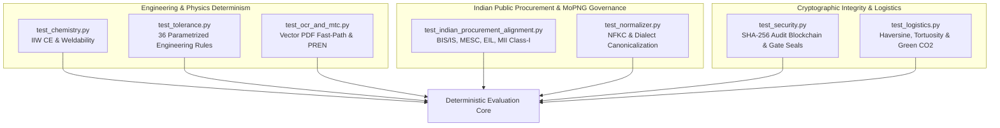

# Samanvay AI — Unit Test Suite (`tests/unit/`)

> **Executive Scope**: The `tests/unit/` module encapsulates isolated, zero-dependency unit tests verifying deterministic mathematical formulations, physical engineering laws, Indian public procurement compliance policies, cryptographic hash-chain tamper-evidence, and ASME/ASTM engineering tolerance rules for Samanvay AI.

---

## 1. Architectural Overview & Component Topology

Unit tests execute directly in the Python runtime without spinning up external Docker services, PostgreSQL instances, Qdrant vector databases, or Neo4j graph databases. They validate deterministic logic with millisecond-scale execution speeds.



---

## 2. Test File Catalog & Verification Coverage

| File | Primary Target Module | Target Functions / Classes | Core Verifications |
| :--- | :--- | :--- | :--- |
| [`test_chemistry.py`](file:///C:/Users/mayank/Development/Hackathons/Samanvay-AI/tests/unit/test_chemistry.py) | Mathematical Metallurgy | `calculate_carbon_equivalent()` | IIW formula accuracy, weldability grading thresholds (`GOOD`, `FAIR`, `POOR`). |
| [`test_indian_procurement_alignment.py`](file:///C:/Users/mayank/Development/Hackathons/Samanvay-AI/tests/unit/test_indian_procurement_alignment.py) | [`machine_learning.ner_tagger`](file:///C:/Users/mayank/Development/Hackathons/Samanvay-AI/machine_learning/ner_tagger.py), [`graph.logistics`](file:///C:/Users/mayank/Development/Hackathons/Samanvay-AI/graph/logistics.py) | `DialectNormalizer`, `compute_route_summary`, `road_distance` | BIS/IS standards (IS 1239, IS 14846, IS 2062, IS 1367), OIL Duliajan logistics hub, PN-to-Class mapping, PPP-MII local content >= 50%. |
| [`test_logistics.py`](file:///C:/Users/mayank/Development/Hackathons/Samanvay-AI/tests/unit/test_logistics.py) | Geodesic Routing | `calculate_haversine()`, `road_distance` | Great-circle distance (Mumbai-Delhi ~1,148 km), 1.28 tortuosity factor, 50 km/h transit, 0.15 kg CO2/ton-km. |
| [`test_normalizer.py`](file:///C:/Users/mayank/Development/Hackathons/Samanvay-AI/tests/unit/test_normalizer.py) | Unicode Canonicalization | `normalize_text()` | NFKC ligature normalization (`ffi` -> `ffi`), dialect dictionary canonicalization (`spanner` -> `WRENCH`). |
| [`test_ocr_and_mtc.py`](file:///C:/Users/mayank/Development/Hackathons/Samanvay-AI/tests/unit/test_ocr_and_mtc.py) | [`backend.app.ingestion`](file:///C:/Users/mayank/Development/Hackathons/Samanvay-AI/backend/app/ingestion) | `OCREngine`, `MTCParser`, `compute_carbon_equivalent`, `compute_pren`, `validate_composition` | PyMuPDF vector PDF extraction (< 50ms SLA), 300 DPI image enhancement, Duplex 2205 PREN, ASTM A105 limits, HITL routing on sparse scans. |
| [`test_security.py`](file:///C:/Users/mayank/Development/Hackathons/Samanvay-AI/tests/unit/test_security.py) | [`backend.app.core.security`](file:///C:/Users/mayank/Development/Hackathons/Samanvay-AI/backend/app/core/security.py) | `compute_audit_hash`, `verify_audit_chain`, `compute_gate_pass_seal`, `compute_request_hash` | SHA-256 block hash consistency, tamper detection on broken chains, gate pass security seal, deterministic dictionary JSON hashing. |
| [`test_tolerance.py`](file:///C:/Users/mayank/Development/Hackathons/Samanvay-AI/tests/unit/test_tolerance.py) | [`rules.tolerance`](file:///C:/Users/mayank/Development/Hackathons/Samanvay-AI/rules/tolerance.py) | `evaluate_material_compatibility` | 36 parametrized industrial scenarios: pressure down-rating, cryogenic fracture, NACE MR0175 sour service, liquid metal embrittlement, valve trims, API seal plans. |

---

## 3. Deep-Dive Specification Breakdown

### 3.1. Chemical Composition & Weldability Verification
[`test_chemistry.py`](file:///C:/Users/mayank/Development/Hackathons/Samanvay-AI/tests/unit/test_chemistry.py) tests the International Institute of Welding (IIW) carbon equivalent equation:

$$\text{CE}_{\text{IIW}} = \text{C} + \frac{\text{Mn}}{6} + \frac{\text{Cr} + \text{Mo} + \text{V}}{5} + \frac{\text{Ni} + \text{Cu}}{15}$$

- **Threshold Standards**:
  - $\text{CE} \le 0.35\%$: `GOOD` (Standard weldable without preheat).
  - $0.35\% < \text{CE} \le 0.45\%$: `FAIR` (Standard weldable, optional low-temp preheat).
  - $\text{CE} > 0.45\%$: `POOR` (Requires mandatory preheating per ASME Section IX / AWS D1.1).

### 3.2. Indian Public Procurement & MoPNG Alignment
[`test_indian_procurement_alignment.py`](file:///C:/Users/mayank/Development/Hackathons/Samanvay-AI/tests/unit/test_indian_procurement_alignment.py) validates strict adherence to MoPNG mandates and CPSE interoperability:
- **MESC Parsing**: Standardizes Oil India Limited (OIL) SAP MESC material codes (e.g., `03.10.45.19.04`).
- **BIS Cross-Standard Resolution**:
  - `IS 1239 Part 1 Heavy` $\iff$ `ASTM A106 Gr. B` / `API 5L PSL 2`.
  - `IS 14846 FG 200` $\iff$ `API 600` / `ASTM A216 WCB`.
  - `IS 2062 Grade E250` $\iff$ `ASTM A105` / `ASME B16.5`.
  - `IS 1367 Part 3 Class 8.8` $\iff$ `ASTM A193 B7`.
- **Make in India (PPP-MII) Compliance**:
  - `Class-I Local Supplier`: Local content $\ge 50\%$.
  - `Class-II Local Supplier`: $20\% \le \text{Local Content} < 50\%$.
  - Generates compliance warning alerts when non-compliant materials are proposed for inter-CPSE procurement.
- **OIL Logistics Topology**:
  - Validates routing between OIL Duliajan HQ and regional installations (`OIL Moran`, `NRL Numaligarh`, `ONGC Nazira`, `OIL Guwahati`, `OIL Jodhpur`, `OIL Kakinada`, `Panipat Refinery`).

### 3.3. Dual-Path OCR & MTC Conformance
[`test_ocr_and_mtc.py`](file:///C:/Users/mayank/Development/Hackathons/Samanvay-AI/tests/unit/test_ocr_and_mtc.py) verifies the ingestion intelligence:
- **Dual-Path Classification**: Differentiates between text-native `DIGITAL_VECTOR_PDF` and image-based `RASTER_SCANNED_PDF`.
- **Fast-Path Latency**: In-memory PyMuPDF stream parsing must execute in under $50\text{ ms}$.
- **PREN Corrosion Index**:
  $$\text{PREN} = \text{Cr} + 3.3 \cdot \text{Mo} + 16 \cdot \text{N}$$
  Verifies Duplex 2205 ($\text{PREN} \approx 35.11$).
- **HITL Routing**: Sparse or smudged documents triggering a confidence score below $0.85$ are flagged with `requires_hitl = True` and populate `missing_attributes` without raising runtime exceptions.

### 3.4. Cryptographic Security & Audit Integrity
[`test_security.py`](file:///C:/Users/mayank/Development/Hackathons/Samanvay-AI/tests/unit/test_security.py) implements blockchain-inspired immutable record-keeping:
- **Genesis Root Hash**: Starts from `GENESIS_ROOT_64_HEX` (`0000000000000000000000000000000000000000000000000000000000000000`).
- **Chain Tamper Verification**: Any mutated byte in historic logs immediately invalidates subsequent SHA-256 links and returns the exact zero-based index of the tampered transaction block.
- **Gate Pass Seal**: Generates deterministic 64-character hex seals binding material SKU, physical gate pass ID, driver ID, and issuing officer metadata.

### 3.5. 36-Rule Parametric Tolerance Matrix
[`test_tolerance.py`](file:///C:/Users/mayank/Development/Hackathons/Samanvay-AI/tests/unit/test_tolerance.py) runs 36 real-world cross-substitutability scenarios against [`evaluate_material_compatibility`](file:///C:/Users/mayank/Development/Hackathons/Samanvay-AI/rules/tolerance.py):

| Test Case | Scenario / Query Attributes | Candidate Attributes | Tier Result | Expected Violation Keyword |
| :---: | :--- | :--- | :---: | :--- |
| **01** | Class 300 A105 RF Flange | Class 150 A105 RF Flange | **TIER 3** | `PRESSURE DOWN-RATING` |
| **02** | ASTM A350 LF2 Flange (Cryo) | ASTM A105 Flange (Ambient) | **TIER 3** | `CRYOGENIC` |
| **03** | A193 B7 Stud @ 350°C Bare | A193 B7 Stud Galvanized | **TIER 3** | `LIQUID METAL` |
| **04** | SS304 (A351 CF8) Gate Valve | SS316 (A351 CF8M) Gate Valve | **TIER 2** | `None` (Safe Metallurgy Upgrade) |
| **05** | 200mm Sch 40 A106-B Pipe | 200mm Sch 40 A106-B Pipe | **TIER 1** | `None` (Exact Parity) |
| **06** | 250mm Sch 40 Pipe | 200mm Sch 40 Pipe | **TIER 3** | `DIMENSION` |
| **07** | 200mm Sch 80 Pipe | 200mm Sch 40 Pipe | **TIER 3** | `SCHEDULE` (Down-rating) |
| **08** | 200mm Sch 40 Pipe | 200mm Sch 80 Pipe | **TIER 2** | `None` (Safe Schedule Upgrade) |
| **09** | Class 300 Raised Face (RF) | Class 300 Ring Type Joint (RTJ) | **TIER 3** | `FACING` |
| **10** | 300 PSI Rated Pipe | 350 PSI Rated Pipe | **TIER 1** | `None` (Safe Pressure Over-rating) |
| **11** | Hazardous Zone 1 Ex d Motor | Non-Ex General Purpose Motor | **TIER 3** | `EXPLOSION` |
| **12** | NACE MR0175 Sour Service Flange | Non-NACE Commercial Flange | **TIER 3** | `SOUR` |
| **13** | Gate Valve API Trim 8 (Hardfaced) | Gate Valve API Trim 1 (F6a) | **TIER 3** | `TRIM` (Erosive Downgrade) |
| **14** | Piggable Pipeline Full Bore Ball Valve | Reduced Bore Ball Valve | **TIER 3** | `PIG` |
| **15** | Toxic Service API Plan 53A Pump | API Plan 11 Standard Pump | **TIER 3** | `SEAL` |
| **16** | A320 L7 Bolt (725 MPa) | A193 B7 Bolt (600 MPa) | **TIER 3** | `STRENGTH` |
| **17** | Gasket Max Temp 200°C | Gasket Max Temp 300°C | **TIER 2** | `None` (Safe Temp Upgrade) |
| **18** | Gasket Max Temp 200°C | Gasket Max Temp 150°C | **TIER 3** | `TEMPERATURE` |
| **19** | NPT Threaded Fitting | BSPT Threaded Fitting | **TIER 3** | `THREAD` |
| **20** | IP65 Ingress Protected Motor | IP54 Motor | **TIER 3** | `IP RATING` |
| **21** | IP54 Ingress Protected Motor | IP65 Motor | **TIER 2** | `None` (Safe Enclosure Upgrade) |
| **22** | 100 m³/h Process Pump | 80 m³/h Process Pump | **TIER 3** | `FLOW RATE` |
| **23** | Flanged End Connection Valve | Buttweld End Connection Valve | **TIER 3** | `CONNECTION` |
| **24** | Roller Bearing Assembly | Ball Bearing Assembly | **TIER 3** | `BEARING TYPE` |
| **25** | API Plan 53B Compressor Seal | API Plan 52 Seal | **TIER 3** | `API PLAN` |
| **26** | 415V 3-Phase Industrial Motor | 230V Single-Phase Motor | **TIER 3** | `VOLTAGE` |
| **27** | 50 Hz Grid Frequency Motor | 60 Hz Frequency Motor | **TIER 3** | `FREQUENCY` |
| **28** | Pneumatic Actuated Valve | Manual Handwheel Valve | **TIER 3** | `OPERATION` |
| **29** | Flexible Shaft Coupling | Rigid Shaft Coupling | **TIER 3** | `COUPLING` |
| **30** | Viton Fluoroelastomer O-Ring | NBR Nitrile O-Ring | **TIER 3** | `SEAL MATERIAL` |
| **31** | NBR Nitrile O-Ring @ 100°C | Viton O-Ring @ 100°C | **TIER 2** | `None` (Safe Material Upgrade) |
| **32** | Epoxy Phenolic Tank Coating | Alkyd Enamel Paint | **TIER 3** | `PAINT` |
| **33** | 500 µm External Pipe Coating | 250 µm Pipe Coating | **TIER 3** | `THICKNESS` |
| **34** | 250 µm External Pipe Coating | 500 µm Pipe Coating | **TIER 2** | `None` (Safe Coating Upgrade) |
| **35** | 10 µm Micron Fuel Filter | 25 µm Micron Fuel Filter | **TIER 3** | `MICRON RATING` |
| **36** | 25 µm Micron Fuel Filter | 10 µm Micron Fuel Filter | **TIER 2** | `None` (Superior Filtration Upgrade) |

---

## 4. Execution & Verification Guide

Unit tests are designed to execute independently in an isolated virtual environment:

```powershell
# Run the complete unit test suite
uv run pytest tests/unit/ -v

# Run only the 36 parametric tolerance compatibility tests
uv run pytest tests/unit/test_tolerance.py -v

# Run the Indian public procurement & Oil India Limited alignment suite
uv run pytest tests/unit/test_indian_procurement_alignment.py -v

# Run the cryptographic audit and gate-pass security verification
uv run pytest tests/unit/test_security.py -v
```
