# Samanvay AI — Unit Test Suite (`tests/unit/`)

> **Executive Scope**: The `tests/unit/` module encapsulates isolated, zero-dependency unit tests verifying deterministic mathematical formulations, physical engineering laws, Indian public procurement compliance policies, zero-trust session security, CSRF defenses, brute-force rate-limiting, Have I Been Pwned breach detection, Alembic migration integrity, and ASME/ASTM engineering tolerance rules for Samanvay AI.

---

## 1. Architectural Overview & Component Topology

Unit tests execute directly in the Python runtime without spinning up external Docker services, PostgreSQL instances, Qdrant vector databases, or Neo4j graph databases. They validate deterministic logic with millisecond-scale execution speeds.

```mermaid
graph TD
    subgraph "Engineering & Physics Determinism"
        TC[test_chemistry.py<br/>IIW CE & Weldability]
        TT[test_tolerance.py<br/>36 Parametrized Engineering Rules]
        TMTC[test_ocr_and_mtc.py<br/>Vector PDF Fast-Path & PREN]
    end

    subgraph "Zero-Trust Security & Integrity"
        TCSRF[test_csrf_origin.py<br/>CSRF Origin & Token Defense]
        THIBP[test_hibp_service.py<br/>HaveIBeenPwned k-Anonymity API]
        TRL[test_rate_limit.py<br/>Sliding-Window Rate Limiting]
        TSESS[test_session_security.py<br/>Hashed Tokens & Tamper Proofing]
        TMIG[test_migration_integrity.py<br/>Alembic Baseline DDL Verification]
    end

    subgraph "Indian Public Procurement & Logistics"
        TIPA[test_indian_procurement_alignment.py<br/>BIS/IS, MESC, EIL, MII Class-I]
        TN[test_normalizer.py<br/>NFKC & Dialect Canonicalization]
        TS[test_security.py<br/>SHA-256 Audit Blockchain & Gate Seals]
        TL[test_logistics.py<br/>Haversine, Tortuosity & Green CO2]
    end

    TC --> EvalCore[Deterministic Evaluation Core]
    TT --> EvalCore
    TMTC --> EvalCore
    TCSRF --> EvalCore
    THIBP --> EvalCore
    TRL --> EvalCore
    TSESS --> EvalCore
    TMIG --> EvalCore
    TIPA --> EvalCore
    TN --> EvalCore
    TS --> EvalCore
    TL --> EvalCore
```



---

## 2. Test File Catalog & Verification Coverage

| File | Primary Target Module | Target Functions / Classes | Core Verifications |
| :--- | :--- | :--- | :--- |
| [`test_csrf_origin.py`](file:///C:/Users/mayank/Development/Hackathons/Samanvay-AI/tests/unit/test_csrf_origin.py) | [`backend.app.core.csrf`](file:///C:/Users/mayank/Development/Hackathons/Samanvay-AI/backend/app/core/csrf.py) | `origin_allowed`, `generate_csrf_token`, `verify_csrf_token` | Origin allowlist matching, exact port/protocol checks, localhost variants, and HMAC token verification. |
| [`test_hibp_service.py`](file:///C:/Users/mayank/Development/Hackathons/Samanvay-AI/tests/unit/test_hibp_service.py) | [`backend.app.services.hibp_service`](file:///C:/Users/mayank/Development/Hackathons/Samanvay-AI/backend/app/services/hibp_service.py) | `check_password_breached`, `verify_password_hygiene` | Have I Been Pwned k-anonymity SHA-1 prefixing (5 chars), suffix evaluation, fail-open resiliency, and breached password rejection. |
| [`test_rate_limit.py`](file:///C:/Users/mayank/Development/Hackathons/Samanvay-AI/tests/unit/test_rate_limit.py) | [`backend.app.services.auth_rate_limit`](file:///C:/Users/mayank/Development/Hackathons/Samanvay-AI/backend/app/services/auth_rate_limit.py) | `RateLimitGuard`, `consume` | In-memory sliding window consumption, bucket expiration, per-user separation, and brute-force throttling. |
| [`test_session_security.py`](file:///C:/Users/mayank/Development/Hackathons/Samanvay-AI/tests/unit/test_session_security.py) | [`backend.app.services.auth_session_service`](file:///C:/Users/mayank/Development/Hackathons/Samanvay-AI/backend/app/services/auth_session_service.py) | `create_session`, `resolve_session_with_outcome` | 256-bit token entropy, SHA-256 token hash storage, session timeout enforcement, and tamper prevention. |
| [`test_migration_integrity.py`](file:///C:/Users/mayank/Development/Hackathons/Samanvay-AI/tests/unit/test_migration_integrity.py) | [`backend.alembic`](file:///C:/Users/mayank/Development/Hackathons/Samanvay-AI/backend/alembic) | `verify_schema_version`, baseline DDL | Baseline schema validation (`0001_baseline`), table completeness check, revision head consistency, and non-destructive schema adoption. |
| [`test_chemistry.py`](file:///C:/Users/mayank/Development/Hackathons/Samanvay-AI/tests/unit/test_chemistry.py) | Mathematical Metallurgy | `calculate_carbon_equivalent()` | IIW formula accuracy, weldability grading thresholds (`GOOD`, `FAIR`, `POOR`). |
| [`test_indian_procurement_alignment.py`](file:///C:/Users/mayank/Development/Hackathons/Samanvay-AI/tests/unit/test_indian_procurement_alignment.py) | [`machine_learning.ner_tagger`](file:///C:/Users/mayank/Development/Hackathons/Samanvay-AI/machine_learning/ner_tagger.py), [`graph.logistics`](file:///C:/Users/mayank/Development/Hackathons/Samanvay-AI/graph/logistics.py) | `DialectNormalizer`, `compute_route_summary`, `road_distance` | BIS/IS standards (IS 1239, IS 14846, IS 2062, IS 1367), OIL Duliajan logistics hub, PN-to-Class mapping, PPP-MII local content >= 50%. |
| [`test_logistics.py`](file:///C:/Users/mayank/Development/Hackathons/Samanvay-AI/tests/unit/test_logistics.py) | Geodesic Routing | `calculate_haversine()`, `road_distance` | Great-circle distance (Mumbai-Delhi ~1,148 km), 1.28 tortuosity factor, 50 km/h transit, 0.15 kg CO2/ton-km. |
| [`test_normalizer.py`](file:///C:/Users/mayank/Development/Hackathons/Samanvay-AI/tests/unit/test_normalizer.py) | Unicode Canonicalization | `normalize_text()` | NFKC ligature normalization (`ffi` -> `ffi`), dialect dictionary canonicalization (`spanner` -> `WRENCH`). |
| [`test_ocr_and_mtc.py`](file:///C:/Users/mayank/Development/Hackathons/Samanvay-AI/tests/unit/test_ocr_and_mtc.py) | [`backend.app.ingestion`](file:///C:/Users/mayank/Development/Hackathons/Samanvay-AI/backend/app/ingestion) | `OCREngine`, `MTCParser`, `compute_carbon_equivalent`, `compute_pren`, `validate_composition` | PyMuPDF vector PDF extraction (< 50ms SLA), 300 DPI image enhancement, Duplex 2205 PREN, ASTM A105 limits, HITL routing on sparse scans. |
| [`test_security.py`](file:///C:/Users/mayank/Development/Hackathons/Samanvay-AI/tests/unit/test_security.py) | [`backend.app.core.security`](file:///C:/Users/mayank/Development/Hackathons/Samanvay-AI/backend/app/core/security.py) | `compute_audit_hash`, `verify_audit_chain`, `compute_gate_pass_seal`, `compute_request_hash` | SHA-256 block hash consistency, tamper detection on broken chains, gate pass security seal, deterministic dictionary JSON hashing. |
| [`test_tolerance.py`](file:///C:/Users/mayank/Development/Hackathons/Samanvay-AI/tests/unit/test_tolerance.py) | [`rules.tolerance`](file:///C:/Users/mayank/Development/Hackathons/Samanvay-AI/rules/tolerance.py) | `evaluate_material_compatibility` | 36 parametrized industrial scenarios: pressure down-rating, cryogenic fracture, NACE MR0175 sour service, liquid metal embrittlement, valve trims, API seal plans. |

---

## 3. Execution & Verification Guide

Unit tests are designed to execute independently in an isolated virtual environment:

```powershell
# Run the complete unit test suite
uv run pytest tests/unit/ -v

# Run the security unit tests
uv run pytest tests/unit/test_csrf_origin.py tests/unit/test_hibp_service.py tests/unit/test_rate_limit.py tests/unit/test_session_security.py tests/unit/test_migration_integrity.py -v

# Run only the 36 parametric tolerance compatibility tests
uv run pytest tests/unit/test_tolerance.py -v

# Run the Indian public procurement & Oil India Limited alignment suite
uv run pytest tests/unit/test_indian_procurement_alignment.py -v

# Run the cryptographic audit and gate-pass security verification
uv run pytest tests/unit/test_security.py -v
```
